# Guida all'uso di Stella

Stella è un'app per creare carte e altri elementi di gioco stampati a partire da un foglio di calcolo. Si disegna una volta il modello della carta, il **template**, e ogni riga del foglio diventa una carta. Le carte si esportano come immagini, come PDF da stampare o come oggetti per Tabletop Simulator: mazzi, segnalini, pedine, tessere, plance e dadi, pronti da caricare nel gioco.

Questa guida segue l'ordine in cui di solito si lavora: creare un progetto, disegnare un template, inserire le carte, rifinire testi e immagini, esportare. Gli esempi vengono da un piccolo progetto con tre set: personaggi, oggetti e carte mercato.

Video tutorial su YouTube, senza voce ([tutta la playlist](https://www.youtube.com/playlist?list=PLd3mtbjgiPEo)):

**Inizia qui**

- 1 · [Panoramica delle funzioni di base](https://www.youtube.com/watch?v=0JnZ92Jy_JU) (4 minuti)
- 2 · [Il tuo primo componente da zero](https://www.youtube.com/watch?v=kUgGQ_ab8Yg) (10 minuti)
- 14 · [Un gioco completo, dall’idea al tavolo](https://www.youtube.com/watch?v=_y1I1nVNgy0) (21 minuti)

**Componenti**

- 7 · [Plance, tessere, segnalini e dadi](https://www.youtube.com/watch?v=02s-e9wMHU8) (9 minuti)
- 8 · [Le griglie e le formule nelle caselle](https://www.youtube.com/watch?v=wY4PRv9vN1o) (14 minuti)
- 11 · [Immagini, icone e font](https://www.youtube.com/watch?v=LhgecwJeUWU) (6 minuti)
- 16 · [Generare le carte e dividere un’immagine](https://www.youtube.com/watch?v=TR5Eiuatdec) (6 minuti)

**Testo e formule**

- 4 · [Testo, icone, stili e formule](https://www.youtube.com/watch?v=2I0ABob4DoQ) (5 minuti)
- 13 · [L’assistente formule](https://www.youtube.com/watch?v=azgDlcktVfk) (12 minuti)

**Dati e lingue**

- 10 · [I dati dal foglio di calcolo](https://www.youtube.com/watch?v=EtS5nl_aKAg) (9 minuti)
- 12 · [Un gioco in più lingue](https://www.youtube.com/watch?v=1eV4QzH_3XI) (6 minuti)

**Dal file al tavolo**

- 9 · [Stampare i componenti](https://www.youtube.com/watch?v=TG-WWQqBDUk) (9 minuti)
- 3 · [Da Stella a Tabletop Simulator](https://www.youtube.com/watch?v=XxKgcgba9wE) (5 minuti)
- 5 · [Il regolamento e gli altri documenti](https://www.youtube.com/watch?v=psMiWRUQ4k4) (5 minuti)

**Strumenti**

- 6 · [Stella con un agente IA](https://www.youtube.com/watch?v=ymvGmxgpxgA) (4 minuti)
- 17 · [Backup e recupero](https://www.youtube.com/watch?v=2fPQwU0LlFg) (5 minuti)
- 18 · [Lavorare più veloce](https://www.youtube.com/watch?v=p1nM-sH1cvE) (5 minuti)

English version: [../guide/README.md](../guide/README.md).

## Indice

- [Installare Stella](#installare-stella)

1. [Concetti di base](#1-concetti-di-base)
2. [Schermata di ingresso](#2-schermata-di-ingresso)
3. [La finestra del progetto](#3-la-finestra-del-progetto)
4. [Disegnare un template](#4-disegnare-un-template)
5. [Inserire e modificare le carte](#5-inserire-e-modificare-le-carte)
6. [Testo e markup](#6-testo-e-markup)
7. [Variabili e stili](#7-variabili-e-stili)
8. [Immagini, icone e font](#8-immagini-icone-e-font)
9. [Formule e campi calcolati](#9-formule-e-campi-calcolati)
10. [Generare le carte](#10-generare-le-carte)
11. [Esportare](#11-esportare)
12. [Documenti](#12-documenti)
13. [Backup](#13-backup)
14. [Importare da Tabletop Creator](#14-importare-da-tabletop-creator)
15. [Lavorare con un agente IA](#15-lavorare-con-un-agente-ia)
16. [La versione web](#16-la-versione-web)
17. [I file del progetto](#17-i-file-del-progetto)
18. [Scorciatoie da tastiera](#18-scorciatoie-da-tastiera)

## Installare Stella

Stella si scarica dalla sezione [Scarica del sito](https://stella.lucadj.eu/it/#download), che propone il file giusto per il tuo sistema, oppure dalla pagina delle [release su GitHub](https://github.com/lucadj77/stella/releases), dove ci sono tutte le versioni. È gratuita e non serve un account.

Stella non è firmata con un certificato di Apple o di Microsoft: i certificati costano centinaia di euro l'anno, e Stella è un progetto gratuito. Per questo, la prima volta che la apri, macOS e Windows mostrano un avviso e chiedono conferma. Il programma è lo stesso che trovi su GitHub, con il codice sorgente pubblico; la conferma serve una volta sola, poi Stella si apre normalmente, anche dopo gli aggiornamenti automatici.

### Mac

1. Scegli il file in base al processore: `Stella-<versione>-mac-arm64.dmg` per i Mac con chip Apple (M1 e successivi), `Stella-<versione>-mac-x64.dmg` per quelli con processore Intel. Se non sai quale hai: menu Apple → **Informazioni su questo Mac**, alla voce **Chip** o **Processore**.
2. Apri il .dmg e trascina l'icona di Stella sulla cartella **Applicazioni**. Poi espelli il disco di Stella dalla barra laterale del Finder. Tieni Stella in Applicazioni (o in un'altra cartella in cui puoi scrivere): aperta dal disco scaricato non si aggiorna da sola.
3. Apri Stella da Applicazioni o da Launchpad. macOS dice che non può verificare che l'app sia priva di malware: premi **Fine** (o **OK**), non **Sposta nel Cestino**.
4. Apri **Impostazioni di Sistema → Privacy e sicurezza** e scorri fino alla sezione **Sicurezza**: c'è la riga «L'apertura di "Stella" è stata bloccata». Premi **Apri comunque** e conferma con la password o con Touch ID.
5. Riapri Stella e, nell'ultimo avviso, premi **Apri**. Da qui in poi non viene più chiesto.

Sulle versioni di macOS precedenti a Sequoia (15) basta anche un clic destro (o Ctrl+clic) sull'app in Applicazioni → **Apri** → **Apri**.

Se macOS dice che Stella «è danneggiata e non può essere aperta», o se **Apri comunque** non compare, si toglie il blocco dal Terminale (Applicazioni → Utility → Terminale):

```bash
xattr -dr com.apple.quarantine /Applications/Stella.app
```

### Windows

1. Scarica `Stella-<versione>-windows-setup.exe`. Edge o Chrome possono avvisare che il file non viene scaricato spesso: nel pannello dei download apri il menu **…** accanto al file e scegli **Mantieni** (in Edge poi **Mostra altro → Mantieni comunque**).
2. Apri il file. Compare la finestra blu «Windows ha protetto il PC» di SmartScreen: premi **Ulteriori informazioni** e poi **Esegui comunque**. Se Windows chiede se consentire all'app di apportare modifiche, rispondi **Sì**.
3. Segui l'installazione: puoi scegliere se installare Stella solo per te o per tutti gli utenti, e la cartella. Alla fine Stella è nel menu Start e sul desktop.

La versione **portatile**, `Stella-<versione>-windows-portable.exe`, non si installa: si avvia con un doppio clic, anche da una chiavetta USB, e tiene i suoi dati (progetti recenti, preferenze) nella cartella `Stella data` accanto al file. Anche lei passa da SmartScreen la prima volta. Non si aggiorna da sola: quando esce una versione nuova Stella lo segnala e apre la pagina da cui scaricarla.

Sui computer di lavoro l'amministratore può impedire del tutto i programmi non firmati. In quel caso c'è la [versione web](#16-la-versione-web), che non si installa.

### Linux

- **AppImage** (`Stella-<versione>-linux-x86_64.AppImage`), per qualsiasi distribuzione: rendilo eseguibile e avvialo. Dal file manager: tasto destro → Proprietà → Permessi → «Consenti l'esecuzione come programma»; oppure dal terminale:

  ```bash
  chmod +x Stella-*-linux-x86_64.AppImage
  ./Stella-*-linux-x86_64.AppImage
  ```

  L'AppImage richiede libfuse2: su Ubuntu 24.04 e successive `sudo apt install libfuse2t64`, sulle versioni precedenti `sudo apt install libfuse2`. Si aggiorna da sola.

- **Pacchetto .deb** (`Stella-<versione>-linux-amd64.deb`), per Debian, Ubuntu e derivate: `sudo apt install ./Stella-<versione>-linux-amd64.deb`. Stella compare tra le applicazioni e si avvia anche con il comando `stella`. Non si aggiorna da sola: per una versione nuova si installa il .deb nuovo allo stesso modo.

### Disinstallare

Sul Mac si trascina Stella dalla cartella Applicazioni nel Cestino; su Windows si usa **Impostazioni → App → App installate → Stella → Disinstalla**; su Linux si cancella l'AppImage, oppure `sudo apt remove stella`. I progetti restano dove li hai salvati: sono cartelle normali, che Stella non cancella mai.

## 1. Concetti di base

| Termine       | Cos'è                                                                                                                                 |
| ------------- | ------------------------------------------------------------------------------------------------------------------------------------- |
| **progetto**  | una cartella sul disco con il file `stella.json`, il file dei dati, i template e gli asset                                            |
| **template**  | il disegno di una carta: formato, abbondanza e una pila di **livelli** (testi, immagini, forme, gruppi), per il fronte e per il retro |
| **set**       | un gruppo di carte che usano lo stesso template; corrisponde a un foglio del file dati (`data/carte.xlsx`)                            |
| **livello**   | un elemento del template. Il nome del livello è anche il nome della colonna del foglio da cui prende il valore                        |
| **asset**     | immagini, icone e font del progetto, nella cartella `assets/`                                                                         |
| **variabile** | un nome che si richiama nei testi con `{nome}`: un'icona, un testo formattato, un colore o un valore                                  |
| **stile**     | un insieme di attributi del testo con un nome, da applicare a un livello, a un paragrafo o a una parola                               |

Il collegamento tra dati e disegno è sempre lo stesso: nel template il livello di testo `nome` mostra, su ogni carta, il contenuto della colonna `nome` della riga corrispondente.

Le misure sono in millimetri, le dimensioni del testo in punti. Le parole chiave del markup e delle formule sono in inglese e non cambiano con la lingua dell'interfaccia.

## 2. Schermata di ingresso

All'avvio Stella mostra la schermata di ingresso.

La prima volta, quando non ci sono ancora progetti recenti, la schermata dà il benvenuto con due scelte grandi: **Comincia da zero** crea un progetto vuoto, **Esplora l'esempio** apre il progetto di esempio. Sotto ci sono i tre passi del lavoro (disegnare un template, compilare un set, esportare) e i collegamenti al video di panoramica, a tutti i video tutorial e a questa guida. Dal primo progetto in poi la schermata è quella descritta qui sotto, con una riga di collegamenti sotto i progetti recenti.

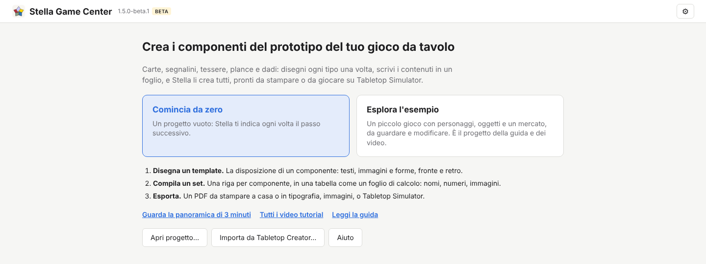

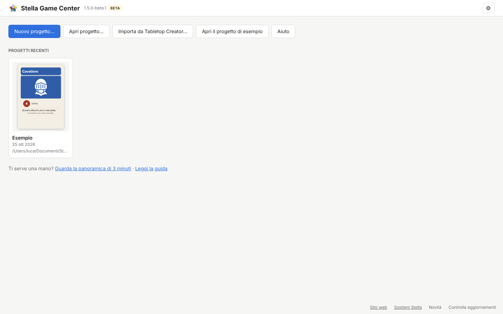

- **Nuovo progetto…** crea una cartella vuota con la struttura di un progetto.
- **Apri progetto…** apre una cartella che contiene `stella.json`. Si aprono anche i progetti creati quando l'app si chiamava Naibi (`naibi.json`) o GameCreator (`gamecreator.json`).
- **Importa da Tabletop Creator…** converte un progetto di Tabletop Creator ([capitolo 14](#14-importare-da-tabletop-creator)).
- **Apri il progetto di esempio** apre il progetto usato in questa guida e nei video: tre set (Personaggi, Oggetti, Mercato), icone, variabili e stili. La prima volta lo copia in Documenti/Stella/Esempio, dove si può modificare liberamente; poi apre quella copia. Nella versione web la copia sta nello spazio che il browser riserva al sito: si modifica e si salva senza scegliere una cartella, ma resta solo in quel browser.
- **Progetti recenti** mostra fino a 24 progetti, con la prima carta come miniatura. La × toglie un progetto dall'elenco senza cancellare la cartella.

Il pulsante ⚙ in alto a destra, in ogni schermata, apre le impostazioni: la dimensione dell'interfaccia, l'**unità di misura** (millimetri, centimetri o pollici) per posizioni, misure e margini in tutta l'app (il testo resta in punti, gli spessori delle linee in mm), il tema (chiaro, scuro o quello del sistema), la lingua (inglese o italiano) e **Strumenti IA…**, che prepara un agente IA a lavorare sui progetti ([capitolo 15](#15-lavorare-con-un-agente-ia)).

Quando esce una versione nuova, all'avvio compare una striscia in cima alla finestra: **Novità** mostra cosa cambia, **Aggiorna e riavvia** scarica la versione nuova, la installa e riapre Stella. Questo vale per Stella installata con il setup su Windows, per l'AppImage su Linux e sul Mac per l'app in Applicazioni (o in un'altra cartella in cui puoi scrivere); se ci sono modifiche non salvate Stella lo chiede prima. La versione portatile di Windows, il pacchetto .deb e un'app aperta dal disco scaricato hanno invece **Scarica**, che apre la pagina da cui scaricarla; lo stesso succede se l'aggiornamento automatico non riesce. **Salta questa versione** non la segnala più, **Ricordamelo più tardi** la nasconde fino al prossimo avvio.

Nel menu ⚙, **Aggiornamenti** sceglie il canale. **Stabile** propone solo le versioni ufficiali; **Beta** anche quelle di prova, che portano le novità prima ma possono avere qualche difetto in più. Chi aveva già una beta si trova su Beta. Tornando da Beta a Stabile Stella non installa una versione più vecchia: aspetta la prossima ufficiale.

Nella schermata di ingresso, in basso a destra, **Novità** mostra le novità della versione in uso, anche senza rete, e **Controlla aggiornamenti** chiede subito a GitHub se c'è una versione più recente, e lo dice anche quando hai già l'ultima.

Per creare un progetto si scrivono il nome e la posizione. Di base la posizione è `Documenti/Stella` e il file dei dati è Excel (`.xlsx`). **Opzioni del file dei dati** mostra la scelta del formato: Excel, OpenDocument (`.ods`) o **Un file che hai già (.xlsx, .ods, .csv)…**. Con quest'ultimo il progetto parte da un file che hai già: Stella ne fa una copia nella cartella `data` del progetto e i suoi fogli diventano set con **Nuovo set** (vedi [Usare un file Excel che hai già](excel-esistente.md)).

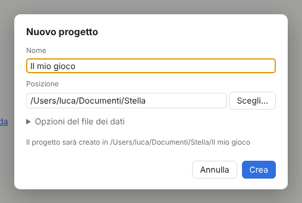

Un progetto nuovo è vuoto. In cima alla finestra compare la striscia **Primi passi**, con i quattro passi da fare: disegnare un template, creare un set, aggiungere il primo componente ed esportare. Ogni passo si spunta da solo quando è fatto, e il pulsante accanto apre quello successivo. La × nasconde la striscia, anche negli altri progetti. Nei progetti che hanno già dei componenti quando si aprono la striscia non compare.

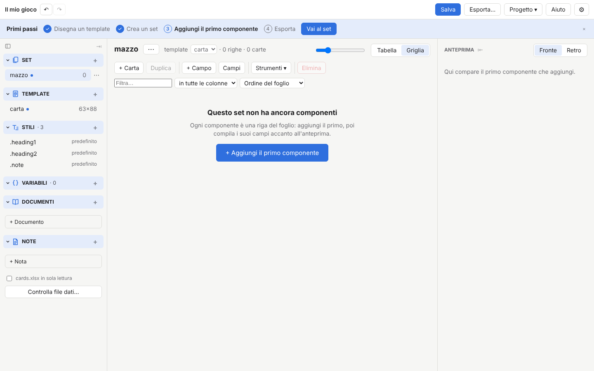

Il «?» accanto al titolo di alcune finestre (nuovo template, nuovo set, esporta, genera, assistente formule) apre la sezione di questa guida che ne parla.

Le richieste di conferma, per esempio prima di eliminare un set o di chiudere un progetto con modifiche non salvate, compaiono in una finestra di Stella che dice cosa succede. Il pulsante che conferma dice cosa fa (**Elimina il set**, **Scarta le modifiche**); quando l'azione cancella qualcosa è rosso, e il tasto Invio sceglie **Annulla**.

## 3. La finestra del progetto

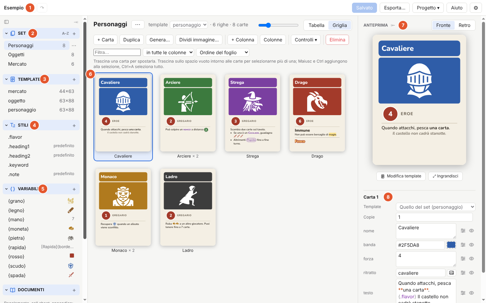

1. **Barra in alto.** Nome del progetto (passando col mouse si vede la cartella), annulla e ripristina (valgono per ciò che è aperto: le carte, stili e variabili, o il template nell'editor), il menu della lingua delle carte (solo nei progetti con più lingue), **Salva** (⌘S / Ctrl+S), **Esporta…**, il menu **Progetto**, **Aiuto** (F1, [capitolo 6](#6-testo-e-markup)) e ⚙ per le impostazioni. Il menu **Progetto** raccoglie i comandi usati di rado: **Backup…**, **Cestino…**, **Google Sheets…**, **Lingue…** ([5.7](#57-carte-in-più-lingue)), **Salva una copia…** (copia la cartella del progetto in una cartella nuova o vuota; il progetto aperto resta quello di prima, e alla fine si può aprire la copia), **Sposta…** (sposta la cartella e riapre il progetto dal posto nuovo, con i suoi backup), **Ricarica dal disco** (rilegge il progetto, perdendo le modifiche non salvate) e **Chiudi progetto**. Copia e spostamento chiedono prima di salvare le modifiche, e ci sono solo nell'app per computer.
2. **Set.** Un clic apre le carte del set; il numero è il totale delle carte, copie comprese.
3. **Template.** Un clic apre il template nell'editor; accanto c'è il formato in millimetri.
4. **Stili** di testo del progetto ([capitolo 7](#7-variabili-e-stili)).
5. **Variabili** del progetto, con un'anteprima.
6. **Carte del set**, in tabella o in griglia.
7. **Anteprima** della carta selezionata, fronte o retro. **Modifica template** apre il template della carta, cioè quello del set o quello scelto per la carta, con questa carta già caricata nell'anteprima dell'editor (il menu **Dati** in alto a destra mostra il set e il numero della carta); **Ingrandisci** apre la carta grande con il modulo accanto.
8. **Campi della carta** selezionata, modificabili come le celle della tabella.

Il pulsante ⋯ accanto al nome del set o del template aperto apre un menu per rinominarlo, duplicarlo, eliminarlo e, per un template, crearne un derivato (**Deriva**). Lo stesso menu si apre dal ⋯ che compare passando col mouse su una voce della barra laterale, o con il tasto destro sulla voce. Rinominando un set cambia nome anche il suo foglio nel file dei dati (se il foglio è già nel file Stella prima chiede, perché le formule di altri fogli che lo citano si romperebbero); rinominando un template cambia nome il suo file, e il nome nuovo va nei set, nei derivati e nella colonna `template` delle carte che lo usano. I file cambiano nome quando si salva. Un template eliminato va nella cartella `deleted` del progetto. Anche il foglio di un set eliminato, al salvataggio, esce dal file dei dati e va in `deleted` come file a sé, così il suo nome torna libero. **Cestino…**, nel menu **Progetto**, elenca quello che c'è in `deleted` (template, set, note e documenti, dal più recente) e **Ripristina** rimette un elemento nel progetto: un set prende il template scelto (Stella propone quello con più colonne in comune), un nome già usato riceve un numero. Template e set ripristinati escono dal cestino quando si salva. Le voci della barra laterale si riordinano trascinandole; il + accanto a ciascun titolo crea un elemento nuovo. Accanto ai titoli di **Stili** e **Variabili** c'è il numero delle voci: con più di sei voci la sezione parte chiusa, e Stella ricorda per ogni progetto se l'hai aperta o chiusa. Finché non ci sono documenti o note, le loro sezioni mostrano un pulsante **+ Documento** e **+ Nota**. Stili e variabili si dividono in gruppi con il campo **Gruppo** della loro finestra: le voci di un gruppo stanno sotto il suo titolo, che si chiude e si apre con un clic, dopo quelle senza gruppo. Una voce trascinata sul titolo di un gruppo entra nel gruppo; trascinata su un'altra voce prende il gruppo di quella voce (anche nessuno). Con più di 12 voci compare sopra l'elenco un campo per filtrarle per nome. Nella finestra di uno stile o di una variabile, **Dove si usa** elenca i template (con i livelli), i set (con i numeri delle carte) e le altre variabili e stili che lo richiamano; un clic su un template o su un set lo apre. Soffermando il mouse su una voce compare un'anteprima: le prime carte di un set, fronte e retro di un template, una frase con lo stile, l'icona o il colore di una variabile. Nella sezione **Note** si tengono appunti sul progetto: il + crea una nota, un clic la apre in un pannello accanto a qualsiasi schermata, dove si scrive in Markdown (con **Anteprima** per vederla formattata) e si rinomina dal titolo. Una nota già scritta si apre in **Anteprima**, una nuova pronta per scrivere. Le note si salvano da sole mentre si scrive, come file `notes/<nome>.md` del progetto; il cestino le sposta in `deleted`. Un'IA che lavora sul progetto le legge con `stella notes`. Il pulsante in alto a sinistra riduce la barra a sole icone, e le frecce accanto ai titoli dei pannelli li spostano dall'altro lato della finestra.

Le modifiche restano in memoria finché non si salva. Il pulsante **Salva** diventa **Salvato** quando non c'è nulla da scrivere.

Nell'app per computer gli stessi comandi stanno anche nel menu dell'app (sul Mac nella barra in cima allo schermo, su Windows e Linux con il tasto Alt): **File** (apri, salva, esporta, backup, cestino, Google Sheets, ricarica, chiudi), **Modifica**, **Vista** (dimensione dell'interfaccia con ⌘+, ⌘− e ⌘0 / Ctrl+, Ctrl− e Ctrl+0, schermo intero) e **Aiuto**.

## 4. Disegnare un template

### 4.1 Creare un template

Il + accanto a **Template** apre la finestra del nuovo template. In cima, **Cosa stai creando?** sceglie il tipo di componente: **Carta**, **Segnalino**, **Tessera**, **Plancia**, **Faccia di dado** o **Pedina**. Il tipo propone i formati adatti (per un segnalino i tondi da 20, 25 e 38 mm, per una tessera quadrati ed esagoni, per una plancia 30 cm, A3 e A4) e cambia le parole dell'app: nel set il pulsante diventa **+ Segnalino** o **+ Faccia**, e i conteggi dicono «6 facce». Per un dado ogni riga del set è una faccia, e sei facce di seguito fanno un dado. Poi si scrivono il nome, il formato e le misure; il lucchetto tra larghezza e altezza mantiene le proporzioni.

Il tipo si cambia anche dopo, con **Componente** nelle proprietà del template. Nell'esportazione per Tabletop Simulator ogni set parte dall'oggetto del suo tipo: segnalini, pedine, tessere, plance o dadi.

Una **pedina** è una figura che sta in piedi, per esempio un personaggio disegnato su fondo trasparente. Il template nasce senza sfondo e senza abbondanza, e nell'editor sotto la figura si vede una scacchiera. Il retro non si disegna: è il fronte specchiato, e Stella lo ricava da solo. Così nel PDF ci sono le due facce da ritagliare e incollare, e combaciano sempre. Si stampano con i normali segni di taglio rettangolari attorno al riquadro, e la sagoma si ritaglia a mano. In Tabletop Simulator la pedina diventa un segnalino in piedi, con lo spessore scelto (10 mm se non lo si cambia, perché la base deve tenerla dritta), ritagliato sulla parte non trasparente del fronte.

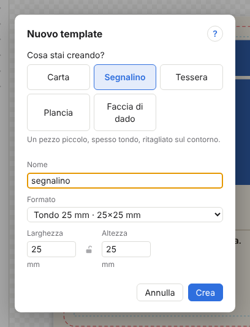

### 4.2 L'editor

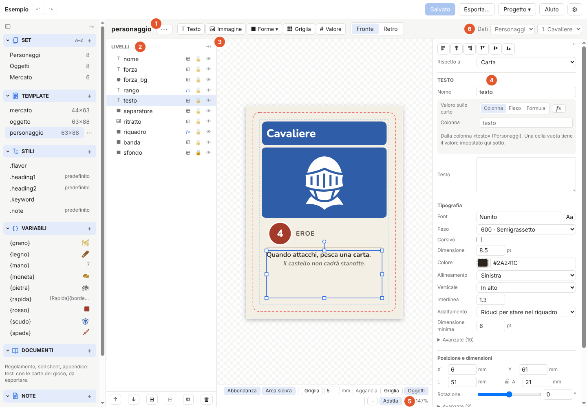

1. **Strumenti** per aggiungere un livello, ognuno con il suo nome: **Testo** (T), **Immagine**, **Forme** (un menu con rettangolo (R), ellisse (E), poligono, stella e linea), **Griglia**, **Valore** e **Snap** (lo snap point di Tabletop Simulator, P). **Immagine** apre subito la scelta dell'immagine; **Per ora nessuna immagine** crea il livello vuoto, per esempio quando l'immagine viene da una colonna. Un'immagine trascinata dal computer sulla tela diventa un livello immagine e si copia in `assets/images`. **Fronte** e **Retro** passano da un lato all'altro della carta; le frecce annullano e ripetono.
2. **Livelli**, dall'alto in basso come si sovrappongono sulla carta. Accanto a ogni livello c'è la fonte del valore (colonna del foglio o _fx_ per una formula), il lucchetto e l'occhio per nasconderlo.
3. **Tela** con la carta. Il tratteggio rosso è il bordo di taglio, l'area esterna è l'abbondanza, il tratteggio azzurro l'area sicura.
4. **Proprietà** del livello selezionato, o del template se non è selezionato nulla.
5. **Barra della tela**: mostra o nasconde abbondanza, area sicura e griglia, sceglie a cosa agganciarsi (griglia, oggetti) e regola lo zoom.
6. **Dati**: disegna la tela con i valori di una carta di un set, invece dei valori del template.

Sulla tela i livelli si spostano trascinandoli, si ridimensionano con le maniglie e si ruotano con la maniglia rotonda in alto (Maiuscolo per scatti di 15°). Tenendo premuto Maiuscolo mentre si sposta, il livello si muove solo in orizzontale, in verticale o a 45°, secondo la direzione più vicina. Ridimensionando, Maiuscolo inverte il blocco delle proporzioni (le mantiene se sono libere, le libera se sono bloccate) e ⌘ / Ctrl ridimensiona dal centro; i due si possono combinare. Durante il trascinamento i bordi si agganciano alla griglia, agli altri livelli e alle guide; tenendo premuto Alt si trascina liberamente. Alt+clic seleziona il livello che sta sotto quello selezionato, nello stesso punto: serve quando un livello più grande ne copre altri. Un livello già selezionato, anche scelto così o nell'elenco dei livelli, si trascina pure dove un altro lo copre; un clic senza trascinare seleziona invece quello in cima. Le frecce della tastiera spostano il livello di 0,5 mm, con Maiuscolo di 5 mm.

Nell'elenco dei livelli si trascina un livello per cambiarne l'ordine, o sul centro di un gruppo per metterlo dentro. Con Maiuscolo o ⌘ / Ctrl si selezionano più livelli; ⌘G / Ctrl+G li raggruppa. Con più livelli selezionati il pannello delle proprietà mostra le voci che hanno in comune (opacità, rotazione, visibilità, e quelle del tipo se sono tutti dello stesso tipo, per esempio colore e dimensione del testo): una modifica vale per tutti. I campi mostrano i valori del primo livello selezionato.

I livelli selezionati si copiano con ⌘C / Ctrl+C (⌘X / Ctrl+X per tagliarli) e si incollano con ⌘V / Ctrl+V in un altro template, anche di un altro progetto, o nello stesso. Arrivano con tutte le proprietà, sopra al livello selezionato. Se il template ha già un livello con lo stesso nome, quello incollato prende un nome nuovo (per esempio `nome_2`) ma continua a leggere la colonna di prima. Nello stesso template la copia è spostata di 2 mm per non coprire l'originale.

### 4.3 Le proprietà del template

Senza livelli selezionati, il pannello mostra le proprietà del template: il tipo di componente, misure, abbondanza (di base 3 mm), margine dell'area sicura, forma della carta (rettangolo con angoli arrotondati, cerchio o ellisse, esagono, sagoma presa da un'immagine), orientamento della forma, guide manuali e **Nome delle carte**, il campo che compare sotto ogni carta nella griglia. **Orientamento della forma** gira o specchia solo il contorno, non il contenuto: ⟲ e ⟳ fanno un quarto di giro e scambiano larghezza e altezza (un esagono con un lato in alto diventa con la punta in alto), **180°** capovolge la forma (uno scudo preso da un'immagine diventa a punta in su), ⇆ e ⇅ la specchiano. Con il quarto di giro i livelli si sistemano come quando si cambiano le misure. L'esagono è sempre regolare, il più grande che sta nella carta: per riempirla il lato corto deve essere il lato lungo × 0,866, e il pulsante **Adatta la carta all'esagono** cambia così il lato corto. Nelle forme poligono e stella, **Rendi regolare** porta il riquadro a un quadrato attorno allo stesso centro, così lati e angoli sono tutti uguali.

Quando si cambiano le misure di un template che ha già dei livelli, l'app chiede se scalare i livelli in proporzione o lasciarli dove sono. Nel secondo caso ogni livello segue i suoi **vincoli**: due menu nella sezione della posizione, uno per l'orizzontale e uno per il verticale, che dicono a che cosa il livello resta attaccato quando la carta cambia misura.

| vincolo                                                | cosa fa quando la carta cambia misura                                                                                 |
| ------------------------------------------------------ | --------------------------------------------------------------------------------------------------------------------- |
| **Resta a sinistra** / **Resta in alto**               | tiene la distanza dal bordo sinistro o da quello superiore                                                            |
| **Segue il lato destro** / **Segue il lato inferiore** | tiene la distanza dal bordo destro o da quello inferiore: un piè di pagina resta in fondo anche su una carta più alta |
| **Resta al centro**                                    | tiene la distanza dal centro della carta                                                                              |
| **Si allunga con la carta**                            | tiene la distanza da entrambi i bordi, quindi si allarga o si restringe: uno sfondo o una banda a tutta larghezza     |
| **Scala**                                              | posizione e misura cambiano in proporzione alla carta                                                                 |

I vincoli servono quando lo stesso disegno deve stare su due formati, per esempio una carta poker e una tarocchi, o quando si cambia formato dopo aver disegnato: si impostano una volta e il cambio di misura sistema i livelli da solo.

### 4.4 Le proprietà dei livelli

Il pannello delle proprietà è diviso in sezioni. Ogni sezione mostra le voci più usate e raccoglie le altre in **Avanzate**. Passando con il mouse su una voce compare una freccia che la sposta in Avanzate o la riporta fuori; la disposizione vale per tutti i progetti.

In cima al pannello c'è un campo di ricerca (⌘F / Ctrl+F nell'editor). Scrivendo parte del nome di una voce restano solo le voci che la contengono, con il titolo della loro sezione: per esempio «cont» mostra **Contorno** in **Tipografia**. Se il testo è nel titolo di una sezione, la sezione si mostra intera: «pos» mostra tutta **Posizione e dimensioni**. Le voci trovate in **Avanzate** compaiono aperte; Esc cancella la ricerca.

Nei campi numerici si può trascinare l'etichetta a destra o a sinistra per cambiare il valore come con un cursore (Maiuscolo per passi più grandi, Alt per passi più fini); rotazione e opacità hanno anche un cursore accanto alla casella.

<table>
<tr>
<td width="33%">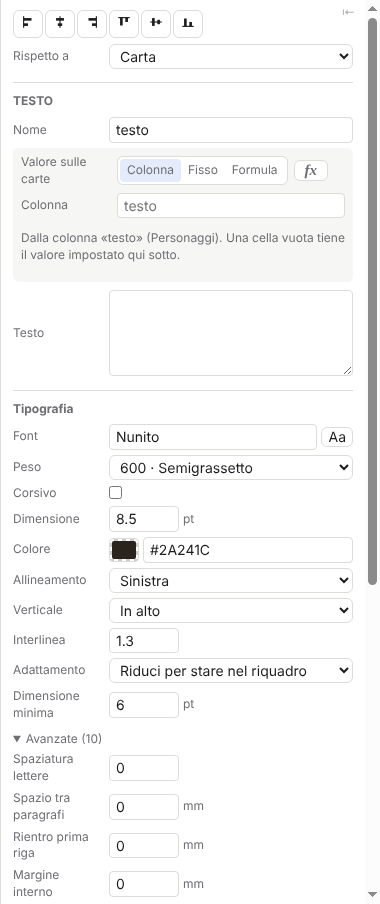</td>
<td width="33%">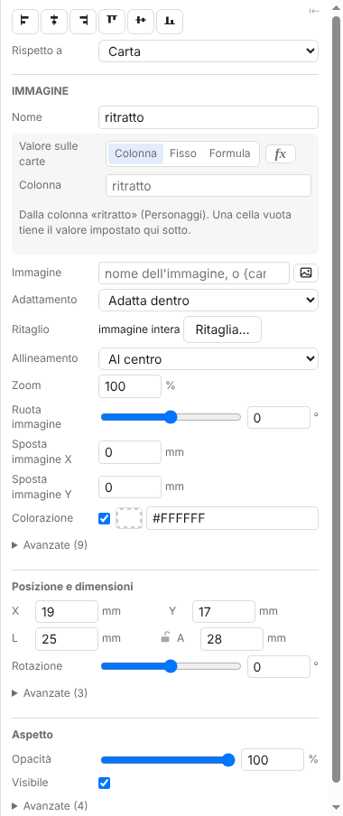</td>
<td width="33%">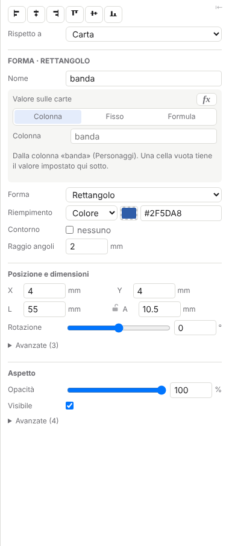</td>
</tr>
<tr>
<td>Testo</td>
<td>Immagine</td>
<td>Forma</td>
</tr>
</table>

In cima a ogni livello ci sono il **nome**, che è anche il nome della colonna del foglio, e il **valore sulle carte**, con il tasto **fx** dell'assistente formule accanto al titolo e sotto tre scelte su tutta la larghezza del pannello:

- **Colonna**: la colonna del foglio, di base quella con lo stesso nome del livello. Una cella vuota lascia il valore scritto nel template.
- **Fisso**: lo stesso valore su tutte le carte.
- **Formula**: il valore si calcola dagli altri campi della carta ([capitolo 9](#9-formule-e-campi-calcolati)).

Le proprietà principali per tipo di livello:

- **Testo**: contenuto, stile, font, peso, dimensione, colore, allineamento orizzontale e verticale, interlinea, adattamento (riduci per stare nel riquadro, taglia al bordo, lascia uscire). In Avanzate spaziature, rientro, margini interni, maiuscole, sottolineato, barrato, a capo automatico e contorno delle lettere.
- **Immagine**: nome del file o della variabile, adattamento (riempi ritagliando, riempi lasciando uscire la parte fuori dal riquadro, adatta dentro, allunga, dimensione originale, ripeti), allineamento, zoom, rotazione dell'immagine dentro il riquadro, spostamento, colorazione e ritaglio. **Ritaglia…** mostra l'immagine intera con un rettangolo da spostare e ridimensionare: il livello usa solo quella parte, senza modificare il file. Il rettangolo può tenere le proporzioni del riquadro del livello; × toglie il ritaglio. Se il nome dell'immagine viene da una colonna, il ritaglio si prova sull'immagine della carta mostrata e vale per tutte le carte. In Avanzate riflessioni, regolazioni (scala di grigi, luminosità, contrasto, saturazione), raggio, contorno e cosa fare se l'immagine manca.
- **Forma**: tipo, riempimento (nessuno, colore o sfumatura lineare o radiale), contorno (continuo, tratteggiato, a punti) e raggio degli angoli. Poligoni e stelle hanno il numero di lati o punte; la linea va da un punto A a un punto B; la forma "da un'immagine" prende la sagoma di una PNG con trasparenza o di una SVG.
- **Griglia**: caselle uguali dentro il riquadro del livello, per plance, tracciati e mappe ([4.8](#48-la-griglia)).
- **Gruppo**: raccoglie altri livelli, che si spostano, si ruotano e si nascondono insieme. **Disponi i figli** li mette in riga, in colonna o in griglia con uno spazio fisso, senza allinearli a mano: tre icone in riga restano a distanza uguale anche se una viene nascosta. **Ripeti** disegna il gruppo un numero di volte fisso o preso da un campo: con `{forza}` una spada per ogni punto di forza. Con la maschera il livello più in basso del gruppo fa da sagoma per gli altri: un ritratto dentro un cerchio è un gruppo con un'ellisse in fondo e l'immagine sopra.

Per tutti i livelli ci sono posizione, dimensioni, rotazione e, nella sezione **Aspetto**, opacità, visibilità, fusione, dissolvenza, ombra e blocco.

Per il testo, **Adattamento** decide cosa succede quando il testo non sta nel riquadro: **Riduci per stare nel riquadro** abbassa la dimensione fino alla **Dimensione minima**, **Taglia al bordo del riquadro** nasconde quello che esce, **Esce dal riquadro** lo disegna oltre il bordo. Per il testo delle regole conviene ridurre, con una dimensione minima ancora leggibile; **Controlla testi…** ([5.3](#53-ordinare-e-filtrare)) trova le carte in cui nemmeno la dimensione minima basta.

Nella sezione **Aspetto** l'**opacità** rende il livello trasparente; la **fusione** dice come si combina con quello che sta sotto (**Moltiplica** scurisce uno sfondo con una texture, **Scolora** lo schiarisce); la **dissolvenza** sfuma l'opacità da un lato all'altro del livello, o dal centro ai bordi, per far svanire un'immagine di sfondo verso il testo; l'**ombra** ha colore, sfocatura e spostamento, e un'ombra leggera sotto un titolo lo stacca da uno sfondo chiaro. **Bloccato** impedisce di selezionare e spostare il livello sulla tela, utile per lo sfondo.

### 4.5 Allineare e distribuire

Con due o più livelli selezionati, i pulsanti in cima al pannello li allineano tra loro, alla carta o all'area sicura, e li distribuiscono con spaziatura uguale. **Disponi a griglia** li mette in righe e colonne.

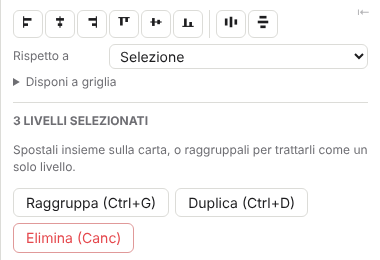

### 4.6 Il retro

**Retro** nella barra dell'editor mostra i livelli del retro, che funzionano come quelli del fronte: possono essere uguali per tutte le carte o prendere valori dal foglio. Nelle pedine il retro è il fronte specchiato: si vede ma non si modifica. Nella griglia del set, **Retro** mostra il retro di tutte le carte.

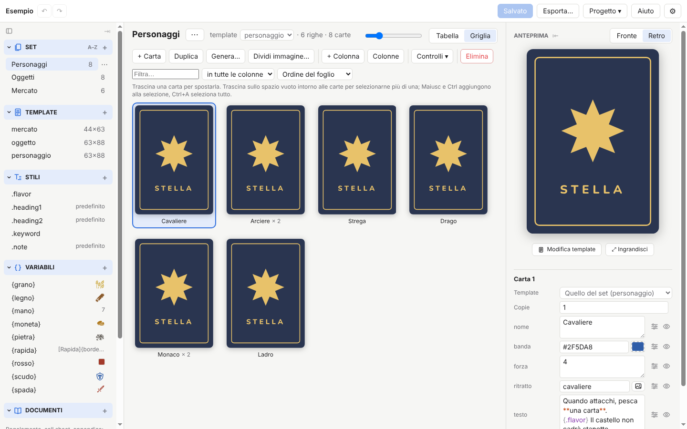

### 4.7 Template derivati

Un template derivato parte da un altro, il base, e ne cambia solo alcune parti: per esempio `carta-fuoco` deriva da `carta` e cambia lo sfondo e il colore della banda. Tutto ciò che il derivato non cambia segue il base, anche quando il base cambia dopo.

Il pulsante ↳ accanto a un template, nella barra laterale, crea un derivato, che si apre nell'editor uguale al base. In intestazione l'editor mostra da quale template deriva, con un link per aprirlo.

Si lavora come su un template normale, con alcune differenze:

- Nel pannello delle proprietà, accanto a ogni valore, la catena indica che viene dal base; la freccia indica che il derivato l'ha cambiato, e un clic sulla freccia torna al valore del base.
- Nel pannello dei livelli, la catena segna i livelli del base, la freccia quelli con modifiche (un clic li riporta come nel base), il + quelli che esistono solo nel derivato.
- I livelli del base non si eliminano (Canc li nasconde), non si spostano nell'elenco e non si rinominano: il loro nome è anche la colonna del foglio, uguale a quella del base. I livelli aggiunti si gestiscono come sempre.
- Le misure della carta sono quelle del base.

**Rendi indipendente**, nell'intestazione, trasforma il derivato in un template normale con i valori che ha in quel momento. Un template che fa da base a un altro non si può eliminare finché i suoi derivati non sono indipendenti o eliminati.

### 4.8 La griglia

Il livello **griglia** (strumento con le caselle) disegna caselle uguali dentro il suo riquadro: serve per plance, tracciati del punteggio, mappe, tabelle da compilare a mano. Le caselle sono quadrate, tonde, esagonali, triangolari, a rombo o con la forma presa da un'immagine (il contorno della parte non trasparente, con le sue proporzioni), in righe e colonne con uno spazio tra l'una e l'altra. **Rotazione della casella** gira la forma di ogni casella intorno al suo centro, per qualsiasi forma: le caselle restano al loro posto e il contenuto non gira. **A incastro** le dispone ad alveare per gli esagoni (con la punta o con il lato in alto), alternate in su e in giù per i triangoli, nei vuoti tra le altre per rombi e cerchi, a mattoncino per i quadrati. Le caselle hanno riempimento, contorno e raggio degli angoli (non i cerchi); lo **sfondo della griglia** riempie lo spazio dietro e tra le caselle fino al **bordo della griglia**, che ha un suo contorno. In Avanzate il margine tra caselle e bordo, il raggio dello sfondo, la larghezza delle caselle rispetto all'altezza, lo zoom (100% è la griglia più grande che sta nel riquadro senza deformare le caselle), la posizione nel riquadro e il taglio di ciò che esce. Il riempimento delle caselle è il valore del livello, quindi può cambiare da carta a carta; per le altre proprietà si usano colonne come `griglia.rows`.

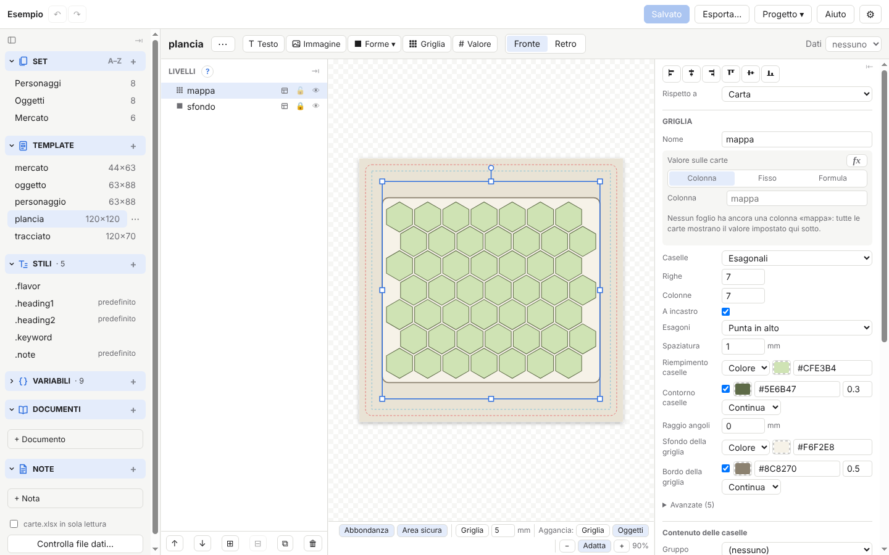

**Contenuto delle caselle** sceglie un gruppo dello stesso lato che si ripete in ogni casella: si disegna nella prima casella (**Porta nella prima casella** ce lo sposta) e le altre ne ricevono una copia spostata al loro posto. Dentro il gruppo i campi `{cell.index}` (1, 2, 3… per righe), `{cell.row}`, `{cell.column}`, `{cell.count}` (numero di caselle) e `{cell.random}` (un numero da 1 a 999999, fisso per carta e casella) cambiano da casella a casella: un testo con la formula `=IF(MOD({cell.index}; 10) = 0; "[" & {cell.index} & "]{color=red}"; {cell.index})` numera un tracciato del punteggio con i multipli di 10 in rosso, un'icona con `=PICK({cell.index}; {icone})` mette in sequenza le icone di una colonna `icone`. Nell'editor il gruppo resta selezionabile nella sua posizione; sulle carte si vede solo nelle caselle.

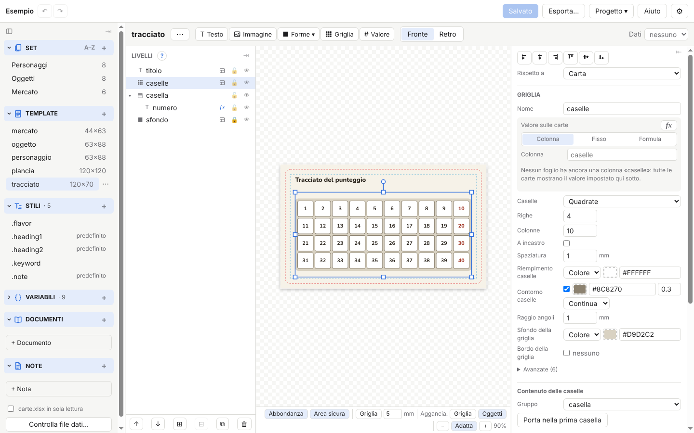

## 5. Inserire e modificare le carte

### 5.1 Creare un set

Il + accanto a **Set** chiede il nome, il template e il foglio: un foglio nuovo, con le colonne che il template legge, o uno già presente nel file dei dati e non ancora collegato.

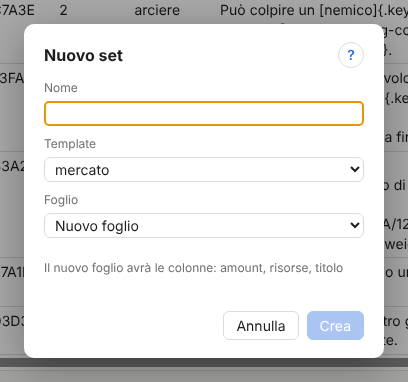

Il foglio può essere anche uno già usato da un altro set: i due set condividono le righe e ognuno le disegna col suo template, per esempio "Truppe rosse" e "Truppe gialle" dallo stesso foglio "Truppe". Una modifica ai dati fatta in uno dei due vale per tutti i set del foglio. Il nuovo set deve avere un nome diverso dal foglio. Rinominare un set con il foglio condiviso non rinomina il foglio, ed eliminarlo lascia il foglio nel file finché lo usa un altro set.

### 5.2 Tabella e griglia

Un set si apre nella **griglia**, con le carte disegnate; **Tabella** lo mostra come foglio di calcolo.

La **tabella** mostra il testo delle celle come appare sulla carta: grassetto, colori, icone e variabili, con le icone ripetute (`{spada*forza}`) secondo il valore della riga. Il testo scritto, con il markup, si vede passando il mouse sulla cella e quando la si modifica. Per il resto funziona come un foglio di calcolo: doppio clic o digitazione per modificare una cella, Alt+Invio per andare a capo dentro la cella, trascinamento del numero di riga per spostare una carta. **+ Carta**, **Duplica** ed **Elimina** agiscono sulle righe selezionate (Maiuscolo o ⌘ / Ctrl per selezionarne più di una, anche nella griglia). Con più carte selezionate il modulo a destra le modifica in blocco: ciò che si scrive in un campo va in tutte, mentre i campi con valori diversi restano vuoti e non cambiano finché non li si tocca.

Il campo **Copie** (la colonna `amount` del foglio) indica quante copie stampare di ogni carta; vuoto vale 1.

Un file immagine trascinato dal computer su una cella della tabella, o su un campo immagine del modulo, si copia in `assets/images` e il suo nome va nella cella.

Le spiegazioni brevi del set, dell'editor e delle proprietà del template stanno dietro un piccolo **?**: il puntatore del mouse sopra mostra il testo.

Un set senza componenti mostra al posto della tabella il pulsante **+ Aggiungi il primo componente**.

Tabella e modulo mostrano tutte le colonne che si possono modificare: quelle del foglio e quelle che il template legge ma il foglio non ha ancora (con l'intestazione in corsivo), che si creano scrivendoci un valore. Il pulsante **Campi** sceglie quali colonne nascondere; **Ripristina** torna alla vista di base, con le sole colonne lette dai livelli collegati a una colonna (le colonne rimaste nel foglio senza un livello, per esempio da un progetto TTC importato, si nascondono) e i dettagli dei campi chiusi. Nel modulo della carta l'occhio accanto al campo di un livello lo mostra o lo nasconde su quella carta. L'icona con i cursori apre le proprietà del livello per la carta (colore, corsivo, forma, posizione...), con menu per i valori prestabiliti, campi numerici e selettore del colore: un valore scritto lì vale solo per quella carta e crea la colonna `livello.proprietà`, mentre un campo vuoto mostra in grigio il valore del template. Il numero sull'icona dice quante proprietà la carta cambia. La puntina accanto a una proprietà la fissa: resta sotto il suo campo anche con le proprietà chiuse e cambiando carta, finché non si toglie con la stessa puntina. Le proprietà fissate valgono per il set e si salvano nel progetto. Le colonne dei livelli fissi o con formula non arrivano alla carta e restano nascoste; **Mostra i livelli fissi e con formula** le aggiunge in sola lettura, con il simbolo ƒ e il valore che hanno su ogni carta.

Le colonne vero/falso (le proprietà come `stemma.visible` o `nome.italic`, e le colonne in cui ogni cella vale `true` o `false`) hanno una casella: un clic, o la barra spaziatrice sulla cella, la spunta o la toglie. Una casella chiara vuol dire cella vuota: vale il valore del template.

La **griglia** mostra le carte come verranno stampate. Il cursore in alto cambia la dimensione delle miniature (anche con ⌘ / Ctrl e la rotella del mouse); trascinando una carta se ne cambia la posizione.

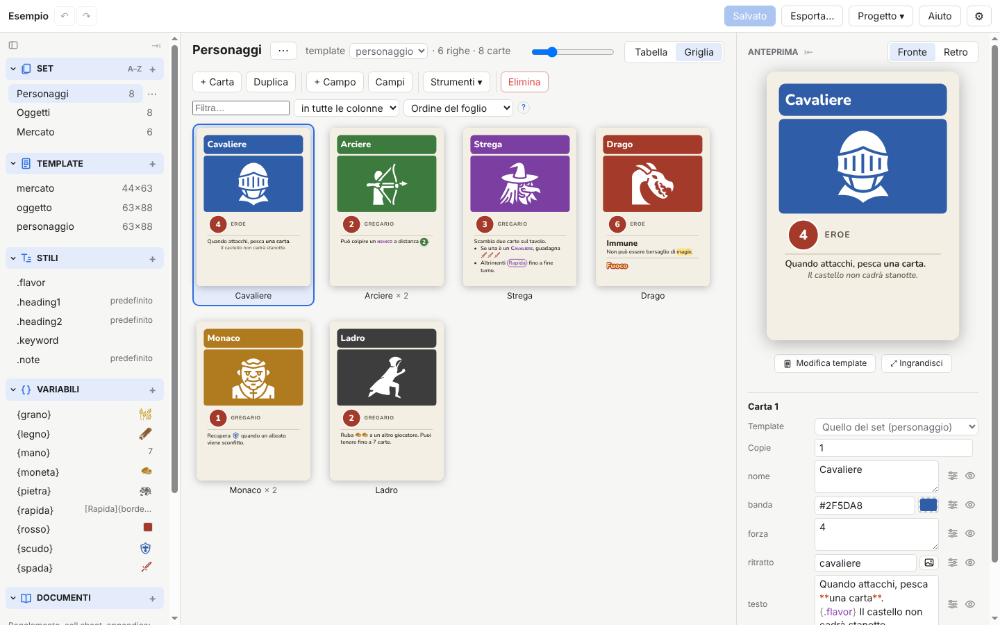

Per selezionare più carte nella griglia si trascina sullo spazio vuoto intorno alle carte: il rettangolo seleziona quelle che tocca, e con Maiuscolo o ⌘ / Ctrl le aggiunge a quelle già selezionate. ⌘A / Ctrl+A seleziona tutte le carte mostrate (anche con un filtro attivo, solo quelle che passano il filtro), Esc torna alla sola carta in anteprima. Sopra la griglia una barra dice quante carte sono selezionate, con **Seleziona tutte** e **Tieni solo una**. Trascinando una delle carte selezionate si spostano tutte insieme.

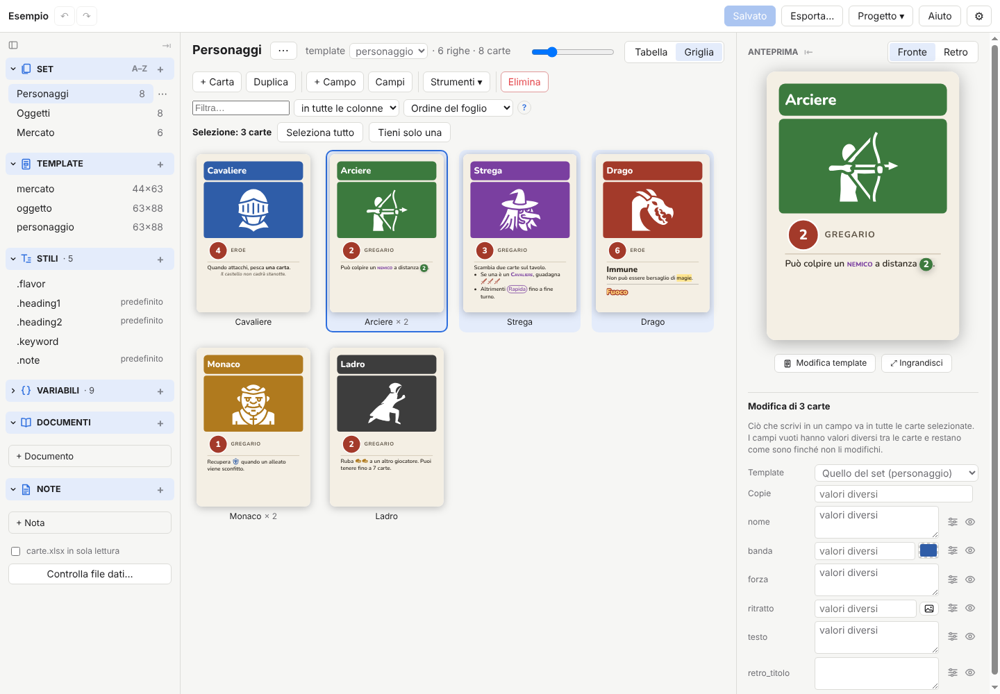

In entrambe le viste, a destra, il modulo della carta selezionata ha un campo per ogni colonna. Un clic su un livello dell'anteprima porta al suo campo; Alt+clic nello stesso punto passa al livello sotto, utile quando un livello ne copre un altro. Il doppio clic modifica il livello direttamente sulla carta: per un testo si apre un riquadro sopra il livello, per un'immagine le miniature, per una forma il selettore del colore. Esc annulla la modifica, un clic fuori o Ctrl+Invio la chiude. Il doppio clic su un livello fisso o con formula dice da dove arriva il valore, con un pulsante per aprire il template. Il pulsante ⤢ in alto nell'anteprima apre la carta grande in una finestra, con il modulo della carta accanto, gli stessi clic e le frecce per passare da una carta all'altra. PagSu e PagGiù passano alla carta precedente o successiva, anche mentre si scrive in un campo del modulo, che resta lo stesso.

### 5.3 Ordinare e filtrare

Un clic sull'intestazione di una colonna ordina le carte (crescente, poi decrescente, poi l'ordine del foglio); nella griglia la colonna si sceglie dal menu. Il campo **Filtra…** mostra solo le righe che contengono un testo, in tutte le colonne o in una sola.

Ordinamento e filtro cambiano solo la vista: il foglio e l'esportazione restano come sono. **Applica questo ordine** riordina il foglio come lo si vede; **Mostra tutto** toglie ordinamento e filtro.

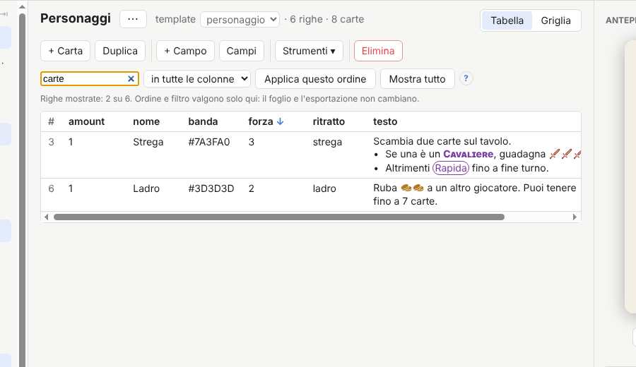

I controlli sul set stanno nel menu **Strumenti** della riga dei pulsanti, insieme a **Genera…** e **Dividi immagine…**.

**Statistiche…** mostra quante carte hanno ogni valore di una colonna, anche di un livello con formula, con una barra per confrontarli: serve a bilanciare il set (per esempio quante carte per costo). Per le colonne di numeri dà anche somma, media, minimo e massimo. Le copie della colonna `amount` contano, a meno di togliere la spunta; con un filtro attivo contano solo le carte filtrate.

**Controlla testi…** cerca, in tutte le carte del set, fronte e retro, i testi che non stanno nel loro riquadro: quelli che escono, quelli tagliati e quelli che anche ridotti alla dimensione minima non ci stanno. L'elenco dice carta, faccia e livelli; un clic seleziona la carta. Nella griglia le carte con un testo che non sta hanno un segno arancione accanto al nome.

**Confronta…** segna le carte nuove o cambiate rispetto all'ultima esportazione o a un backup, per ristampare solo quelle. Si sceglie la versione, e nei set le carte diverse hanno un punto blu; **Mostra solo queste** nasconde le altre. Con il confronto attivo, la finestra **Esporta…** propone **Solo le carte nuove o cambiate**. Il confronto guarda quello che le carte mostrano (dati, template, variabili e stili che usano), non il contenuto dei file di immagini e font; una carta spostata non conta come cambiata, a meno che mostri il suo numero. Ogni esportazione fatta dall'app ricorda le carte esportate nel file nascosto `.stella-printed.json` del progetto.

### 5.4 Colonne delle proprietà

Oltre al valore principale, ogni proprietà di un livello può cambiare carta per carta con una colonna `livello.proprietà`: per esempio `nome.color` per il colore del titolo o `icona.tint` per la colorazione di un'icona. **+ Campo** propone le colonne che il template legge e che mancano nel foglio, le proprietà di un livello a scelta, o una colonna libera.

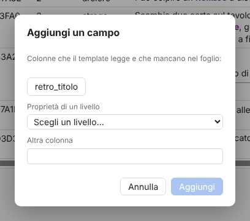

Nelle celle i colori si scrivono come nomi (`red`, o il nome di una variabile colore) o in esadecimale (`#A33A2A`); un contorno come `colore/spessore/tratteggio`, per esempio `red/0.3/dashed`; un ritaglio come `x y larghezza altezza` in percentuale dell'immagine, per esempio `10 0 50 50` (`none` per l'immagine intera). Nel modulo della carta il pulsante **Ritaglia…** accanto al campo del ritaglio scrive questi numeri al posto tuo.

Il campo **Template**, in cima al modulo della carta, sceglie il template di una singola carta tra quelli con le misure del set: vuoto vale quello del set, e la scelta va nella colonna `template` del foglio. Serve per esempio per dare a poche carte di un set un template derivato. Nel modulo della carta il campo diventa un menu con i template che hanno le stesse misure di quello del set.

### 5.5 Modificare il file in Excel

Il file dei dati è un normale foglio di calcolo e si può modificare anche con Excel, LibreOffice o Numbers, anche con il progetto aperto: quando salvi il file, Stella lo rilegge da sola. Se in Stella ci sono modifiche ai dati non ancora salvate, invece, compare un avviso con **Ricarica** e **Ignora**. Per modificare i dati solo fuori da Stella, spunta **in sola lettura** accanto al nome del file, in fondo alla barra laterale, e salva: Stella non scrive più nel file dei dati, le modifiche ai dati nella griglia e nella scheda della carta vengono rifiutate e accanto al conteggio delle carte compare _sola lettura_. Template, anteprime ed esportazioni funzionano come sempre. **Controlla file dati…**, sotto la casella, mostra come Stella legge ogni foglio: i set che lo usano, le colonne che i loro template leggono e il foglio non ha, e le anomalie (titoli sopra le intestazioni, celle unite, errori di Excel, formule senza risultato salvato, righe vuote); non modifica il file. Dalla stessa finestra, **Importa un foglio da un altro file…** mette le righe di un foglio di un altro file (.xlsx, .ods, .csv) al posto di quelle di un set: prima mostra le righe nuove, tolte e cambiate (riconosciute da una colonna con valori tutti diversi, come il nome) e permette di tenere le colonne che il file non ha; poi fa un backup del progetto. La modifica si annulla con ⌘Z / Ctrl+Z. Al salvataggio Stella riscrive solo le colonne con un'intestazione: formattazione delle celle, altri fogli e colonne senza intestazione restano come sono. Una cella con una formula di Excel resta una formula finché il risultato non cambia. Se parti da un file Excel che hai già, con formule e fogli di analisi, leggi [Usare un file Excel che hai già](excel-esistente.md).

### 5.6 Dati da Google Sheets

Se tieni i dati in un foglio Google, **Google Sheets…**, nel menu **Progetto**, li porta nel progetto. Nel foglio Google scegli **Condividi** → **Chiunque abbia il link** (lettore), copia il link e incollalo; **Scarica** legge tutte le schede. Ogni scheda va al set con lo stesso nome (senza badare a maiuscole); dal menu puoi sceglierne un altro o **non importare** la scheda. Se una scheda non ha alcune colonne del set, la finestra le elenca: dopo l'importazione quelle colonne non ci sono più. **Importa** sostituisce i dati dei set scelti (⌘Z / Ctrl+Z annulla) e **Salva** li scrive nel file dei dati del progetto, che resta la copia locale: Stella funziona anche senza rete.

Il link resta nel progetto: la volta dopo basta aprire la finestra e premere **Scarica**. Un foglio non condiviso con il link non si può scaricare, e Stella lo dice. Un'IA può fare lo stesso con `stella pull-sheets`.

### 5.7 Carte in più lingue

Un progetto può stampare le stesse carte in più lingue. **Lingue…**, nel menu **Progetto**, apre la finestra delle lingue: la prima è la principale, quella in cui sono scritte le colonne di sempre. Con **Aggiungi lingua** scrivi il codice della lingua (en per l'inglese, fr per il francese, de per il tedesco…). Sotto, **Nomi tradotti** dà il nome del progetto e dei set nelle altre lingue: lo usano `{project.name}` e `{set.name}`. Lasciando spuntata la casella in fondo, **Salva** aggiunge ai fogli le colonne da tradurre.


La traduzione di una colonna sta in una colonna con lo stesso nome seguito da @ e dal codice della lingua: `nome@en` accanto a `nome`, `testo@en` accanto a `testo`. Le colonne con soli numeri non servono. Una cella tradotta vuota usa il testo della lingua principale, così puoi tradurre poco alla volta.

Il menu accanto al nome del progetto, in alto, sceglie in che lingua mostrare le carte: griglia, anteprima, editor e documenti cambiano subito. Il doppio clic sulla carta modifica il testo tradotto, se la colonna c'è.


Si traduce solo ciò che si legge sulla carta. Nomi delle immagini, colori e formule che cominciano con `=` usano sempre i valori della lingua principale: una formula come `=IF({tipo}="Attacco"; ...)` funziona in ogni lingua senza cambiarla. Per avere un'immagine diversa in una lingua aggiungi la sua colonna tradotta, per esempio `icona@en`.

I testi che non vengono dal foglio si traducono dove si scrivono. Un livello di testo con **Valore sulle carte** su **Fisso** ha, sotto il testo, un campo per ogni altra lingua; lo stesso vale per i livelli valore fissi e, nella loro finestra, per le variabili di testo e valore. Un campo lasciato vuoto usa il testo della lingua principale. Se una formula con `=` deve scrivere un testo tradotto, falle restituire una variabile: `=IF({tipo}="Attacco";"{attacco}";"{difesa}")` confronta il valore italiano e scrive la variabile `attacco` nella lingua della carta.

Un documento usa sempre la lingua principale, anche se in alto è scelta un'altra lingua. Per un regolamento in inglese scrivi `language: en` nella testa del documento, o sceglilo in **Pagina**, alla voce **Lingua delle carte**: carte e variabili del documento saranno in inglese. La finestra **Lingue** dice quanti testi restano da tradurre in ogni lingua, e `stella check` li elenca uno per uno.

In **Esporta…** scegli la lingua, o **Tutte le lingue**. La lingua principale va nella cartella di sempre, le altre in una sottocartella con il loro codice, per esempio `export/en`; i nomi dei file restano gli stessi. Un'IA fa lo stesso con `stella render --lang en` e `stella export --profile NOME --lang all`.

## 6. Testo e markup

Il testo delle carte si scrive con un markup semplice, uguale nell'app e nelle celle del foglio. Non serve HTML.

### 6.1 Markdown

| Scrivi                       | Ottieni                                        |
| ---------------------------- | ---------------------------------------------- |
| `**testo**`                  | grassetto                                      |
| `*testo*`                    | corsivo                                        |
| `++testo++`                  | sottolineato                                   |
| `~~testo~~`                  | barrato                                        |
| `==testo==`                  | evidenziato                                    |
| `^testo^` / `~testo~`        | apice / pedice                                 |
| `# Titolo`, `## Sottotitolo` | paragrafo con lo stile `heading1` o `heading2` |
| `> testo`                    | paragrafo con lo stile `note`                  |
| `- voce` / `1. voce`         | elenco puntato / numerato                      |
| `---`                        | linea separatrice                              |
| `\` a fine riga              | a capo senza nuovo paragrafo                   |
| `_4{moneta}_`                | non va mai a capo                              |

Ogni a capo inizia un nuovo paragrafo, come quando si scrive in una cella di Excel con Alt+Invio. Per tenere un pezzo di testo sulla stessa riga, così che `4` e la sua icona non finiscano su righe diverse, lo si chiude tra due trattini bassi: `_4{moneta}_`. È lo stesso di `[4{moneta}]{nowrap}`. Un trattino basso dentro una parola (`nome_file`) resta com'è; per scriverne uno isolato si usa `\_`.

### 6.2 Attributi

Le parentesi quadre delimitano il testo e le graffe che seguono dicono come formattarlo: `[Attenzione]{color=red weight=800}`. Gli attributi si separano con spazi.

| Attributo                             | Esempio                                    | Effetto                                        |
| ------------------------------------- | ------------------------------------------ | ---------------------------------------------- |
| `.nome`                               | `[pino]{.keyword}`                         | applica uno stile                              |
| `color=`, `highlight=`                | `{color=#A33A2A}`                          | colore del testo o dell'evidenziazione         |
| `size=`                               | `{size=14}` · `{size=+2}` · `{size=80%}`   | dimensione in pt, relativa o in percentuale    |
| `font=`, `weight=`                    | `{font=Open_Sans weight=800}`              | famiglia (con `_` al posto degli spazi) e peso |
| `stroke=`                             | `{stroke=white/8%}`                        | contorno delle lettere                         |
| `upper`, `lower`, `smallcaps`         | `[Fase]{smallcaps}`                        | maiuscole, minuscole, maiuscoletto             |
| `nowrap`                              | `[4 monete]{nowrap}`                       | la porzione non va a capo                      |
| `left`, `center`, `right`, `justify`  | `{.flavor center}` a inizio paragrafo      | allineamento del paragrafo                     |
| `border=`, `fill=`, `radius=`, `pad=` | `[Rapida]{border=red/0.3 radius=round}`    | riquadro attorno al testo                      |
| `bg=`, `bg-color=`, `bg-size=`        | `[3]{bg=circle bg-color=blue color=white}` | forma o immagine dietro il testo               |

Le forme `circle`, `square`, `rounded`, `hexagon` e `diamond` sono sempre disponibili per `bg=`. Per alzare o abbassare il testo dentro il riquadro senza spostare il riquadro si usa `text-raise=` in pt, anche in uno stile: `.cuore = bg=cuore color=white text-raise=1` (`raise=` invece sposta tutto il riquadro).

### 6.3 Campi, variabili e icone

| Scrivi                        | Ottieni                                                         |
| ----------------------------- | --------------------------------------------------------------- |
| `{forza}`                     | il valore del campo `forza` della carta                         |
| `{spada}`                     | la variabile `spada`: un'icona, un testo, un colore o un valore |
| `{spada*3}` · `{spada*forza}` | l'icona ripetuta tre volte, o tante volte quanto vale il campo  |
| `{legno}`                     | un'immagine di `assets/` con quel nome, alta quanto la riga     |
| `{spada tint=red size=150%}`  | l'icona con attributi validi solo per questo uso                |
| `\{`, `\*`, `\[`              | il carattere letterale                                          |

Stella conosce da sé alcuni valori, le **variabili di sistema**, che si scrivono come i campi, anche nelle formule: `{project.name}` (il gioco), `{set.name}`, `{template.name}`, `{card.number}` (la riga della carta nel set), `{set.rows}`, `{set.cards}` (le carte con le copie), `{card.copies}`, `{card.copy}` (la copia stampata, per scrivere per esempio `{card.copy}/{card.copies}`), `{card.side}` (`front` o `back`) e `{date}`. Un piè di pagina come `{set.name} {card.number}/{set.rows}` numera le carte da solo.

Il pulsante **Aiuto** nella barra in alto e nella schermata di ingresso, o il tasto F1, apre un riepilogo del markup, dei campi e delle variabili, delle variabili di sistema, delle formule e delle scorciatoie. La prima scheda, **Primi passi**, riassume i quattro passi da un progetto vuoto ai componenti stampati, con un collegamento alla sezione della guida per ciascuno, i primi video e le parole da conoscere (componente, template, set, livello, abbondanza...). Si apre lì quando il progetto non ha ancora componenti; altrimenti sulla scheda usata l'ultima volta. Le scorciatoie compaiono nella forma del sistema in uso: ⌘ sul Mac, Ctrl su Windows e Linux.

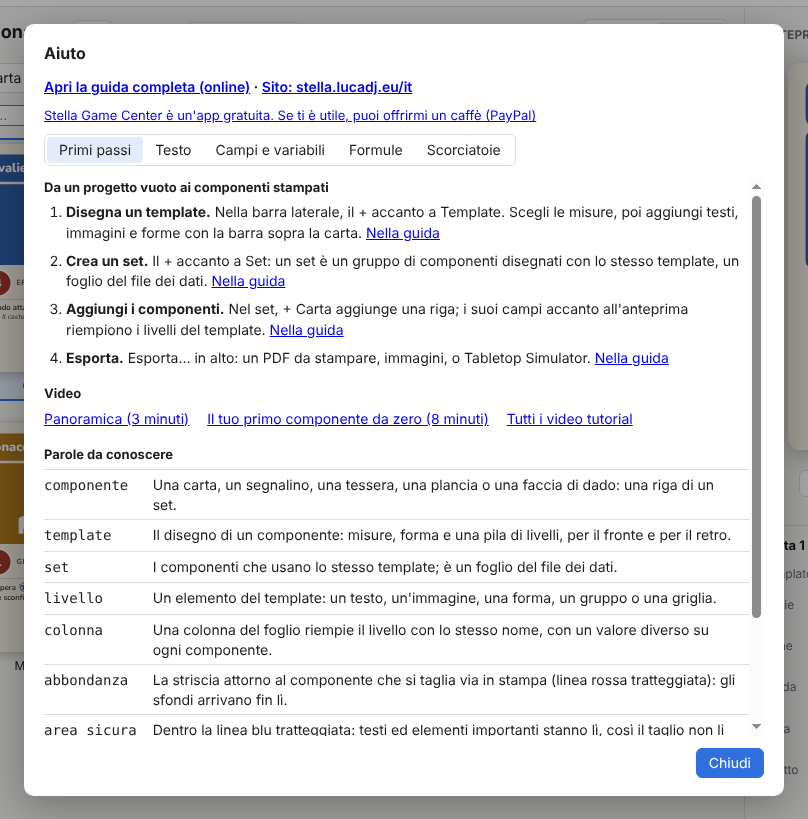

<table><tr>
<td width="50%">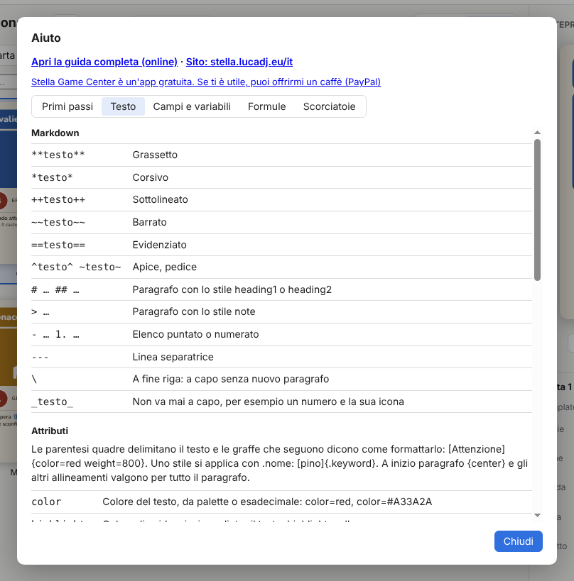</td>
<td width="50%">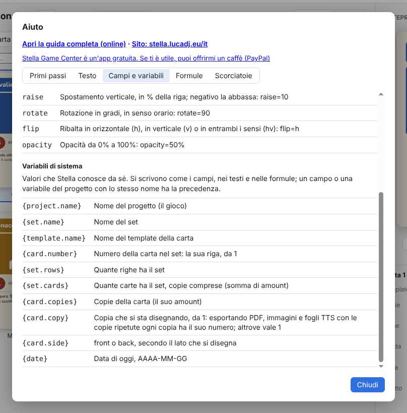</td>
</tr></table>

### 6.4 Aiuto alla scrittura

Nei campi di testo dell'editor, del modulo della carta e nelle celle della tabella, digitando `{` compaiono i campi e le variabili, con l'anteprima dell'icona, del testo o del colore. ↑ e ↓ scelgono, Invio o Tab inseriscono, Esc chiude. Dentro le graffe compaiono allo stesso modo gli attributi, gli stili e i colori.

Il markup è colorato mentre si scrive. Gli errori, come una variabile che non esiste, sono sottolineati in rosso e compaiono sotto l'anteprima nella sezione **Problemi su questa carta**.

<table>
<tr>
<td width="50%">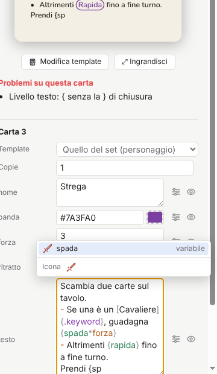</td>
<td width="50%">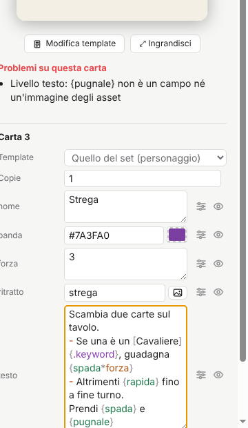</td>
</tr>
</table>

### 6.5 Formattare senza scrivere il markup

Il pulsante **Aa Formatta…** sotto un campo di testo apre l'editor visuale: si seleziona una parte del testo, si scelgono gli attributi e l'app scrive `[testo]{...}`. In fondo si vede il markup risultante. **Salva come stile…** trasforma la formattazione in uno stile del progetto; **Togli la formattazione** rimuove le parentesi. Accanto a **Sfondo** un pulsante apre le miniature: forme predefinite, variabili immagine e immagini del progetto.

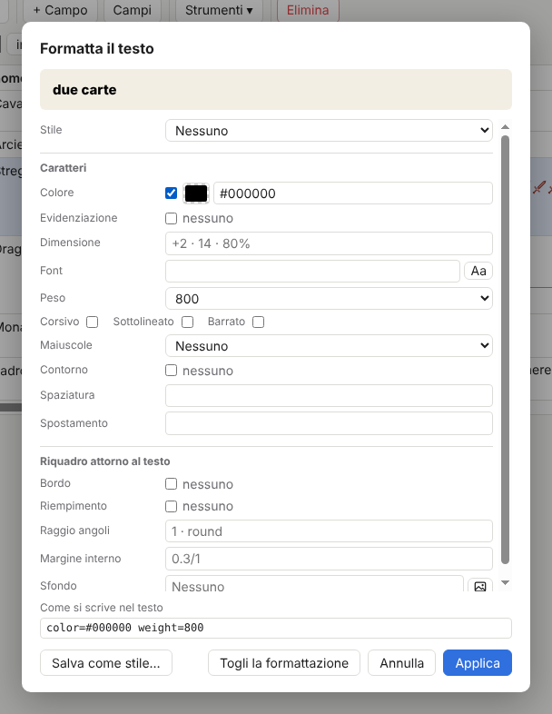

## 7. Variabili e stili

### 7.1 Variabili

Le variabili si creano con il + accanto a **Variabili** e si modificano con un clic. Ce ne sono quattro tipi:

- **Icona**: un'immagine di `assets/` con tinta, dimensione rispetto alla riga, spostamento verticale, rotazione, ribaltamento e opacità. Con **Colore del testo in cui è inserita** l'icona prende il colore del testo. **Sfondo** mette dietro l'immagine una forma (circle, square, rounded, hexagon, diamond), un'immagine o un'altra variabile immagine, con **Colore dello sfondo** e **Spazio attorno** (lo spazio tra l'immagine e il bordo dello sfondo). Lo sfondo vale ovunque si usi la variabile: nei testi, nei livelli immagine, nei documenti e nello schema del tavolo. Per esempio una variabile `acqua` con l'icona di una goccia, tinta bianca e sfondo `circle` rosso mostra la goccia bianca in un cerchio rosso.
- **Testo**: un testo, anche formattato, che sostituisce `{nome}`. Può richiamare altre variabili.
- **Colore**: un colore con un nome, utilizzabile in ogni proprietà colore e negli attributi del markup. Una variabile con il nome di un colore predefinito (per esempio `red`) lo ridefinisce in tutto il progetto.
- **Valore**: un testo o un numero, utilizzabile nei testi e nelle formule (per esempio il numero massimo di carte in mano).

<table>
<tr>
<td width="50%">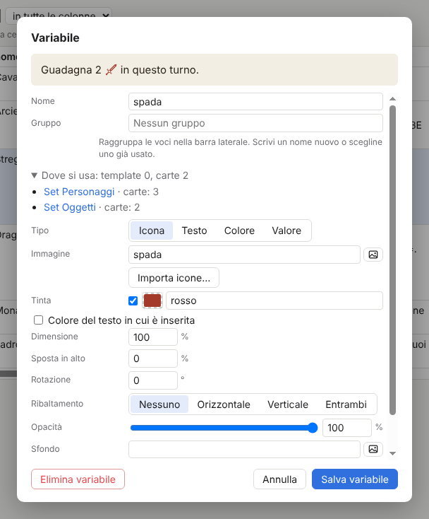</td>
<td width="50%">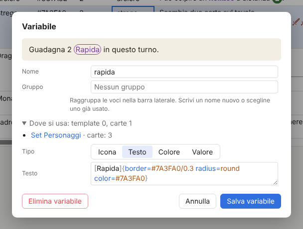</td>
</tr>
</table>

In cima alla finestra una frase di prova mostra il risultato. Rinominare una variabile aggiorna i richiami nei template, nelle celle, nelle altre variabili e negli stili.

### 7.2 Stili di testo

Uno stile raccoglie attributi del testo con un nome: si applica a un livello intero (proprietà **Stile**), a un paragrafo (`{.nome}` a inizio riga) o a una porzione (`[testo]{.nome}`). Modificando lo stile cambiano tutte le carte che lo usano. Uno stile può basarsi su un altro ed ereditarne gli attributi.

`heading1`, `heading2` e `note` esistono in ogni progetto e corrispondono a `#`, `##` e `>`; si possono ridefinire.

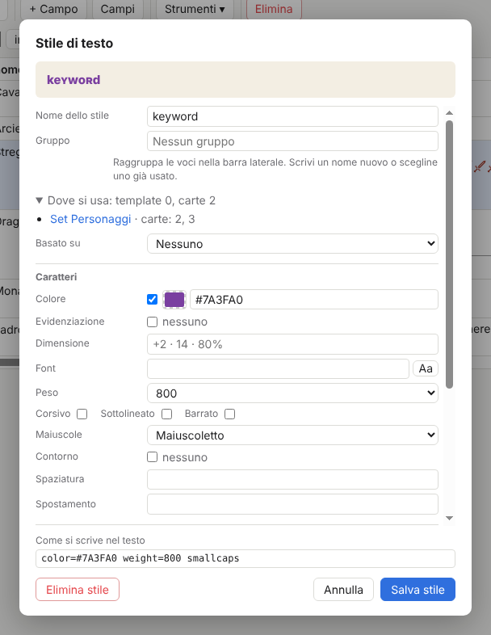

### 7.3 Scegliere un colore

Il quadratino accanto a ogni campo colore apre il selettore: l'area grande sceglie saturazione e luminosità, le due barre sotto la tonalità e la trasparenza. Il codice esadecimale si scrive nel campo accanto all'anteprima; **RGB** e **HSL** cambiano i tre campi numerici (le frecce su e giù li cambiano di 1, con Maiuscolo di 10). Il contagocce prende un colore da qualunque punto dello schermo, anche da un'altra finestra. Sotto ci sono i colori del progetto: prima le variabili colore, segnate da un punto nell'angolo, che si scrivono per nome e mostrano il nome della variabile passandoci sopra; poi i codici usati nel progetto (template, stili, variabili e fogli), dal più usato, senza quelli uguali a una variabile. In fondo gli ultimi colori scelti, comuni a tutti i progetti. Esc o un clic fuori chiudono il selettore. **Nessuno** scrive `none`, cioè nessun colore: un riempimento trasparente o un contorno assente.

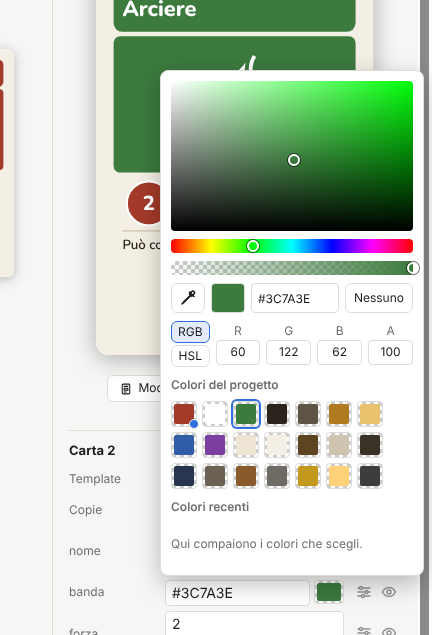

## 8. Immagini, icone e font

### 8.1 Immagini del progetto

Le immagini stanno in `assets/`, anche in sottocartelle, nei formati SVG, PNG, WebP e JPG. Ovunque si indichi un'immagine basta il nome del file, senza cartella né estensione. Se due file hanno lo stesso nome (per esempio `spada.png` e `spada.svg`) l'app lo segnala e chiede di aggiungere l'estensione o la cartella.

Il pulsante con l'immagine accanto ai campi apre le miniature degli asset, con ricerca e filtro per cartella. **Aggiungi immagini…** copia file dal computer in `assets/images` del progetto (un file con lo stesso nome non viene sovrascritto: la copia prende un numero). **Sfondo scuro** mostra le miniature su fondo scuro, per vedere le icone bianche; la scelta viene ricordata.

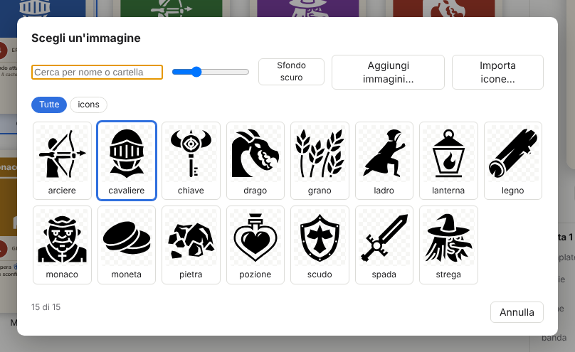

Le icone a un colore (SVG nere su fondo trasparente) si ricolorano con la proprietà **Colorazione** del livello o con la tinta della variabile. La colorazione si stende sopra l'immagine: un colore pieno la ricolora del tutto, un colore semitrasparente la tinge solo in parte. Per esempio nero al 20% (`#00000033`) scurisce un bosco, e l'immagine resta opaca.

### 8.2 Importare icone

**Importa icone…**, nella scelta delle immagini e nella finestra di una variabile icona, apre tre raccolte incluse nell'app, che funzionano senza rete, e una online:

- **game-icons.net**: circa 4200 icone, con categorie tradotte e ricerca anche in italiano. Licenza CC BY 3.0: gli autori vanno citati (vedi i crediti, [capitolo 11.6](#116-crediti)). **Aggiorna catalogo** scarica le icone pubblicate dopo questa versione dell'app (serve la rete, richiede circa un minuto).
- **Kenney: icone e motivi**: icone per giochi da tavolo e motivi ripetibili, in CC0.
- **Kenney: carte, dadi e pedine**: immagini PNG a colori, in CC0.
- **Iconify (online)**: oltre 200 altre collezioni (Material Design, Tabler, Phosphor, emoji...), cercate su internet. Si scrive nella ricerca per cercare in tutte, oppure si sceglie una collezione a sinistra per sfogliarla. I nomi delle icone sono in inglese.

Si possono scegliere più icone, anche da raccolte diverse, e rinominarle prima di importarle. Le icone finiscono in `assets/icons/` (quelle a colori in `assets/images/`) e la loro provenienza in `assets/sources.json`.

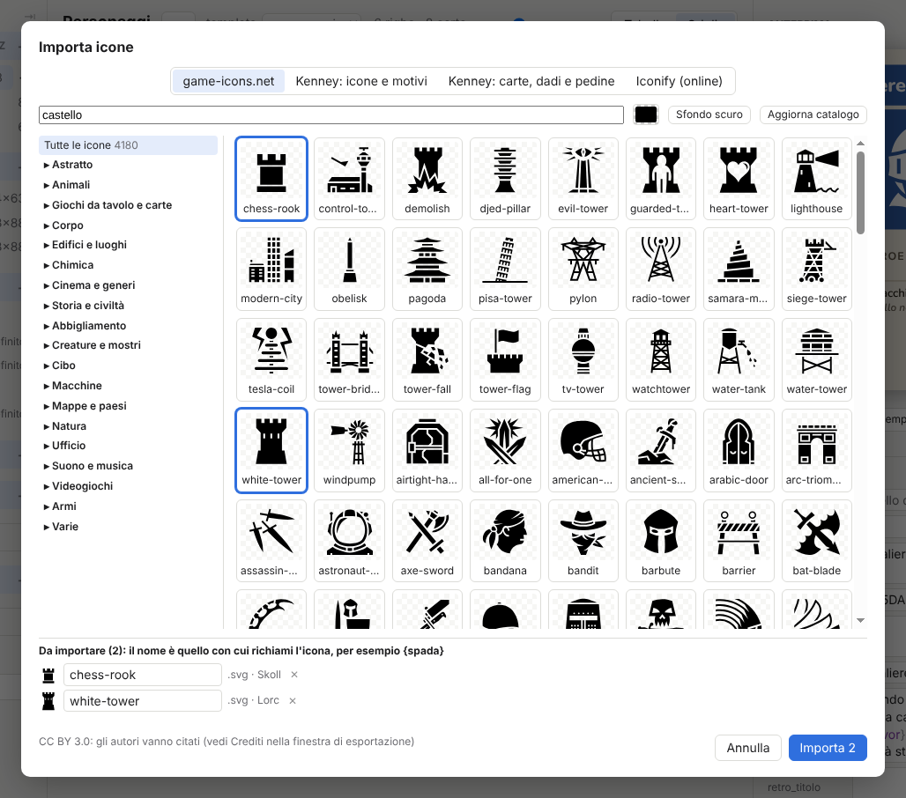

Ogni collezione di Iconify ha la sua licenza, indicata da un pallino: verde per le licenze libere, blu per quelle che chiedono di citare l'autore, arancione per quelle restrittive per un gioco pubblicato (condivisione allo stesso modo, uso non commerciale, GPL). **Nascondi le licenze restrittive** le toglie dall'elenco e dai risultati. La licenza e l'autore della collezione finiscono nei crediti come per le altre icone.

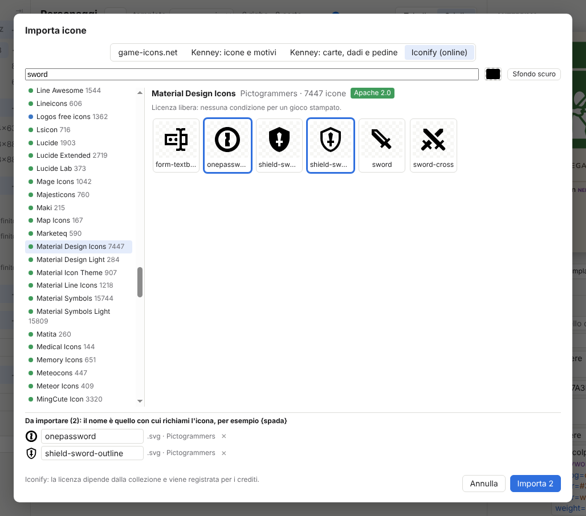

### 8.3 Font

Il pulsante **Aa** accanto al campo del font apre la scelta dei font, con tre schede:

- **Nel progetto**: i font in `assets/fonts/` e Nunito, il font incluso nell'app.
- **Google Fonts**: il catalogo di Google Fonts, con filtro per categoria. Si scelgono gli stili e **Scarica** salva i file in `assets/fonts/`, con la licenza. Le anteprime richiedono la rete; dopo il download il font funziona anche senza. **Aggiorna catalogo** scarica l'elenco più recente, con i font pubblicati dopo questa versione dell'app.
- **Sul computer**: i font installati. **Copia nel progetto** copia i file in `assets/fonts/`, se la licenza lo permette; altrimenti il progetto si vede uguale solo dove quel font è installato.

<table>
<tr>
<td width="50%">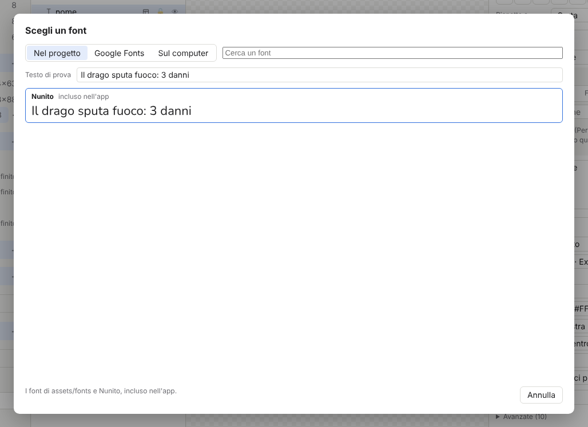</td>
<td width="50%">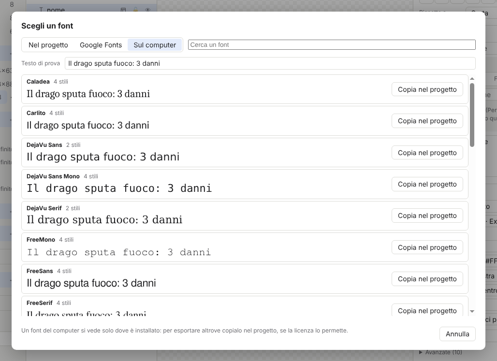</td>
</tr>
</table>

Un font che non si trova viene segnalato sotto la carta e al termine dell'esportazione; il testo usa intanto un font predefinito. Al posto del nome del font si può scrivere una variabile di testo, per esempio `{titoli}`: cambiando la variabile cambia il font di tutti i livelli che la usano.

## 9. Formule e campi calcolati

Un livello con **Valore sulle carte: Formula** calcola il proprio valore dagli altri campi della carta.

- **Composizione di testo**: `{nome}.png`, `Forza {forza}`.
- **Calcolo**: se la formula contiene `+ - * /` e il risultato è un numero, si calcola: `{forza}+2`.
- **Espressione**: con `=` iniziale funziona come in Excel. Testi tra virgolette, confronti `= <> < > <= >=`, `&` per unire testi, argomenti separati da `;` o `,`. Funzioni: `IF`, `AND`, `OR`, `NOT`, `MIN`, `MAX`, `ABS`, `ROUND`, `FLOOR`, `CEILING`, `UPPER`, `LOWER`, `LEN`, `CONCAT`, `ISBLANK`, `COUNTIN`, `MOD`, `PICK`.

Le funzioni, con un esempio sulle carte della guida (Drago, forza 4, costo `{oro}{oro}{legno}`):

| funzione                                      | cosa fa                                       | esempio                                             |
| --------------------------------------------- | --------------------------------------------- | --------------------------------------------------- |
| `IF(condizione; se vera; se falsa)`           | sceglie tra due valori                        | `=IF({forza}>3; "Forte"; "Debole")` → Forte         |
| `AND`, `OR`, `NOT`                            | combinano condizioni                          | `=IF(AND({forza}>3; {costo}<>""); "sì"; "no")` → sì |
| `MIN`, `MAX`                                  | il numero più piccolo o più grande            | `=MAX({forza}; 3)` → 4                              |
| `ABS`                                         | il numero senza segno                         | `=ABS({forza}-6)` → 2                               |
| `ROUND(numero; decimali)`, `FLOOR`, `CEILING` | arrotondano                                   | `=ROUND({forza}/3; 1)` → 1.3                        |
| `UPPER`, `LOWER`                              | maiuscole e minuscole                         | `=UPPER({nome})` → DRAGO                            |
| `LEN`                                         | quanti caratteri ha il testo                  | `=LEN({nome})` → 5                                  |
| `CONCAT`                                      | unisce i testi (come `&`)                     | `=CONCAT({nome}; " "; {forza})` → Drago 4           |
| `ISBLANK`                                     | vero se il valore è vuoto                     | `=IF(ISBLANK({nota}); "-"; {nota})` → -             |
| `COUNTIN(testo; cercato)`                     | quante volte un testo ne contiene un altro    | `=COUNTIN({costo}; "oro")` → 2                      |
| `MOD(numero; divisore)`                       | il resto della divisione                      | `=MOD({cell.index}; 10)` → 0 ogni dieci caselle     |
| `PICK(n; valore1; valore2; …)`                | l'n-esimo valore, ricominciando dopo l'ultimo | `=PICK({forza}; "spada"; "scudo"; "mano")` → spada  |

La finestra **Aiuto** (F1), scheda **Formule**, ha la stessa tabella con il risultato calcolato sulle carte del progetto aperto.

Nell'esempio il livello `rango` mostra "Eroe" o "Gregario" secondo la forza. Sotto la formula compare il risultato per la prima carta del set.

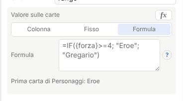

Il livello **Valore** (strumento #) non si disegna: contiene un valore della carta da usare nelle formule e nei testi degli altri livelli come `{nome}`. Nell'esempio, il livello `punti` delle carte mercato conta le risorse con `COUNTIN` e il livello `punti_testo` lo mostra.

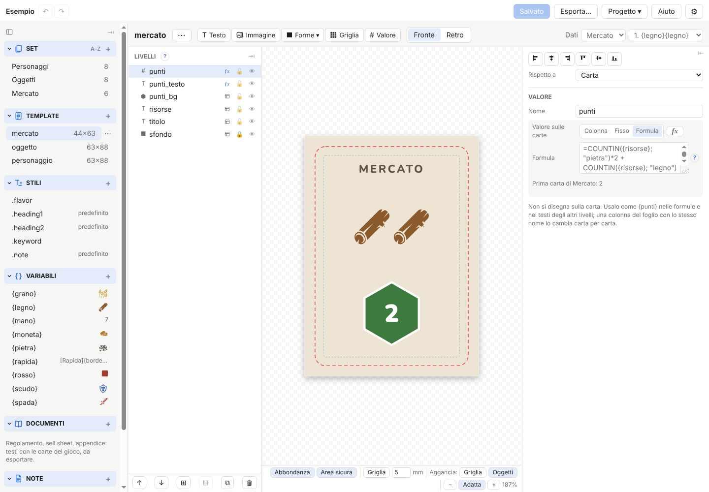

Un livello valore può dare anche un colore: nei campi colore (riempimento, colore del testo, contorno, ombra, tinta) si scrive `{nome}` del livello, che il menu del campo propone. Il valore calcolato può essere un codice come `#A33A2A`, un nome di colore o una variabile colore, per esempio `=IF({forza}>3; "rosso"; "blu")`. Se il valore è vuoto il colore è trasparente.

Un campo vale, in ordine di precedenza: il livello valore calcolato, la cella non vuota della riga, il valore scritto nel template. Gli errori delle formule compaiono sotto la carta e nel pannello delle proprietà.

### 9.1 L'assistente formule

Il tasto **fx**, accanto al titolo **Valore sulle carte**, apre l'assistente. Su un livello con **Colonna** o **Fisso**, confermando la formula il livello passa a **Formula**. C'è anche accanto al **Filtro** del generatore (sezione 10), dove la formula deve dare vero o falso.

Con una formula vuota l'assistente chiede **Cosa vuoi fare?** e propone i casi frequenti come schede: un valore diverso secondo una condizione, cambia qualcosa ogni N caselle (o componenti), alterna due valori, scacchiera, scorri un elenco, scegli a caso, mostra solo se un campo non è vuoto, basso/medio/alto, calcola un numero, unisci testi e campi e, sui livelli di testo, **Ripeti un'icona** («Mostra l'icona spada tante volte quanto forza», come `{spada*forza}` nel testo). Accanto al filtro del generatore le schede sono condizioni (confronta un campo con un valore, un campo non è vuoto). **La scrivo io** passa alla modalità avanzata.

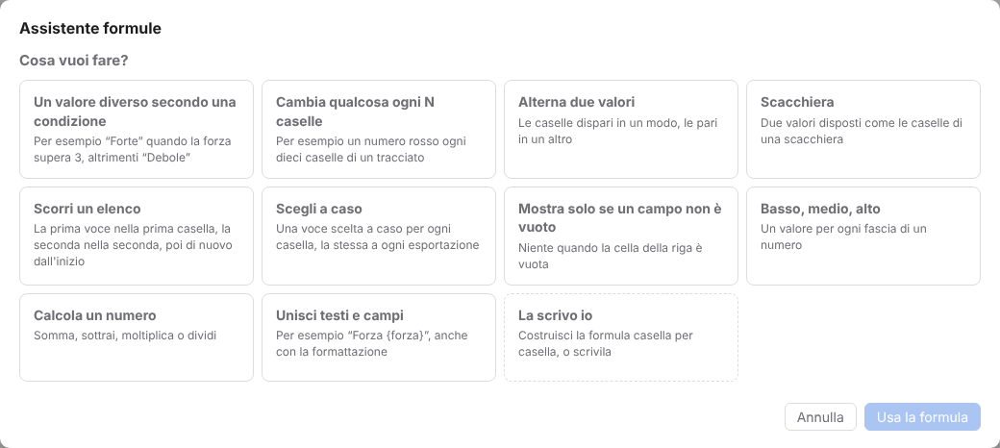

Scelta una scheda, la formula compare come una frase da completare, già riempita con valori sensati: per esempio **Ogni 10 caselle, mostra "Sì" altrimenti "No"**. Ogni spazio è un pulsante: quello selezionato ha sotto il selettore. Per uno spazio di testo (**Cosa mostrare**, **Altrimenti**…) il selettore mostra prima l'elenco da cui scegliere; se lo spazio contiene un solo campo o un testo semplice, il testo è riassunto in una riga **Testo: {forza} · modifica**. **modifica** apre il campo del testo, che si apre da solo quando lo spazio contiene già un testo misto (come «Forza {forza}») o formattato. Nel campo si scrive e le schede **Campo**, **Componente e casella** e **Variabile** inseriscono il valore scelto dove c'è il cursore, come `{forza}` o `{cell.index}`; **Formatta…** dà colore, peso e gli altri attributi a tutto il testo, per esempio il numero della casella in rosso ogni sei caselle. **Altro…** mostra le schede restanti (**Numero**, **Colore**, **Formula** per annidare una funzione…), che sostituiscono il contenuto dello spazio. Sotto la frase il risultato sulla prima carta e, dentro una griglia, quello delle prime caselle; **Mostra formula** apre il testo della formula, che si può anche scrivere a mano. Aprendo una formula esistente che corrisponde a una delle frasi, l'assistente la mostra già come frase.

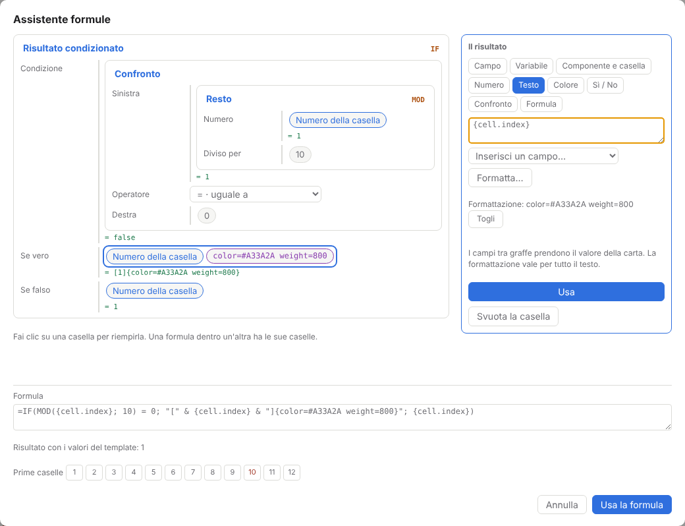

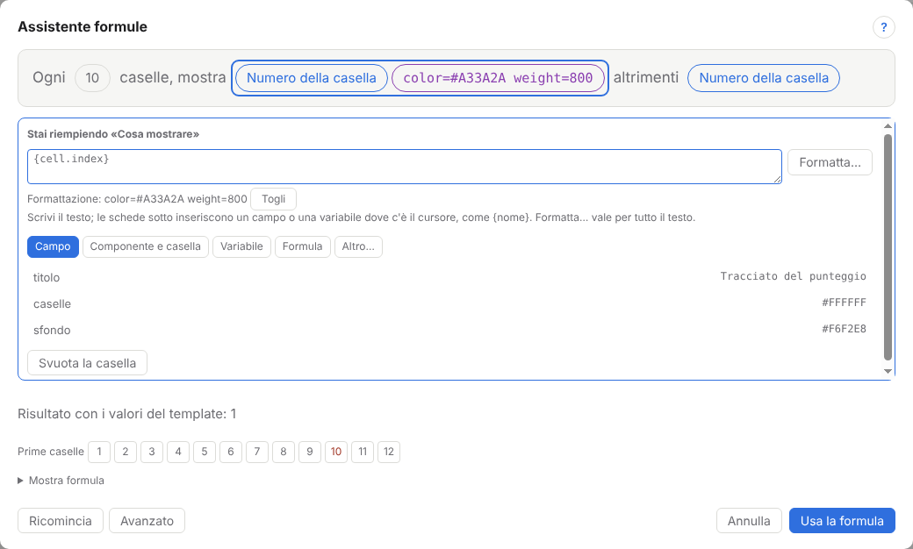

**Funzioni annidate.** In uno spazio si può mettere un'altra funzione: la scheda **Formula** del selettore propone in alto **Cosa vuoi metterci?**, con gli stessi casi della schermata iniziale (le condizioni in uno spazio di condizione, i calcoli in uno spazio di numero), e sotto **Tutte le funzioni**. Il caso scelto compare come una frase più piccola dentro la frase, in un riquadro tratteggiato con il nome dello spazio in alto: per esempio «Se forza è maggiore di 3 mostra [Ogni 10 caselle, mostra… altrimenti…] altrimenti…». Un clic sul nome del riquadro lo sceglie per cambiarlo o svuotarlo. Una condizione con **Se** ha **+ e anche** e **+ oppure**, che aggiungono un confronto (`AND`, `OR`): «Se forza è almeno 3 e costo è minore di 2»; la **×** accanto a un confronto lo toglie. Se dentro uno spazio c'è una funzione che non ha una frase (per esempio `UPPER`), la formula si apre in **Avanzato**.

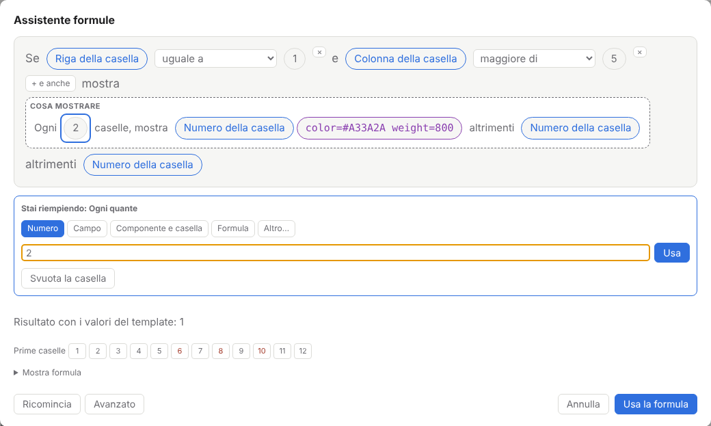

**Avanzato** mostra la formula come blocchi annidati: ogni funzione ha le sue caselle con un nome (per `IF`: **Condizione**, **Se vero**, **Se falso**) e sotto ogni casella il valore che dà sulla prima carta; **Formula** nel selettore raccoglie le funzioni per categoria (**Condizione**, **Selezione**, **Calcolo**, **Testo**, **Ricette**) e **Più casi** mostra una catena di `IF` come elenco di righe **Quando… Allora…** con **Altrimenti** in fondo. Le funzioni annidate già complete si chiudono in una riga con la loro formula e il risultato sotto; un clic le riapre. **⤢** accanto al nome di una funzione annidata la apre da sola, con il percorso in alto (per esempio **Formula › Se vero**) per tornare indietro. **Guidato** torna alla frase quando la formula ha ancora quella forma; **Ricomincia** riporta a **Cosa vuoi fare?**. **Usa la formula** scrive la formula nel campo; una formula aperta e non cambiata resta com'era.

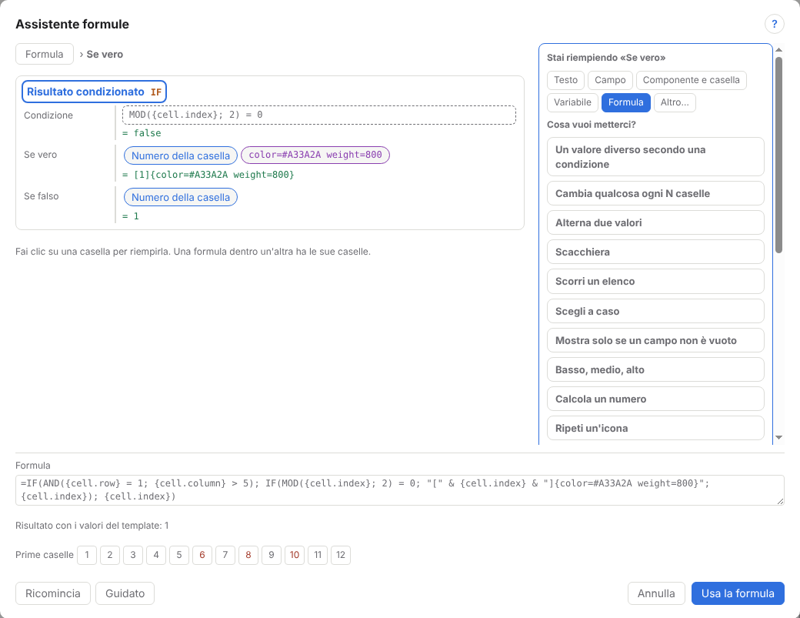

Su un livello **griglia** la formula vale per tutta la griglia (per esempio il colore delle caselle di una carta): per cambiare le caselle una per una la formula va su un livello del **contenuto delle caselle** (sezione 4.8). Per questo, su una griglia senza contenuto, la sezione **Contenuto delle caselle** ha **Testo in ogni casella** e **Forma in ogni casella**: creano un livello nella prima casella, lo chiudono in un gruppo e lo impostano come contenuto; per il testo si apre subito l'assistente. La stessa scelta è nella schermata iniziale dell'assistente come **Varia casella per casella**.

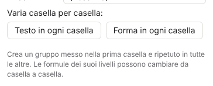

## 10. Generare le carte

**Genera…**, nel menu **Strumenti** del set, crea le righe combinando insiemi di valori. Ogni insieme ha una colonna di destinazione, un elenco di valori (uno per riga o separati da virgole; `1-5` diventa 1, 2, 3, 4, 5) e quanti valori mettere su ogni carta.

- Più insiemi si combinano in tutti i modi possibili: 6 semi e i numeri 1-5 danno 30 carte.
- Con più valori per carta si sceglie se ammettere le ripetizioni e se conta l'ordine. In **Limiti per valore** si fissano minimo e massimo per ciascun valore.
- **Come icona** scrive ogni valore come `{valore}`, così il testo mostra l'icona con quel nome.
- **Filtro** tiene solo le carte per cui un'espressione è vera, per esempio `COUNTIN({costo}; "oro") <= 1`.

L'anteprima mostra quante carte nasceranno e le prime righe. **Aggiungi in fondo** accoda le carte, **Sostituisci le carte** prende il posto di quelle esistenti. **Aggiorna le carte** scrive solo le colonne generate nelle carte già presenti, una per riga, lasciando le altre colonne come sono: per esempio si generano prima 30 carte da 6 semi e i numeri 1-5, poi con **Da una cartella…** si assegnano 30 ritratti alla colonna del ritratto. Se le carte generate sono di più, quelle in più si aggiungono in fondo. ⌘Z / Ctrl+Z annulla.

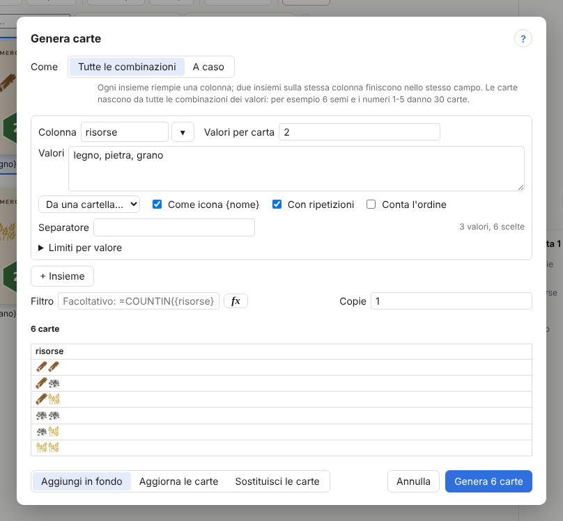

### 10.1 Dividere un'immagine tra le carte

**Dividi immagine…** distribuisce un'immagine grande tra le carte del set: messe in griglia una accanto all'altra, le carte la ricompongono (una mappa, un'illustrazione su più carte). Si scelgono il livello immagine del template, l'immagine, quante colonne e righe, da quale carta cominciare e l'ordine: per righe (da sinistra a destra, poi la riga sotto) o per colonne. Se mancano carte se ne aggiungono.

Ogni carta mostra la parte dell'immagine che sta sotto il suo livello, come se l'immagine coprisse tutta la griglia delle carte rifilate. Stella scrive nelle colonne della carta l'immagine (`livello.src`), il ritaglio (`livello.crop`) e l'adattamento **Allunga**; toglie la tinta, così un'icona del template non diventa una sagoma. L'abbondanza delle carte interne prende l'immagine delle carte vicine. Per le carte sul bordo ci sono due possibilità: se l'immagine comprende anche l'abbondanza intorno a tutta la griglia (casella apposita), la usa; altrimenti il livello si ferma al bordo dell'immagine e nell'abbondanza esterna si vede quello che c'è sotto. Le proporzioni giuste dell'immagine sono colonne × larghezza della carta per righe × altezza (più l'abbondanza, se compresa): se l'immagine è diversa la finestra lo dice, perché i pezzi risulterebbero un po' deformati. Si possono dividere i livelli immagine non ruotati e fuori dai gruppi.

## 11. Esportare

**Esporta…** apre una finestra che comincia da cosa vuoi fare: **Stampare a casa** (un PDF con i componenti affiancati, fronte e retro), **Tipografia** (un PDF con l'abbondanza e i segni di taglio), **Tabletop Simulator** o **Immagini**. Le prime due partono da un preset che si può poi cambiare. Per ognuna si scelgono i set e se ripetere le carte secondo la colonna `amount`. Le carte si disegnano con lo stesso motore dell'anteprima, comprese le modifiche non ancora salvate.

### 11.1 Immagini

Formato PNG, JPG, WebP o SVG, risoluzione (150, 300, 600 DPI o personalizzata), abbondanza inclusa o no, fronte, retro o entrambi, sfondo trasparente fuori dagli angoli arrotondati. I nomi dei file seguono un modello con `%set`, `%n` (numero della carta), `%copy`, `%side` e `{campo}`; una `/` crea sottocartelle.

L'SVG è vettoriale e non ha una risoluzione: si ingrandisce senza perdere qualità e si apre nei programmi di grafica (Inkscape, Illustrator, Affinity). Immagini e font del progetto sono dentro il file; i font installati sul computer no, e chi apre il file deve averli. I testi diventano testi SVG, una riga per elemento, quindi si modificano ma non vanno più a capo da soli.

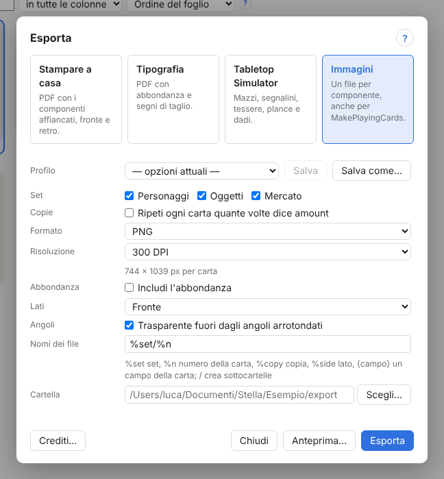

### 11.2 PDF di stampa

Il PDF è vettoriale, con i font incorporati. Si scelgono pagina e orientamento, margini, spaziatura e disposizione (quante carte ci stanno, o righe × colonne). Le altre opzioni:

- **Abbondanza**: con l'abbondanza le carte si toccano e i segni di taglio sono all'esterno.
- **Rotazione**: ruota le carte se altrimenti non entrano o ne entrano di più.
- **Poster**: divide su più pagine le carte più grandi della pagina, con una sovrapposizione.
- **Piegatura**: fronte e retro affiancati, da piegare.
- **Segni di taglio**: agli angoli o a linee intere, con lunghezza, spessore e colore.
- **Fronte-retro**: retri su pagine alternate, girando il foglio sul lato lungo o corto, con una correzione dello spostamento per le stampanti che non allineano i due lati. Per trovare la correzione giusta stampa prima una pagina sola, misura di quanto il retro è spostato rispetto al fronte guardando il foglio controluce e scrivi quel valore in **Spostamento retri**; poi stampa tutto. Il **Foglio di prova** serve a controllare le carte in piccolo prima di consumare carta.
- **Pagine**: con **Uno dopo l'altro sulla stessa pagina** un set comincia subito dopo il precedente invece che su una pagina nuova (10 + 8 carte con 9 per pagina stanno in 2 pagine invece di 3). Un set con carte di un'altra misura comincia su una riga nuova, se nella pagina c'è posto.
- **Foglio di prova**: un PDF a parte con tutte le carte in piccolo.
- **Converti in CMYK**: richiede Ghostscript installato sul computer.

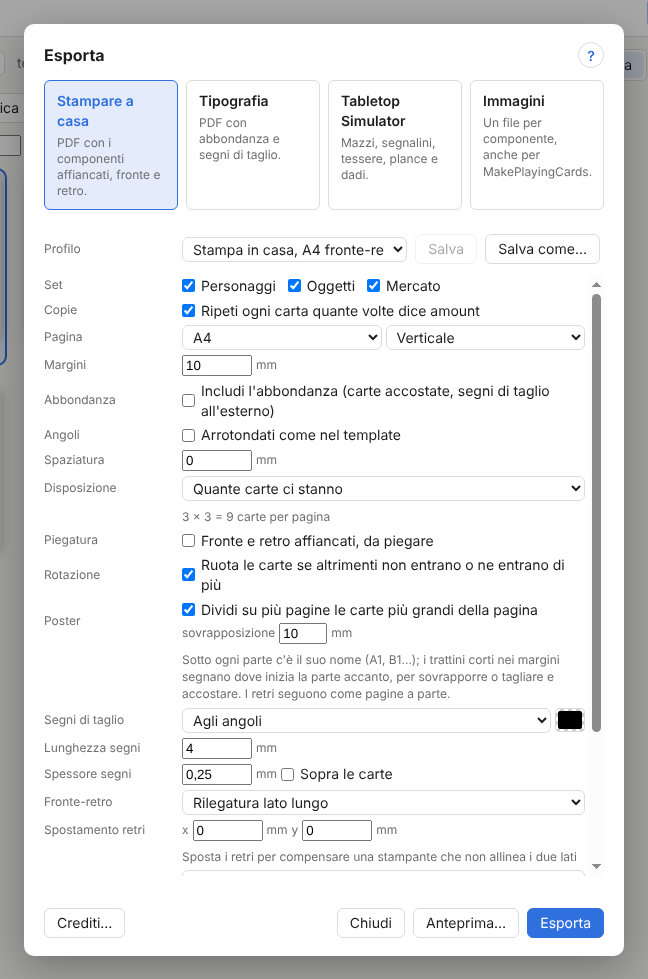

### 11.3 Anteprima

**Anteprima…** mostra i file che l'esportazione scriverà, senza scrivere nulla: le immagini con il nome del file, le pagine del PDF, i fogli di Tabletop Simulator. Si scorrono con ‹ › o con le frecce.

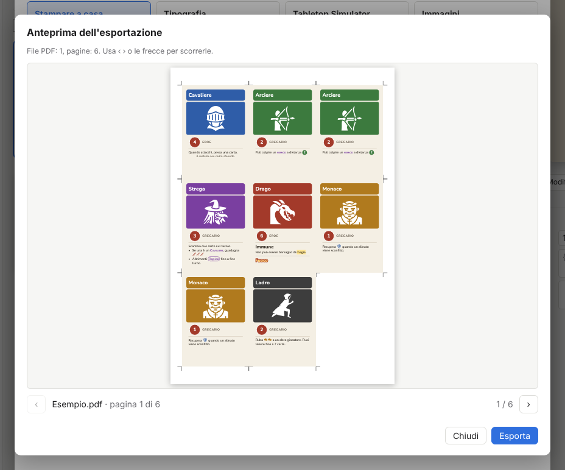

### 11.4 Tabletop Simulator

Crea per ogni set i fogli di carte (fino a 10 × 7, con la griglia scelta in automatico per ridurre gli spazi vuoti) e il file del mazzo da caricare in Tabletop Simulator. I file vanno nella cartella del progetto, in quella degli oggetti salvati di Tabletop Simulator o in entrambe (la scelta predefinita). Nickname e descrizione delle carte possono venire da un campo.

Con **Copie** attivo, **Copie nel foglio** decide dove finiscono le copie di una carta: una volta sola nel foglio, e il file del mazzo la moltiplica (è la scelta predefinita e tiene i fogli piccoli), oppure ripetute nel foglio quante volte dice `amount`. La seconda serve quando si caricano i fogli a mano in Tabletop Simulator, senza il file del mazzo: ogni posizione del foglio è una carta.

**Oggetti** sceglie per ogni set cosa creare in Tabletop Simulator:

- **Carte**: il mazzo dai fogli, come sopra.
- **Segnalini**: un'immagine per carta, ritagliata sulla forma della carta (rettangolo, angoli arrotondati, cerchio, esagono o sagoma). Tabletop Simulator ne fa un pezzo spesso con il bordo del colore dell'immagine; sotto mostra il fronte specchiato, quindi il retro della carta non si usa.
- **Pedine**: come i segnalini, ma in piedi sul tavolo. Si carica solo il fronte; la parte trasparente resta fuori dalla sagoma.
- **Tessere**: fronte e retro della carta. La forma (quadrata, arrotondata, esagonale o rotonda) viene dalla forma della carta; una sagoma diventa un quadrato. **Bordo** è il colore dello spessore.
- **Plance**: come le tessere (fronte, retro, bordo e spessore), ma non si impilano e non vanno in un sacchetto: ogni plancia, copie comprese, arriva sul tavolo accanto alle altre. Hanno sempre gli angoli arrotondati.
- **Dadi (6 facce)**: ogni sei carte del set fanno un dado, nell'ordine del foglio: la prima carta va sulla faccia 1, la seconda sulla 2 e così via; le facce opposte fanno 7 (1-6, 2-5, 3-4). Se le carte non sono un multiplo di sei, l'ultimo dado ripete le sue prime facce e l'esportazione lo segnala. Le copie del dado sono quelle (`amount`) della sua prima carta. Il valore che Tabletop Simulator mostra quando lo tiri è il campo scelto in **Nome** della carta, oppure il numero della faccia. Usa un template quadrato: la faccia del dado è quadrata, larga quanto la carta, e una carta rettangolare viene schiacciata. Stella scrive anche il modello del cubo (`models/<set>_d6.obj`) accanto alle immagini.

Per segnalini, pedine e tessere c'è lo **Spessore**. I pezzi di un set vanno in un sacchetto, copie comprese; un set con un pezzo solo diventa quel pezzo. Carte, segnalini, pedine e tessere arrivano in Tabletop Simulator nelle proporzioni vere: una carta da 63 mm ha la misura predefinita di Tabletop Simulator, e tutto il resto è più grande o più piccolo in proporzione. Le carte orizzontali, come una plancia larga quanto due carte, sono messe di traverso.

**Tag e snap point.** Nelle proprietà del template, sotto **Componente**, **Tag TTS** dà a ogni componente i suoi tag di Tabletop Simulator, separati da virgole. Ammette i `{campi}`, per esempio `{tipo}, carta`, e un mazzo prende i tag di tutte le sue carte. Due set con lo stesso template possono avere tag diversi: in **Oggetti**, accanto a ogni set, il campo **Tag TTS** parte dai tag del template e, se lo cambi, dà al set i tag scritti lì al posto di quelli del template. Uno **snap point** è un punto della plancia (o di una tessera, di un segnalino, di una carta) a cui gli oggetti si agganciano quando li si lascia vicino. Ce ne sono due modi:

- lo strumento **Snap** (P) aggiunge un livello che è solo uno snap point: nell'editor è un mirino blu, nelle stampe e nelle immagini non si vede, e il punto è il centro del suo riquadro;
- ogni altro livello ha in fondo alle proprietà la sezione **Tabletop Simulator** con **Snap point**: il punto va al centro del livello. Per una griglia l'opzione è **Snap point in ogni casella**, comoda per le caselle di una plancia.

In entrambi i casi **Tag dello snap** fa attirare al punto solo gli oggetti con uno di quei tag (vuoto: tutti), e **Ruotato** fa prendere all'oggetto anche una rotazione: di base quella del livello, oppure un **Angolo dello snap** a scelta. Sulla tela il mirino ha una freccetta che indica dove va il lato alto dell'oggetto. Gli snap point vengono dal fronte. Il pulsante **Snap** in basso nella tela nasconde i mirini senza togliere gli snap point dall'esportazione; l'occhio nel pannello livelli invece spegne il livello e quindi anche il suo snap point.

I fogli si richiamano con indirizzi locali, quindi il mazzo funziona sul computer che l'ha esportato. Per giocare online bisogna caricare le immagini su un servizio web e cambiare gli indirizzi in Tabletop Simulator.

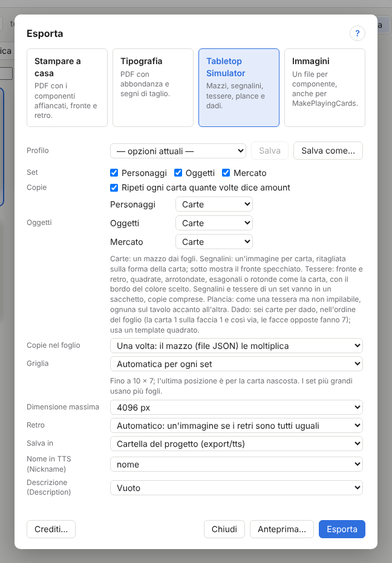

### 11.5 Profili e preset

**Profilo**, in cima alla finestra, sceglie un profilo salvato nel progetto o un preset: MakePlayingCards, The Game Crafter, stampa in casa su A4 o Letter. **Salva come…** salva le opzioni attuali come profilo con un nome, da rilanciare in seguito. Prima di ordinare conviene controllare le specifiche sul sito della tipografia, che possono cambiare.

### 11.6 Crediti

**Crediti…** compone il testo da mettere nel regolamento o sulla scatola, con le icone e i font importati dall'app raggruppati per fonte, licenza e autore. Di base elenca solo ciò che le carte usano. Il testo si copia o si salva in `export/credits.txt`. Le immagini copiate a mano in `assets/` non sono elencate.

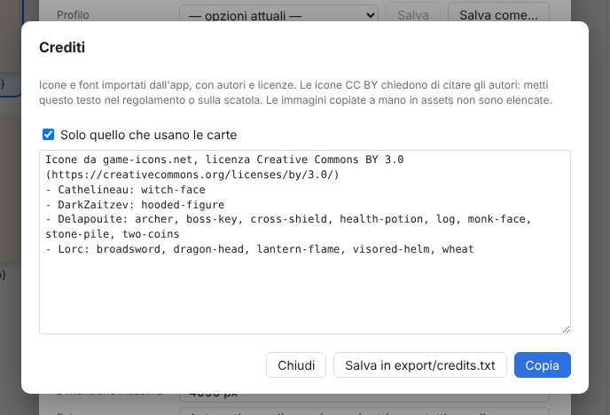

## 12. Documenti

Nella sezione **Documenti** della barra laterale si scrivono i testi che accompagnano il gioco: il regolamento, una sell sheet, un'appendice, le domande frequenti. Il + crea un documento, un clic lo apre al posto del set o del template aperto. A sinistra si scrive, a destra l'anteprima mostra la pagina mentre si scrive e segue il cursore; un clic su un punto dell'anteprima porta il cursore a quel punto del testo. Il nome si cambia dal titolo; il ⋯ accanto al titolo, e il clic destro sul documento nella barra laterale, hanno **Rinomina**, **Duplica** (una copia con il nome seguito da un numero) ed **Elimina**, che sposta il documento in `deleted`. I documenti si salvano da soli mentre si scrive, come file `docs/<nome>.md` del progetto, e si possono scrivere anche con un altro editor o da un agente IA.

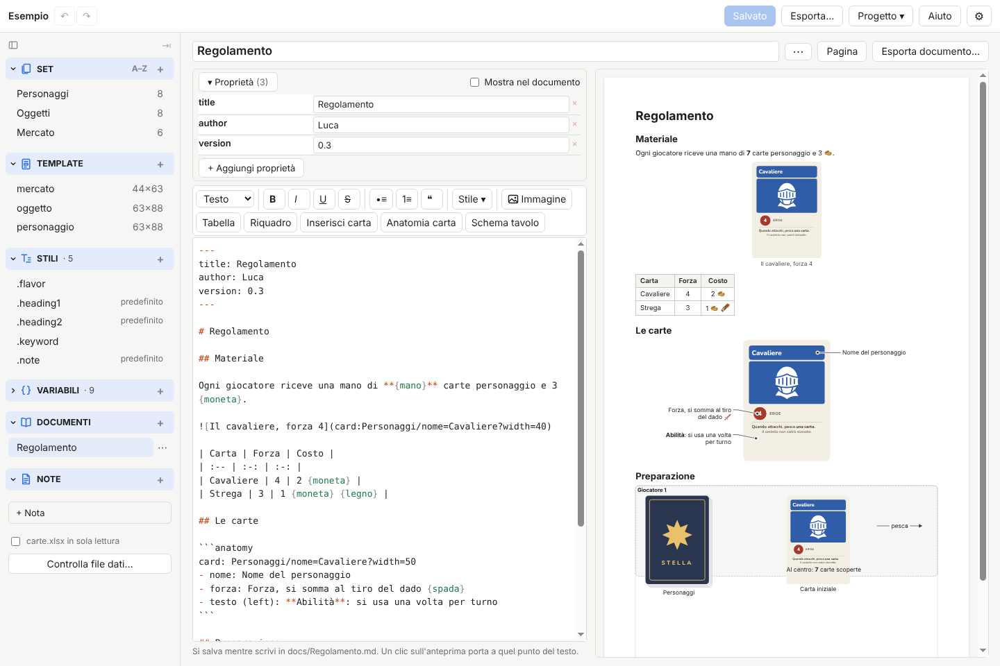

### 12.1 Scrivere e formattare

Sopra il testo c'è la barra di formattazione: il menu **Testo** fa della riga un titolo di primo, secondo o terzo livello o la riporta a paragrafo; **B**, _I_, U e S mettono o tolgono grassetto, corsivo, sottolineato e barrato al testo selezionato (senza selezione lasciano il cursore tra i due segni); i tre tasti successivi fanno delle righe scelte un elenco puntato, un elenco numerato o una citazione, e un secondo clic li toglie. **Stile** applica al testo selezionato uno stile del progetto e ha in fondo **Aa Formatta…**, la formattazione avanzata del [capitolo 6](#6-testo-e-markup). Gli ultimi tasti inseriscono un'immagine degli asset, una tabella, una carta, un'anatomia o uno schema del tavolo. La barra scrive nel testo il markup che si scriverebbe a mano, e ⌘Z / Ctrl+Z lo annulla.

Il testo è Markdown, con il markup di Stella del [capitolo 6](#6-testo-e-markup) dentro le righe:

| Scrivi                                      | Ottieni                                                             |
| ------------------------------------------- | ------------------------------------------------------------------- |
| `# Titolo`, `## Titolo`, `### Titolo`       | titoli di tre livelli                                               |
| una riga vuota                              | un paragrafo nuovo; un a capo semplice resta nello stesso paragrafo |
| `- voce`, `1. voce`                         | elenchi; una voce con due spazi davanti scende di un livello        |
| `> testo`                                   | un riquadro per una nota                                            |
| `\| a \| b \|` e sotto `\|---\|---\|`       | una tabella; `:--`, `:-:` e `--:` allineano la colonna              |
| `---`                                       | una linea                                                           |
| `{spada}`, `[testo]{.keyword}`              | icone, variabili e stili, come sulle carte                          |
| `{project.name}`, `{date}`                  | il nome del progetto e la data di oggi                              |
| ``     | una carta del gioco, con la didascalia "Il mago"                    |
| ``                      | un'immagine degli asset                                             |
| `` | un'immagine larga 40 mm, a destra                                   |

### 12.2 Carte e immagini

Le carte non si copiano nel documento: Stella le disegna dal progetto, quindi una modifica ai dati o al template si vede subito anche nel documento. **Inserisci carta** apre una finestra in cui si sceglie il set e la carta (si cerca per nome), il lato, la larghezza in millimetri (vuota per la misura vera) e la didascalia, e scrive il riferimento al posto del cursore. A mano si scrive `card:Set/3` per la carta della riga 3 oppure `card:Set/colonna=valore` per la carta che ha quel valore in una colonna; dopo un `?` si aggiungono `side=back` per il retro e `width=40` per la larghezza, unite da `&`, come in `card:Personaggi/nome=Mago?side=back&width=40`. Il valore di una colonna, come il nome, è più sicuro del numero, che cambia se le righe si riordinano. Più immagini sulla stessa riga del testo stanno affiancate.

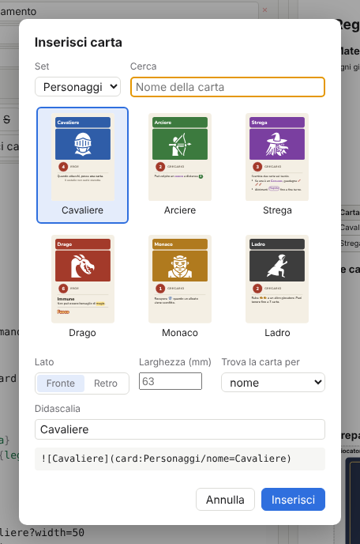

**Immagine** apre una finestra in cui si sceglie il file degli asset (con l'anteprima), la larghezza in millimetri (vuota per la misura dell'immagine, ridotta se non ci sta nella pagina), l'allineamento (a sinistra, al centro, a destra) e la didascalia. Con il cursore su un'immagine già scritta, lo stesso tasto la apre per modificarla. Nel testo le opzioni vanno dopo un `?`, come per le carte: ``. Anche le carte accettano `align=left` o `align=right`. L'allineamento vale per tutta la riga: con più immagini affiancate conta quello della prima che lo indica.

### 12.3 Tabelle e riquadri

**Tabella** apre una griglia da compilare: la prima riga è l'intestazione, ogni colonna ha il suo allineamento, **+ Riga** e **+ Colonna** la allargano e × toglie una riga o una colonna. Si possono incollare celle copiate da Excel o da un altro foglio di calcolo. Con il cursore dentro una tabella già scritta, lo stesso tasto la apre per modificarla. Nel testo la tabella diventa Markdown con le colonne allineate.

Nelle celle vale lo stesso markup del testo (stili, icone, variabili) e si possono mettere immagini e carte: si fa clic in una cella e si usa la barra sopra la griglia per grassetto, corsivo, stili e **Formatta…**, **Immagine** per un'immagine degli asset e **Inserisci carta** per una carta del progetto; nel testo si scrivono come `` e ``. Sotto la griglia, **Aspetto** sceglie la larghezza della tabella (in % del testo, 0 per quanto il contenuto), quella di ogni colonna (il campo % sopra la colonna), quali linee disegnare (tutte, solo tra le righe, solo il contorno, nessuna) con colore e spessore, e gli sfondi dell'intestazione, delle righe e di una riga sì e una no. L'aspetto si scrive in un commento sotto la tabella, `<!-- table width=90% columns=25,55,20 lines=rows header=#dde6f5 -->`, che gli altri programmi per il Markdown non mostrano. Le esportazioni HTML, PDF e Word lo mantengono; quella in Markdown tiene solo testo e immagini.


**Riquadro** mette uno sfondo colorato dietro una parte del documento: serve a dare risalto a un pezzo di testo o a staccare dal foglio immagini bianche senza bordo. Con delle righe selezionate le mette nel riquadro; senza selezione ne inserisce uno nuovo con un testo di prova. Si scelgono lo sfondo, un bordo (colore e spessore), lo spazio interno e gli angoli arrotondati; con il cursore dentro un riquadro lo stesso tasto lo modifica o lo toglie (**Togli il riquadro** lascia il contenuto). Nel testo il riquadro è fatto da due righe, `<!-- box fill=#fff3c4 border=#e0b000 -->` all'inizio e `<!-- /box -->` alla fine: tutto quello che c'è in mezzo (titoli, elenchi, tabelle, carte) prende lo sfondo. Le esportazioni HTML, PDF e Word lo mantengono, quella in Markdown no.

### 12.4 Anatomia della carta

**Anatomia carta** disegna una carta con le etichette che ne spiegano le parti, collegate da una linea ai livelli del template. La finestra ha due colonne: a sinistra si sceglie la carta come in **Inserisci carta**, a destra si vede l'anatomia come uscirà nel documento e sotto si spuntano i livelli da spiegare e si scrive l'etichetta di ciascuno. Sopra le etichette una piccola barra mette grassetto, corsivo, sottolineato, barrato o uno stile del progetto sul testo selezionato dell'etichetta in cui si sta scrivendo. Ogni etichetta va dal lato della carta più vicino al suo livello; carta ed etichette si riducono per stare nella pagina. Con il cursore dentro un'anatomia, lo stesso tasto la apre per modificarla. Nel testo l'anatomia è un blocco come questo, che si può anche scrivere a mano:


````
```anatomy
card: Personaggi/nome=Mago?width=50
- nome: Nome del personaggio
- forza: Forza, si somma al tiro del dado {spada}
- testo (left): **Abilità**: si usa una volta per turno
```
````

`card:` è la carta, scritta come nei riferimenti alle carte (anche con `side=back` e `width`). Ogni riga `- livello: etichetta` spiega un livello; `(left)` o `(right)` dopo il nome sceglie il lato. Con **Fronte e retro** nella finestra (nel testo la riga `sides: both`) le due facce stanno affiancate, con le etichette del fronte a sinistra e quelle del retro a destra; i livelli del retro si scrivono con `(back)`, per esempio `- logo (back): Il logo del gioco`. Nelle etichette si può usare il markup. Un livello che il template non ha viene segnalato sotto il testo e da `stella check`.

**Larghezza (% riga)** e **Didascalie (%)**, sotto la scelta della carta (nel testo le righe `width: 60%` e `font: 90%`), fanno occupare all'anatomia al massimo quella parte della larghezza della riga e cambiano il corpo delle etichette rispetto a quello di base. Restringendo l'anatomia si riducono prima le etichette e poi la carta, se non ha una larghezza scritta con `width=`.

### 12.5 Schema del tavolo

**Schema tavolo** disegna come preparare il tavolo, con le carte vere del progetto. Nella finestra i tasti **Zona**, **Carta**, **Mazzo**, **Testo**, **Freccia** e **Immagine** aggiungono un elemento; carte e mazzi si scelgono come in **Inserisci carta**, le immagini dagli asset. Il disegno occupa quasi tutta la finestra; **Schermo intero** gli dà tutta la finestra dell'app. Lo zoom si cambia con − e +, con ⌘/Ctrl + rotella del mouse, pizzicando il trackpad o con ⌘+ e ⌘− / Ctrl++ e Ctrl+−; **Adatta** (⌘0 / Ctrl+0) torna a mostrare tutto il disegno. Ingrandito, il disegno si sposta con le barre di scorrimento, con la rotella o trascinando con la barra spaziatrice premuta. Un elemento si sceglie con un clic e si sposta trascinandolo, o con le frecce della tastiera (1 mm, 5 con Maiusc); Maiuscolo o ⌘/Ctrl + clic aggiunge o toglie un elemento dalla scelta, un riquadro trascinato su uno spazio vuoto sceglie gli elementi che tocca e ⌘A / Ctrl+A li sceglie tutti. ⌘C, ⌘X e ⌘V / Ctrl+C, Ctrl+X e Ctrl+V copiano, tagliano e incollano gli elementi scelti, anche in un altro schema (gli elementi incollati compaiono 5 mm più in basso a destra), e ⌘D / Ctrl+D li duplica. Con più elementi scelti, trascinandone uno si spostano tutti, e il pannello a destra li allinea (lati, centri) e li distribuisce con spazi uguali in orizzontale o in verticale; la maniglia in basso a destra cambia la misura di zone, testi e immagini, quelle alle due estremità spostano gli estremi di una freccia. Carte, mazzi e immagini hanno sopra una maniglia tonda che li ruota attorno al centro (con Maiuscolo a scatti di 15°); nel pannello a destra **Rotazione** scrive i gradi esatti e **+90°** gira di un quarto. A destra si cambiano posizione e misure in millimetri, l'etichetta (o il testo, con la stessa barra di formattazione dell'anatomia), il numero di carte di un mazzo e la rotazione di 90° in 90°; **Ordine** porta l'elemento in primo piano, avanti, indietro o sullo sfondo rispetto agli elementi dello stesso tipo: le zone restano sempre sotto carte, mazzi e immagini, e testi e frecce sopra. **Duplica** ed **Elimina** fanno quel che dicono. **Immagine** e **Cambia immagine…** propongono anche le variabili immagine, che nello schema mantengono tinta, rotazione, ribaltamento, opacità e sfondo. Senza elemento scelto, **Misura del tavolo fissa** dà allo schema una misura in millimetri; senza, lo schema si adatta agli elementi. Nel documento lo schema si riduce per stare nella pagina, e le didascalie restano leggibili; **Larghezza (% riga)** lo restringe ancora, fino a quella parte della larghezza della riga, e **Didascalie (%)** cambia il corpo delle didascalie. Con il cursore dentro uno schema, lo stesso tasto lo apre per modificarlo. Nel testo è un blocco come questo, che si può anche scrivere a mano:


````
```setup
size 300x230
zone 0,0 300x112 "Giocatore 1"
deck Personaggi/1?side=back 10,10 count=6 "Personaggi"
card Personaggi/nome=Mago 165,10 rotate=90 "Il mago"
text 165,85 width=80 "Al centro: **{mano}** carte scoperte"
arrow 260,40 -> 290,40 "pesca"
image icone/moneta.png 270,75 width=12
```
````

Ogni riga è un elemento, con le misure in millimetri dall'angolo in alto a sinistra: `zone x,y LxA "etichetta"`, `card <carta> x,y`, `deck <carta> x,y count=N`, `text x,y width=L "testo"`, `arrow x,y -> x2,y2 "etichetta"`, `image <file> x,y width=L`. Carte, mazzi e immagini accettano `rotate=` con i gradi, in senso orario (per esempio `rotate=90` o `rotate=30`), e carte e mazzi e un'etichetta tra virgolette; la carta si scrive come nei riferimenti alle carte, con `%20` al posto degli spazi. `size LxA` fissa la misura del tavolo, `width 60%` fa occupare allo schema al massimo il 60% della riga e `font 90%` dà alle didascalie il 90% del corpo di base. Al posto del file di un'immagine si può scrivere una variabile immagine, come `image {moneta} 270,75 width=12`. Nei testi e nelle etichette si può usare il markup. Le righe che non si capiscono e le carte che non si trovano vengono segnalate sotto il testo e da `stella check`.

### 12.6 Proprietà e pagina

**Proprietà**, sopra la barra, raccoglie le note sul documento, come le proprietà di Obsidian: titolo, autore, versione, tag o altro. Ogni proprietà ha un nome (lettere, cifre, `-` e `_`) e un valore; un elenco, segnato con ≡, ha le voci separate da virgole. **+ Aggiungi proprietà** ne aggiunge una, × la toglie. Le proprietà sono scritte in testa al file tra due righe `---`, in YAML, insieme alle impostazioni della pagina, e un documento scritto con Obsidian o con un altro editor Markdown le conserva. Non si stampano: con **Mostra nel documento** compaiono in una tabella in testa alla pagina, anche nelle esportazioni.

**Pagina** apre a destra le impostazioni del documento: formato (A4, A5, Letter), margini, carattere del testo e dei titoli, dimensione del testo, interlinea, spazio dopo i paragrafi, allineamento (a sinistra o giustificato) e colore del testo e dei titoli. L'anteprima mostra la pagina alla sua larghezza vera, ridotta se non ci sta. Le impostazioni sono scritte in testa al file, tra due righe `---`, come `size: 12` o `lineHeight: 1.6`: si possono cambiare anche lì, e **Torna ai valori di base** le toglie.

### 12.7 Esportare un documento

**Esporta documento…** salva il documento in `export/docs/` del progetto in quattro forme: **PDF**, da stampare o inviare, con il formato e i margini del documento (solo nell'app per computer); **HTML**, una pagina web in un solo file, con carte, immagini e font dentro; **Word**, un file `.docx` da modificare in Word o LibreOffice, con titoli, elenchi, tabelle e citazioni come stili di Word, formato pagina, margini e caratteri del documento, e carte, schemi e immagini come PNG; **Markdown**, testo semplice per altri programmi, con le carte in PNG a 300 dpi e le immagini in una cartella accanto (`<nome> images`). Nel Markdown restano grassetto, corsivo e barrato; gli altri stili si perdono. Le carte e le immagini che non si trovano restano fuori, e la finestra lo ricorda se il documento ha dei problemi. Finita l'esportazione, **Apri il file** apre il file con il programma predefinito e **Apri la cartella** la cartella che lo contiene. Nella versione web **Apri il file** mostra PDF, HTML e Markdown in una nuova scheda del browser; per il Word non compare, perché il file è già nella cartella del progetto.

Sotto il testo compaiono i problemi: carte che non si trovano, immagini che non sono negli asset, nomi tra graffe sconosciuti; un clic porta al punto del testo. `stella check` li segnala insieme a quelli delle carte, `stella docs` mostra i documenti a un agente IA e `stella export-doc` li esporta senza aprire l'app (vedi [cli.md](../cli.md)).

## 13. Backup

**Backup…**, nel menu **Progetto**, apre i backup del progetto. Di base l'app crea un backup automatico all'apertura del progetto (al massimo uno all'ora) e ne tiene gli ultimi 10; quelli fatti con **Crea un backup ora** non si cancellano da soli. Nel campo accanto al pulsante si può dare un nome al backup, per ricordare cosa contiene (per esempio «prima delle nuove regole»); un clic sul nome nell'elenco lo cambia, anche per i backup automatici, che con un nome non si cancellano più.

I backup stanno fuori dal progetto, di base in `Documenti/Stella/Backup`. Le immagini si salvano una sola volta per tutti i backup del progetto, quindi un backup in più occupa poco spazio. **Ripristina…** estrae il backup in una cartella nuova accanto al progetto e la apre: il progetto attuale non viene toccato.


## 14. Importare da Tabletop Creator

**Importa da Tabletop Creator…** converte un progetto di Tabletop Creator in un progetto Stella nuovo: template, set, variabili e immagini. La cartella originale viene solo letta.

Si indicano la cartella del progetto Tabletop Creator (quella con il file `.tcp` e la cartella `data`), la cartella del nuovo progetto, che deve essere nuova o vuota, e facoltativamente una cartella in cui cercare le icone della libreria. Le icone di game-icons.net e Kenney si prendono dai cataloghi dell'app.


Al termine l'app elenca ciò che non ha potuto convertire, per esempio le maschere delle immagini e le immagini a 9 sezioni, e i font usati che non sono installati.

## 15. Lavorare con un agente IA

Un agente IA che esegue comandi sul computer (per esempio Claude Code, Codex o Cursor) può leggere e modificare i progetti Stella, cercare i problemi e disegnare le carte per controllarle. Gli serve la **skill** di Stella, un testo di istruzioni.

**Strumenti IA…**, nel menu ⚙ di ogni schermata (e nel menu **Aiuto** dell'app per computer), mostra la skill con il comando `stella` di questo computer già inserito:

1. **Copia la skill**.
2. Incollala nell'agente e chiedigli di installarla come skill (o come istruzioni del progetto, se non gestisce le skill). In alternativa **Salva come file…** la scrive in una cartella di skill; Claude Code le legge da `.claude/skills` nella cartella utente o in un progetto.
3. Chiedi all'agente quello che ti serve, indicando la cartella del progetto.


Il progetto può restare aperto in Stella mentre l'agente lavora. Prima di modificarlo l'agente lo chiede all'app con `stella begin`: se ci sono modifiche non salvate si ferma e ti chiede di salvare; altrimenti Stella mostra che un'IA sta lavorando e non si usa finché l'agente non ha finito (`stella end`), poi ricarica il progetto da sola. Se l'agente si interrompe senza sbloccare l'app, **Sblocca ora** la libera. Con una skill copiata prima della versione 1.2.0-beta.3 l'agente non lo sa fare: copiala di nuovo.

Il comando `stella` si può usare anche direttamente, per esempio in uno script. I comandi principali:

| comando                                                         | cosa fa                                                                                                                          |
| --------------------------------------------------------------- | -------------------------------------------------------------------------------------------------------------------------------- |
| `info <progetto>`                                               | set, template e livelli, variabili, stili, asset, profili di esportazione                                                        |
| `check <progetto> [--set S] [--lang L]`                         | i problemi delle carte e dei documenti (immagini o font mancanti, variabili sconosciute, errori di formule, traduzioni mancanti) |
| `check-data <progetto>`                                         | come viene letto il file dei dati, come **Controlla file dati…**                                                                 |
| `rows <progetto> <set>`, `set-rows <progetto> <set> <file>`     | leggono e scrivono le righe di un set (con un backup prima)                                                                      |
| `stats <progetto> <set>`                                        | quante carte hanno ogni valore, come **Statistiche…**                                                                            |
| `render <progetto> [--set S] [--card 1,3,5-7] [--lang L]`       | disegna le carte in PNG                                                                                                          |
| `export <progetto> --profile NOME [--lang L\|all]`              | esegue un profilo di esportazione salvato                                                                                        |
| `export-doc <progetto> [<nome>] [--format pdf\|html\|docx\|md]` | esporta i documenti                                                                                                              |
| `notes`, `docs`                                                 | leggono le note e i documenti del progetto                                                                                       |
| `rename-set`, `rename-template`, `pull-sheets`, `new`           | rinominano, scaricano da Google Sheets, creano un progetto                                                                       |
| `begin`, `end`                                                  | aprono e chiudono il lavoro di un agente sul progetto                                                                            |

Tutti i dettagli, le opzioni e come lanciare il comando su ogni sistema sono in [docs/cli.md](../cli.md).

## 16. La versione web

Stella funziona anche nel browser, senza installare nulla, all'indirizzo <https://stella.lucadj.eu/app/> (la versione beta in `/beta/`). Serve dove un programma non si può installare, per esempio sui computer di lavoro che bloccano i programmi non firmati. Lavora sulle cartelle dei progetti del tuo computer: i progetti sono gli stessi file dell'app, e si possono aprire ora con l'una ora con l'altra.

Servono Chrome, Edge o Opera (Brave solo dopo aver attivato `brave://flags/#file-system-access-api`); Firefox e Safari non hanno l'accesso alle cartelle che serve. A ogni sessione il browser chiede il permesso sulla cartella del progetto, quando lo apri.

Cosa cambia rispetto all'app per computer (l'elenco è anche in fondo alla schermata di ingresso, in **Cosa ha in più la versione desktop**):

- il PDF passa dalla finestra di stampa del browser, da cui si sceglie **Salva come PDF** (margini nessuno, grafica di sfondo attiva); non c'è la conversione in CMYK;
- per Tabletop Simulator si sceglie la cartella di destinazione con **Scegli…** e la prima volta si incolla il suo percorso completo nel campo sotto, perché il browser non lo dice e il file del mazzo ne ha bisogno;
- i backup senza una cartella scelta restano nel browser, e si perdono cancellando i dati del sito: conviene scegliere una cartella;
- i font di Google arrivano solo con l'alfabeto latino; i font del computer si copiano solo in Chrome ed Edge, dopo il permesso;
- i cataloghi di icone e font sono quelli della versione pubblicata e non si aggiornano;
- non ci sono il comando `stella` e il controllo degli aggiornamenti (il sito è sempre all'ultima versione), e la dimensione dell'interfaccia si regola con lo zoom del browser.

## 17. I file del progetto

```
Esempio/
  stella.json            nome, file dei dati, set, stili, variabili, profili di esportazione
  data/carte.xlsx       un foglio per set (o .ods, o .csv per un solo set)
  templates/<nome>.json un file per template
  docs/<nome>.md        documenti: regolamento, sell sheet, appendici
  notes/<nome>.md       note del progetto
  assets/               immagini e icone, anche in sottocartelle
  assets/fonts/         font del progetto
  assets/sources.json   provenienza e licenza di icone e font importati
  export/               file esportati, si possono rigenerare
  deleted/              template e fogli dei set eliminati, da cui si possono recuperare
```

Il progetto è autonomo: copiando la cartella su un altro computer si vede uguale, a parte i font installati solo sul primo. I dettagli del formato sono in [docs/formato.md](../formato.md).

## 18. Scorciatoie da tastiera

Ogni scorciatoia è scritta prima con il tasto ⌘ del Mac e poi, dopo la barra, con Ctrl per Windows e Linux.

| Dove          | Tasti                                            | Azione                                                                                                       |
| ------------- | ------------------------------------------------ | ------------------------------------------------------------------------------------------------------------ |
| ovunque       | ⌘S / Ctrl+S                                      | salva template, dati e impostazioni                                                                          |
| ovunque       | ⌘O / Ctrl+O, ⌘W / Ctrl+W                         | apre e chiude il progetto (app per computer)                                                                 |
| set           | ⌘Z / Ctrl+Z, ⇧⌘Z / Ctrl+Maiusc+Z                 | annulla e ripete le modifiche ai dati                                                                        |
| ovunque       | ⌘+, ⌘−, ⌘0 / Ctrl+, Ctrl−, Ctrl+0                | ingrandisce, riduce e riporta normale l'interfaccia (app per computer)                                       |
| set           | ⌘A / Ctrl+A, Esc                                 | seleziona tutte le carte, torna a una sola                                                                   |
| tabella       | Alt+Invio                                        | a capo dentro una cella                                                                                      |
| testo         | `{`, poi ↑ ↓, Invio                              | suggerimenti di campi e variabili                                                                            |
| editor        | ⌘Z / Ctrl+Z, ⇧⌘Z / Ctrl+Maiusc+Z (o ⌘Y / Ctrl+Y) | annulla e ripete                                                                                             |
| editor        | T, R, E, I, G, V                                 | nuovo testo, rettangolo, ellisse, immagine, griglia, valore                                                  |
| editor        | ⌘F / Ctrl+F                                      | cerca nel pannello delle proprietà                                                                           |
| editor        | ⌘D / Ctrl+D                                      | duplica i livelli selezionati                                                                                |
| editor        | ⌘C / Ctrl+C, ⌘X / Ctrl+X, ⌘V / Ctrl+V            | copia, taglia e incolla livelli tra template                                                                 |
| editor        | ⌘G / Ctrl+G, ⇧⌘G / Ctrl+Maiusc+G                 | raggruppa e separa                                                                                           |
| editor        | ⌘A / Ctrl+A                                      | seleziona tutti i livelli                                                                                    |
| editor        | Canc                                             | elimina i livelli selezionati                                                                                |
| editor        | frecce, ⇧ + frecce                               | sposta di 0,5 mm o di 5 mm                                                                                   |
| editor        | Esc                                              | toglie la selezione o esce dal gruppo                                                                        |
| tela          | Maiuscolo trascinando                            | sposta solo in orizzontale, in verticale o a 45°; inverte il blocco delle proporzioni; ruota a scatti di 15° |
| tela          | ⌘ / Ctrl ridimensionando                         | ridimensiona dal centro                                                                                      |
| tela          | Alt trascinando                                  | sposta senza agganciarsi                                                                                     |
| tela, griglia | ⌘ / Ctrl + rotella                               | zoom                                                                                                         |
| set           | PagSu, PagGiù                                    | carta precedente o successiva, anche mentre si scrive nel modulo                                             |
| carta         | doppio clic, Ctrl+Invio, Esc                     | modifica un livello sulla carta, chiude la modifica, la annulla                                              |
| carta, editor | Alt+clic                                         | seleziona il livello che sta sotto                                                                           |
