# Stella user guide

Stella is an app for making cards and other printed game components from a spreadsheet. You design the card layout once, the **template**, and every row of the spreadsheet becomes a card. Cards are exported as images, as print-ready PDFs or as Tabletop Simulator objects: decks, tokens, tiles, boards and dice, ready to load into the game.

This guide follows the usual order of work: create a project, design a template, enter the cards, refine texts and images, export. The examples come from a small project with three sets: characters, items and market cards.

Video tutorials on YouTube: [an overview of the basic functions](https://www.youtube.com/watch?v=JOD09G8No_c) (3 minutes) and [your first component from scratch](https://www.youtube.com/watch?v=_sPWwTv96P0) (8 minutes), no voice.

Versione italiana: [../guida/README.md](../guida/README.md).

## Contents

- [Installing Stella](#installing-stella)

1. [Basic concepts](#1-basic-concepts)
2. [Start screen](#2-start-screen)
3. [The project window](#3-the-project-window)
4. [Designing a template](#4-designing-a-template)
5. [Entering and editing cards](#5-entering-and-editing-cards)
6. [Text and markup](#6-text-and-markup)
7. [Variables and styles](#7-variables-and-styles)
8. [Images, icons and fonts](#8-images-icons-and-fonts)
9. [Formulas and calculated fields](#9-formulas-and-calculated-fields)
10. [Generating cards](#10-generating-cards)
11. [Exporting](#11-exporting)
12. [Documents](#12-documents)
13. [Backup](#13-backup)
14. [Importing from Tabletop Creator](#14-importing-from-tabletop-creator)
15. [Working with an AI agent](#15-working-with-an-ai-agent)
16. [The web version](#16-the-web-version)
17. [Project files](#17-project-files)
18. [Keyboard shortcuts](#18-keyboard-shortcuts)

## Installing Stella

Download Stella from the [Download section of the website](https://stella.lucadj.eu/#download), which offers the right file for your system, or from the [releases page on GitHub](https://github.com/lucadj77/stella/releases), which has every version. It's free and needs no account.

Stella is not signed with an Apple or Microsoft certificate: those certificates cost hundreds of dollars a year, and Stella is a free project. So the first time you open it, macOS and Windows show a warning and ask you to confirm. The program is the same one you find on GitHub, with public source code; you confirm only once, then Stella opens normally, also after automatic updates.

### Mac

1. Pick the file for your processor: `Stella-<version>-mac-arm64.dmg` for Macs with an Apple chip (M1 and later), `Stella-<version>-mac-x64.dmg` for those with an Intel processor. If you don't know which one you have: Apple menu → **About This Mac**, under **Chip** or **Processor**.
2. Open the .dmg and drag the Stella icon onto the **Applications** folder. Then eject the Stella disk from the Finder sidebar. Keep Stella in Applications (or another folder you can write to): opened from the downloaded disk, it doesn't update itself.
3. Open Stella from Applications or Launchpad. macOS says it can't verify that the app is free of malware: press **Done** (or **OK**), not **Move to Trash**.
4. Open **System Settings → Privacy & Security** and scroll down to the **Security** section: there's the line "Stella" was blocked to protect your Mac. Press **Open Anyway** and confirm with your password or Touch ID.
5. Open Stella again and, in the last warning, press **Open**. From then on you won't be asked again.

On macOS versions before Sequoia (15), a right-click (or Control-click) on the app in Applications → **Open** → **Open** also works.

If macOS says Stella "is damaged and can't be opened", or **Open Anyway** doesn't appear, remove the block from Terminal (Applications → Utilities → Terminal):

```bash
xattr -dr com.apple.quarantine /Applications/Stella.app
```

### Windows

1. Download `Stella-<version>-windows-setup.exe`. Edge or Chrome may warn that the file isn't commonly downloaded: in the downloads panel open the **…** menu next to the file and choose **Keep** (in Edge then **Show more → Keep anyway**).
2. Open the file. The blue SmartScreen window "Windows protected your PC" appears: press **More info** and then **Run anyway**. If Windows asks whether to allow the app to make changes, answer **Yes**.
3. Follow the installer: you can choose whether to install Stella just for you or for all users, and the folder. At the end Stella is in the Start menu and on the desktop.

The **portable** version, `Stella-<version>-windows-portable.exe`, doesn't install: it starts with a double-click, also from a USB stick, and keeps its data (recent projects, preferences) in the `Stella data` folder next to the file. It also goes through SmartScreen the first time. It doesn't update itself: when a new version comes out, Stella tells you and opens the page to download it.

On work computers the administrator may block unsigned programs entirely. In that case there's the [web version](#16-the-web-version), which doesn't install.

### Linux

- **AppImage** (`Stella-<version>-linux-x86_64.AppImage`), for any distribution: make it executable and start it. From the file manager: right-click → Properties → Permissions → "Allow executing file as program"; or from the terminal:

  ```bash
  chmod +x Stella-*-linux-x86_64.AppImage
  ./Stella-*-linux-x86_64.AppImage
  ```

  The AppImage needs libfuse2: on Ubuntu 24.04 and later `sudo apt install libfuse2t64`, on earlier versions `sudo apt install libfuse2`. It updates itself.

- **.deb package** (`Stella-<version>-linux-amd64.deb`), for Debian, Ubuntu and derivatives: `sudo apt install ./Stella-<version>-linux-amd64.deb`. Stella appears among the applications and also starts with the `stella` command. It doesn't update itself: for a new version, install the new .deb the same way.

### Uninstalling

On the Mac, drag Stella from the Applications folder to the Trash; on Windows, use **Settings → Apps → Installed apps → Stella → Uninstall**; on Linux, delete the AppImage, or `sudo apt remove stella`. Your projects stay where you saved them: they are ordinary folders, which Stella never deletes.

## 1. Basic concepts

| Term         | What it is                                                                                                                    |
| ------------ | ----------------------------------------------------------------------------------------------------------------------------- |
| **project**  | a folder on disk with the `stella.json` file, the data file, the templates and the assets                                     |
| **template** | the design of a card: format, bleed and a stack of **layers** (texts, images, shapes, groups), for the front and for the back |
| **set**      | a group of cards that use the same template; it matches a sheet of the data file (`data/cards.xlsx`)                          |
| **layer**    | an element of the template. The layer name is also the name of the sheet column it takes its value from                       |
| **asset**    | the project's images, icons and fonts, in the `assets/` folder                                                                |
| **variable** | a name you call in texts with `{name}`: an icon, a formatted text, a color or a value                                         |
| **style**    | a named set of text attributes, applied to a layer, a paragraph or a word                                                     |

Data and design are always linked the same way: in the template, the text layer `name` shows on each card the content of the `name` column of its row.

Sizes are in millimeters, text sizes in points. Markup and formula keywords are in English and do not change with the interface language.

## 2. Start screen

When it starts, Stella shows the start screen.

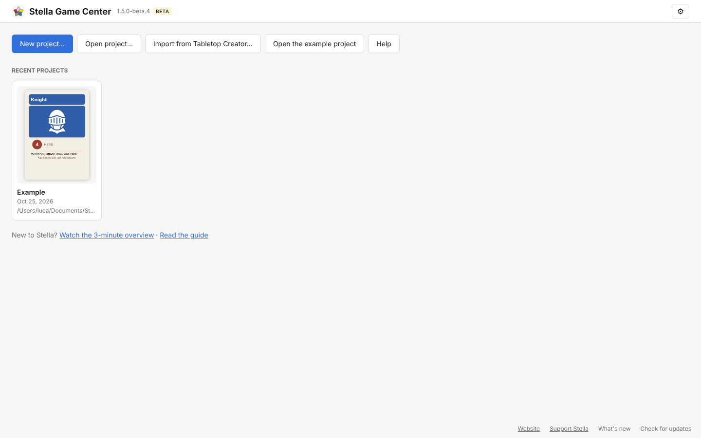

- **New project…** creates an empty folder with the structure of a project.
- **Open project…** opens a folder that contains `stella.json`. Projects created when the app was called Naibi (`naibi.json`) or GameCreator (`gamecreator.json`) open too.
- **Import from Tabletop Creator…** converts a Tabletop Creator project ([chapter 14](#14-importing-from-tabletop-creator)).
- **Open the example project** opens the project used in this guide and in the videos: three sets (Characters, Items, Market), icons, variables and styles. The first time it is copied into Documents/Stella/Example, where it can be changed freely; after that the copy is opened. Not available in the web version.
- **Recent projects** shows up to 24 projects, with their first card as thumbnail. The × removes a project from the list without deleting the folder.

The ⚙ button at the top right, on every screen, opens the settings: the interface size, the theme (light, dark or the system's), the language (English or Italian) and **AI tools…**, which prepares an AI agent to work on projects ([chapter 15](#15-working-with-an-ai-agent)).

When a new version is out, a strip appears at the top of the window at startup: **What's new** shows what changes, **Update and restart** downloads the new version, installs it and reopens Stella. This works for Stella installed with the setup on Windows, for the AppImage on Linux, and on the Mac for the app in Applications (or another folder you can write to); if there are unsaved changes Stella asks first. The Windows portable version, the .deb package and an app opened from the downloaded disk image have **Download** instead, which opens the page to download it; the same happens if the automatic update fails. **Skip this version** stops showing it, **Remind me later** hides it until the next start.

In the ⚙ menu, **Updates** chooses the channel. **Stable** offers only official versions; **Beta** also offers the test versions, which bring new features earlier but may have a few more bugs. If you already had a beta, you are on Beta. Going from Beta back to Stable does not install an older version: Stella waits for the next official one.

On the start screen, at the bottom right, **What's new** shows what changed in the installed version, even offline, and **Check for updates** asks GitHub right away whether a newer version exists, and says so when you already have the latest.

To create a project you write its name and location. The default location is `Documents/Stella`; the data file can be Excel (`.xlsx`, recommended) or OpenDocument (`.ods`). With **A file you already have (.xlsx, .ods, .csv)…**, under **Data file**, the project starts from a file you already have: Stella makes a copy in the project's `data` folder and its sheets become sets with **New set** (see [Using an Excel file you already have](existing-excel.md)).

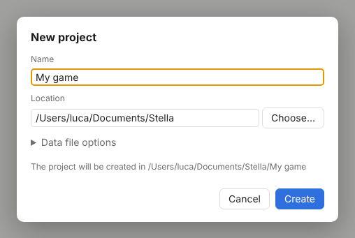

A new project is empty: the app suggests creating a template first, then a set that uses it.

## 3. The project window

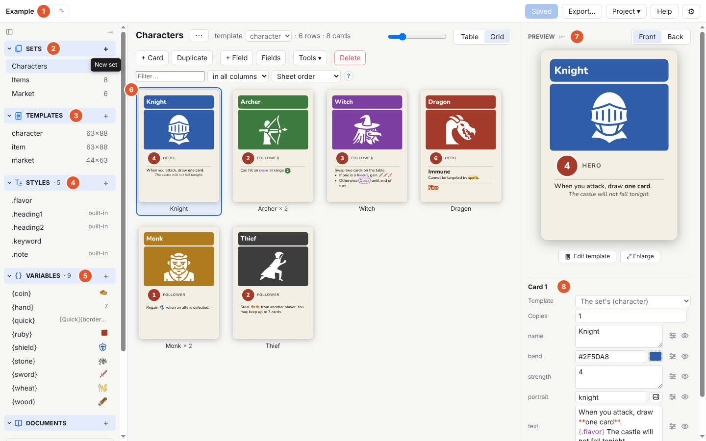

1. **Top bar.** Project name (hover it to see the folder), undo and redo (they apply to what is open: the cards, styles and variables, or the template in the editor), the card language menu (only in projects with several languages), **Save** (⌘S / Ctrl+S), **Export…**, the **Project** menu, **Help** (F1, [chapter 6](#6-text-and-markup)) and ⚙ for the settings. The **Project** menu holds the commands used less often: **Backup…**, **Trash…**, **Google Sheets…**, **Languages…** ([5.7](#57-cards-in-several-languages)), **Reload from disk** (reads the project again, losing unsaved changes) and **Close project**.
2. **Sets.** A click opens the cards of the set; the number is the total of cards, copies included.
3. **Templates.** A click opens the template in the editor; next to it is the format in millimeters.
4. Project text **styles** ([chapter 7](#7-variables-and-styles)).
5. Project **variables**, with a preview.
6. **Cards of the set**, in a table or a grid.
7. **Preview** of the selected card, front or back. **Edit template** opens the card's template, that is the set's or the one chosen for the card; **Enlarge** opens the card large with the form next to it.
8. **Fields of the selected card**, editable like the table cells.

The ⋯ button next to the name of the open set or template opens a menu to rename it, duplicate it, delete it and, for a template, create a derived one (**Derive**). The same menu opens from the ⋯ that appears when you hover an item in the sidebar, or with a right click on the item. Renaming a set also renames its sheet in the data file (if the sheet is already in the file Stella asks first, because formulas in other sheets that refer to it would break); renaming a template renames its file, and the new name goes into the sets, derived templates and `template` column of the cards that use it. Files are renamed when you save. A deleted template goes to the project's `deleted` folder. The sheet of a deleted set also leaves the data file when you save and goes to `deleted` as a file of its own, so its name is free again. **Trash…**, in the **Project** menu, lists what is in `deleted` (templates, sets, notes and documents, newest first) and **Restore** puts an item back in the project: a set gets the template you choose (Stella proposes the one with most columns in common), a name already taken gets a number. Restored templates and sets leave the trash when you save. Sidebar items are reordered by dragging them; the + next to each heading creates a new item. Styles and variables can be split into groups with the **Group** field of their window: the items of a group sit under its heading, which closes and opens with a click, after the items without a group. An item dragged onto a group heading joins that group; dragged onto another item, it takes that item's group (or none). With more than 12 items, a field above the list filters them by name. In the window of a style or variable, **Where it is used** lists the templates (with their layers), the sets (with card numbers) and the other variables and styles that refer to it; clicking a template or set opens it. Hovering over an item shows a preview: the first cards of a set, the front and back of a template, a sentence in a style, the icon or color of a variable. The **Notes** section holds notes about the project: the + creates a note, a click opens it in a panel beside any screen, where you write in Markdown (**Preview** shows it formatted) and rename it from its title. A note already written opens in **Preview**, a new one ready for writing. Notes save themselves as you type, as `notes/<name>.md` files of the project; the bin moves them to `deleted`. An AI working on the project reads them with `stella notes`. The button at the top left collapses the sidebar to icons, and the arrows next to panel headings move panels to the other side of the window.

Changes stay in memory until you save. The **Save** button reads **Saved** when there is nothing to write.

In the desktop app the same commands are also in the app menu (on the Mac in the bar at the top of the screen, on Windows and Linux with the Alt key): **File** (open, save, export, backup, trash, Google Sheets, reload, close), **Edit**, **View** (interface size with ⌘+, ⌘− and ⌘0 / Ctrl+, Ctrl− and Ctrl+0, full screen) and **Help**.

## 4. Designing a template

### 4.1 Creating a template

The + next to **Templates** opens the new template window: name, format (poker, bridge, mini, tarot, square, A6 or custom) and size. The lock between width and height keeps the proportions.

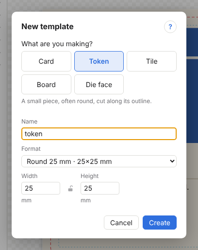

### 4.2 The editor

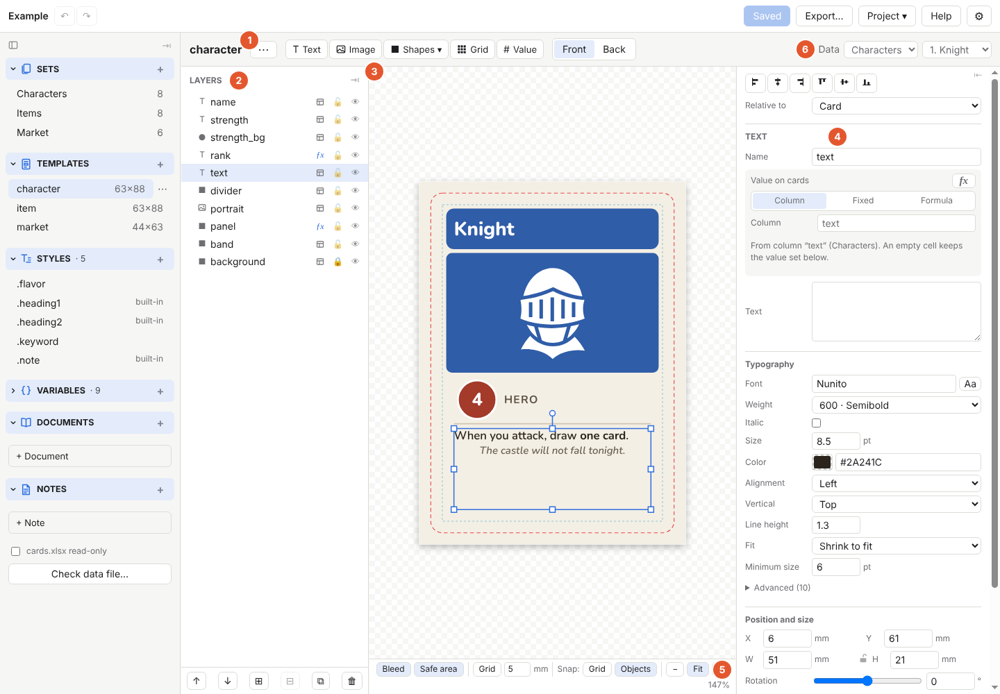

1. **Tools** to add a layer: text (T), image, rectangle (R), ellipse (E), polygon, star, line, grid and value (#). **Front** and **Back** switch between the sides of the card; the arrows undo and redo.
2. **Layers**, top to bottom as they overlap on the card. Next to each layer are the source of its value (sheet column, or _fx_ for a formula), the lock and the eye to hide it.
3. **Canvas** with the card. The red dashed line is the trim edge, the area outside it is the bleed, the light blue dashed line is the safe area.
4. **Properties** of the selected layer, or of the template when nothing is selected.
5. **Canvas bar**: shows or hides bleed, safe area and grid, chooses what to snap to (grid, objects) and sets the zoom.
6. **Data**: draws the canvas with the values of a card from a set, instead of the template values.

On the canvas you move layers by dragging them, resize them with the handles and rotate them with the round handle at the top (Shift for 15° steps). Holding Shift while moving, the layer moves only horizontally, vertically or at 45°, whichever direction is closest. While resizing, Shift switches the proportion lock (keeps proportions when they are free, frees them when they are locked) and ⌘ / Ctrl resizes from the center; the two can be combined. While dragging, edges snap to the grid, to other layers and to guides; holding Alt drags freely. Alt+click selects the layer underneath the selected one at the same spot: useful when a larger layer covers others. A layer that is already selected, also when chosen this way or in the layer list, can be dragged even where another layer covers it; a click without dragging selects the one on top instead. The arrow keys move the layer by 0.5 mm, with Shift by 5 mm.

In the layer list you drag a layer to change its order, or onto the middle of a group to move it inside. Shift or ⌘ / Ctrl selects several layers; ⌘G / Ctrl+G groups them. With several layers selected the properties panel shows what they have in common (opacity, rotation, visibility, and the type's own properties when they are all of the same type, for example text color and size): a change applies to all of them. The fields show the values of the first selected layer.

Selected layers are copied with ⌘C / Ctrl+C (⌘X / Ctrl+X to cut them) and pasted with ⌘V / Ctrl+V into another template, of another project too, or into the same one. They arrive with all their properties, above the selected layer. If the template already has a layer with the same name, the pasted one gets a new name (for example `nome_2`) but keeps reading the same column. In the same template the copy is moved by 2 mm so it does not cover the original.

### 4.3 Template properties

With no layer selected, the panel shows the template properties: size, bleed (3 mm by default), safe margin, card shape (rectangle with rounded corners, circle or ellipse, hexagon, outline taken from an image), manual guides and **Card name**, the field shown under each card in the grid. The hexagon is always regular, the largest that fits in the card: to fill it, the short side must be the long side × 0.866, and the **Fit the card to the hexagon** button changes the short side that way. In polygon and star shapes, **Make regular** turns the frame into a square around the same center, so all sides and angles are equal.

When you change the size of a template that already has layers, the app asks whether to scale the layers in proportion or leave them where they are. In the second case each layer follows its **constraints**: two menus in the position section, one horizontal and one vertical, that say what the layer stays attached to when the card changes size.

| constraint                                     | what it does when the card changes size                                                              |
| ---------------------------------------------- | ---------------------------------------------------------------------------------------------------- |
| **Stay left** / **Stay at top**                | keeps the distance from the left or top edge                                                         |
| **Follow right edge** / **Follow bottom edge** | keeps the distance from the right or bottom edge: a footer stays at the bottom even on a taller card |
| **Stay centered**                              | keeps the distance from the center of the card                                                       |
| **Stretch with card**                          | keeps the distance from both edges, so it widens or narrows: a background or a full-width band       |
| **Scale**                                      | position and size change in proportion to the card                                                   |

Constraints are useful when the same design must fit two sizes, for example a poker card and a tarot card, or when you change the size after designing: set them once and the size change arranges the layers by itself.

### 4.4 Layer properties

The properties panel is split into sections. Each section shows the most used items and keeps the others under **Advanced**. Hovering an item shows an arrow that moves it to Advanced or back out; the layout applies to all projects.

In number fields you can drag the label right or left to change the value like a slider (Shift for bigger steps, Alt for finer ones); rotation and opacity also have a slider next to the box.

<table>
<tr>
<td width="33%">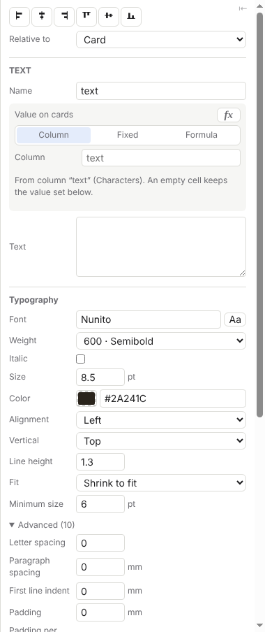</td>
<td width="33%">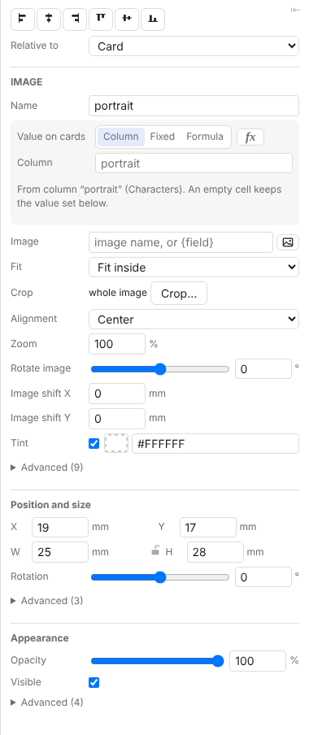</td>
<td width="33%">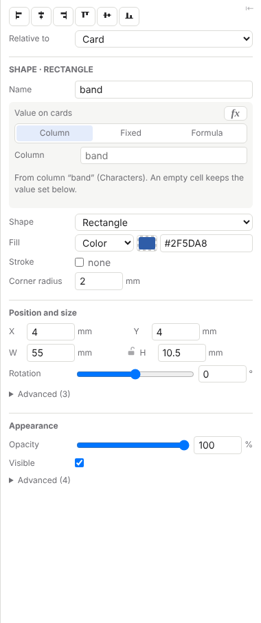</td>
</tr>
<tr>
<td>Text</td>
<td>Image</td>
<td>Shape</td>
</tr>
</table>

At the top of every layer are its **name**, which is also the name of the sheet column, and its **value on cards**:

- **Sheet column**: by default the one with the same name as the layer. An empty cell keeps the value written in the template.
- **Fixed**: the same value on every card.
- **Formula**: the value is calculated from the other fields of the card ([chapter 9](#9-formulas-and-calculated-fields)).

The main properties by layer type:

- **Text**: content, style, font, weight, size, color, horizontal and vertical alignment, line height, fit (shrink to fit the box, cut off at the box, spill out). Under Advanced: spacing, indent, padding, case, underline, strikethrough, wrapping and letter outline.
- **Image**: file or variable name, fit (fill by cropping, fill letting the part outside the frame show, fit inside, stretch, original size, tile), alignment, zoom, rotation of the image inside its frame, shift, tint and crop. **Crop…** shows the whole image with a rectangle to move and resize: the layer uses only that part, and the file is not changed. The rectangle can keep the proportions of the layer's frame; × removes the crop. When the image name comes from a column, the crop is tried on the image of the card shown and applies to all cards. Under Advanced: flips, adjustments (grayscale, brightness, contrast, saturation), radius, outline and what to do when the image is missing.
- **Shape**: type, fill (none, color, or linear or radial gradient), stroke (solid, dashed, dotted) and corner radius. Polygons and stars have the number of sides or points; a line goes from point A to point B; the "from an image" shape takes the outline of a PNG with transparency or of an SVG.
- **Grid**: equal cells inside the layer's frame, for boards, tracks and maps ([4.8](#48-the-grid)).
- **Group**: holds other layers, which move, rotate and hide together. **Arrange children** puts them in a row, a column or a grid with a fixed gap, with no aligning by hand: three icons in a row keep the same distance even when one is hidden. **Repeat** draws the group a fixed number of times or as many as a field says: with `{strength}`, one sword for each point of strength. With the mask, the bottom layer of the group is the shape for the others: a portrait inside a circle is a group with an ellipse at the bottom and the image above it.

Every layer has position, size, rotation and, in the **Appearance** section, opacity, visibility, blend mode, fade, shadow and lock.

For text, **Fit** decides what happens when the text does not fit the box: **Shrink to fit** lowers the size down to the **Minimum size**, **Cut off at the box** hides what goes outside, **Spill out of the box** draws it beyond the edge. For rules text, shrinking is the usual choice, with a minimum size that is still readable; **Check texts…** ([5.3](#53-sorting-and-filtering)) finds the cards where even the minimum size is not enough.

In the **Appearance** section, **opacity** makes the layer transparent; the **blend** mode says how it combines with what is below (**Multiply** darkens a background with a texture, **Screen** lightens it); the **fade** blends the opacity from one side of the layer to the other, or from the center to the edges, to let a background image vanish towards the text; the **shadow** has a color, a blur and an offset, and a light shadow under a title lifts it from a pale background. **Locked** stops the layer from being selected and moved on the canvas, handy for the background.

### 4.5 Aligning and distributing

With two or more layers selected, the buttons at the top of the panel align them to each other, to the card or to the safe area, and distribute them with equal spacing. **Arrange in a grid** places them in rows and columns.

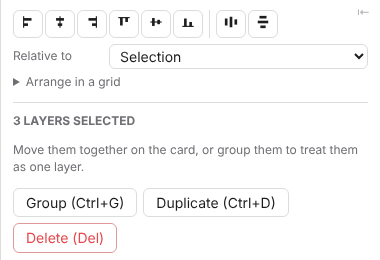

### 4.6 The back

**Back** in the editor bar shows the layers of the back, which work like those of the front: they can be the same for every card or take values from the sheet. In the set grid, **Back** shows the back of every card.

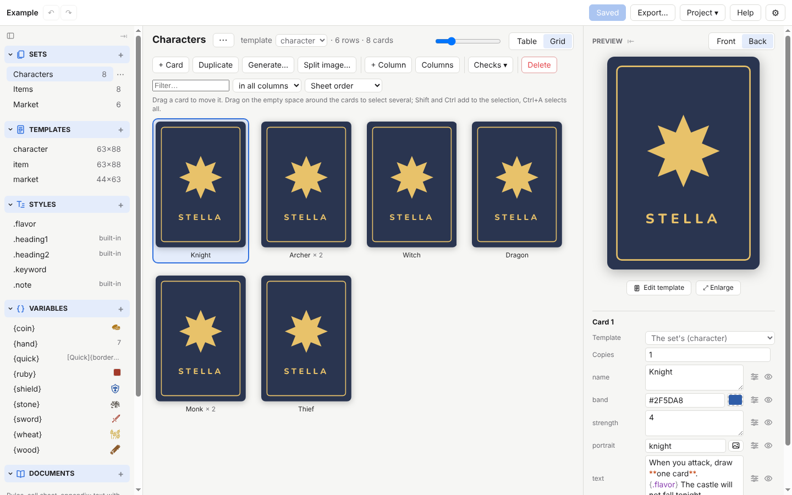

### 4.7 Derived templates

A derived template starts from another one, its base, and changes only some parts of it: for example `card-fire` is based on `card` and changes the background and the color of the band. Everything the derived template does not change follows the base, even when the base changes later.

The ↳ button next to a template, in the sidebar, creates a derived template, which opens in the editor identical to the base. The editor header shows which template it is based on, with a link to open it.

You work as on a normal template, with a few differences:

- In the properties panel, next to each value, the chain means it comes from the base; the arrow means the derived template changed it, and clicking the arrow goes back to the base value.
- In the layers panel, the chain marks the base layers, the arrow the ones with changes (a click reverts them to the base), the + the ones that exist only in the derived template.
- Base layers cannot be deleted (Delete hides them), moved in the list or renamed: their name is also the sheet column, the same as in the base. Added layers work as usual.
- The card size is the base's.

**Make independent**, in the header, turns the derived template into a normal one with the values it has at that moment. A template that is the base of another cannot be deleted until its derived templates are made independent or deleted.

### 4.8 The grid

The **grid** layer (the tool with the cells) draws equal cells inside its frame: for boards, score tracks, maps, tables to fill in by hand. Cells are square, round, hexagonal, triangular or diamond-shaped, in rows and columns with a gap between them. **Interlocking** arranges hexagons as a honeycomb (point up or side up), triangles alternating up and down, diamonds and circles in the spaces between the others, and squares like bricks. Cells have a fill, an outline and a corner radius (not circles); the **grid background** fills the space behind and between the cells up to the **grid border**, which has its own outline. Under Advanced: the padding between cells and border, the background corner radius, the cell width compared with its height, the zoom (100% is the largest grid that fits the frame without stretching the cells), the position in the frame and cutting what goes outside. The cell fill is the layer's value, so it can change from card to card; for other properties use columns such as `grid.rows`.

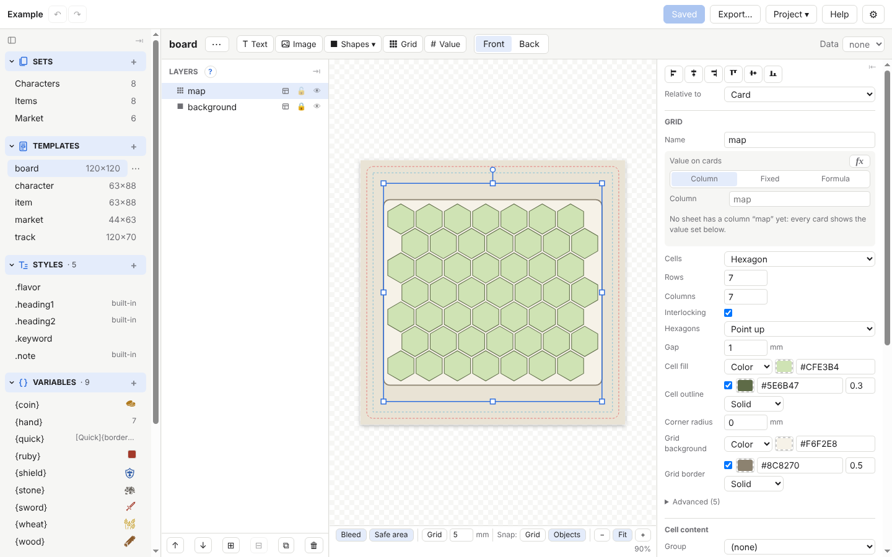

**Cell content** picks a group of the same side that is repeated in every cell: draw it in the first cell (**Move to the first cell** puts it there) and the other cells get a copy moved to their place. Inside the group the fields `{cell.index}` (1, 2, 3… by rows), `{cell.row}`, `{cell.column}`, `{cell.count}` (number of cells) and `{cell.random}` (a number from 1 to 999999, fixed for each card and cell) change from cell to cell: a text with the formula `=IF(MOD({cell.index}; 10) = 0; "[" & {cell.index} & "]{color=red}"; {cell.index})` numbers a score track with multiples of 10 in red, an icon with `=PICK({cell.index}; {icons})` shows the icons of an `icons` column in sequence. In the editor the group stays selectable where it is; on the cards it only shows in the cells.

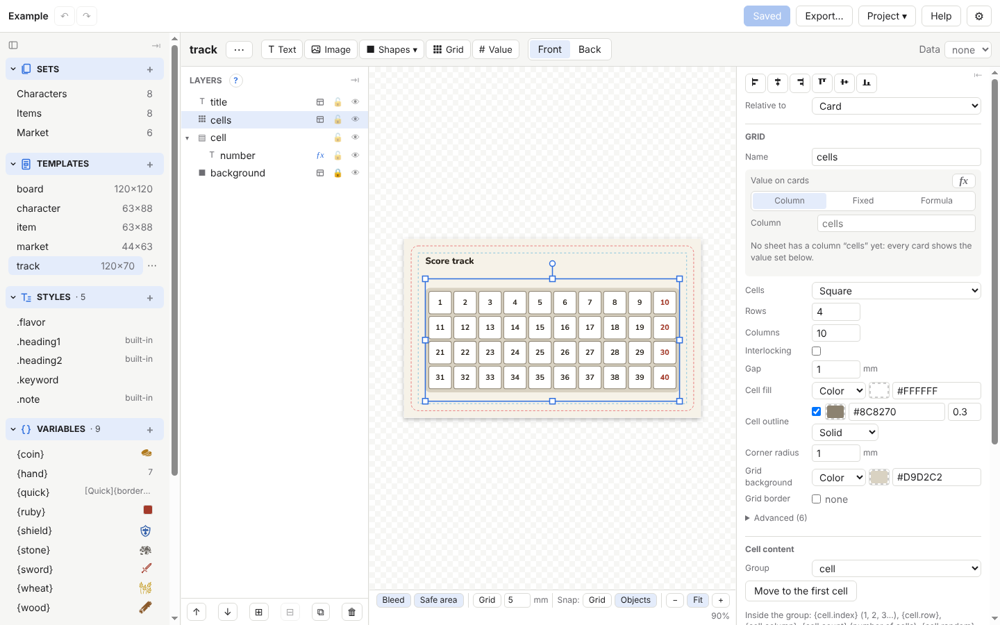

## 5. Entering and editing cards

### 5.1 Creating a set

The + next to **Sets** asks for the name, the template and the sheet: a new sheet, with the columns the template reads, or one that is already in the data file and not yet linked.

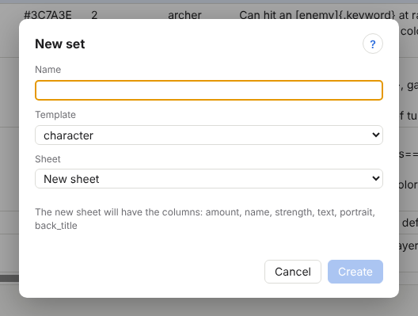

The sheet can also be one already used by another set: the two sets share the rows and each draws them with its own template, for example "Red troops" and "Yellow troops" from the same "Troops" sheet. A change to the data made in one of them applies to every set on the sheet. The new set needs a name different from the sheet. Renaming a set with a shared sheet does not rename the sheet, and deleting it leaves the sheet in the file while another set uses it.

### 5.2 Table and grid

A set opens in the **grid**, with the cards drawn; **Table** shows it as a spreadsheet.

The **table** works like a spreadsheet: double-click or type to edit a cell, Alt+Enter for a new line inside the cell, drag the row number to move a card. **+ Card**, **Duplicate** and **Delete** act on the selected rows (Shift or ⌘ / Ctrl to select more than one, in the grid too). With several cards selected the form on the right edits them in bulk: what you type in a field goes into all of them, while fields with different values stay empty and do not change until you touch them.

The `amount` column says how many copies of each card to print; empty means 1.

The table and the form show every column you can edit: the sheet's columns and the ones the template reads but the sheet does not have yet (with an italic heading), which are created when you type a value. The **Columns** button chooses which ones to hide; **Reset** goes back to the basic view, with only the columns read by layers linked to a column (columns left in the sheet without a layer, for example from an imported TTC project, are hidden) and the field details closed. In the card form the eye next to a layer's field shows or hides that layer on the card. The sliders icon opens the layer's properties for the card (color, italic, shape, position...), with menus for fixed sets of values, number fields and a color picker: a value typed there applies to that card only and creates the `layer.property` column, while an empty field shows the template value in grey. The number on the icon tells how many properties the card changes. Columns of fixed or formula layers do not reach the card and stay hidden; **Show fixed and formula layers** adds them read only, with the ƒ sign and the value they have on each card.

True/false columns (properties such as `crest.visible` or `name.italic`, and columns where every cell is `true` or `false`) have a checkbox: a click, or the space bar on the cell, ticks or clears it. A faded checkbox means an empty cell: the template value applies.

The **grid** shows the cards as they will be printed. The slider at the top changes the thumbnail size (also with ⌘ / Ctrl and the mouse wheel); dragging a card moves it.

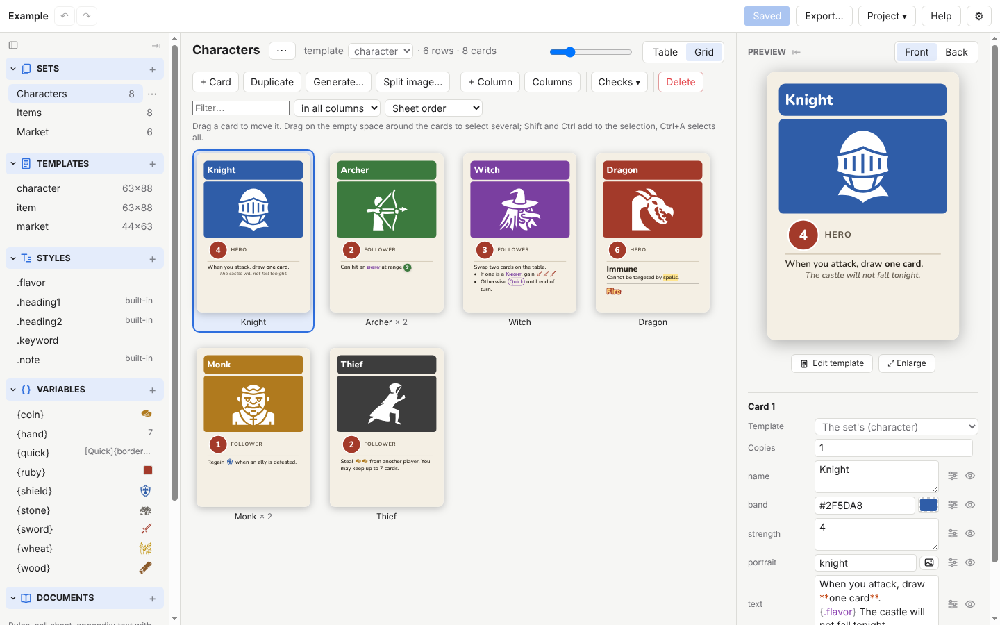

To select several cards in the grid, drag on the empty space around the cards: the rectangle selects the cards it touches, and with Shift or ⌘ / Ctrl adds them to the ones already selected. ⌘A / Ctrl+A selects all the cards shown (with a filter, only the ones that pass it), Esc goes back to the card in the preview. Above the grid a bar shows how many cards are selected, with **Select all** and **Keep only one**. Dragging one of the selected cards moves all of them.

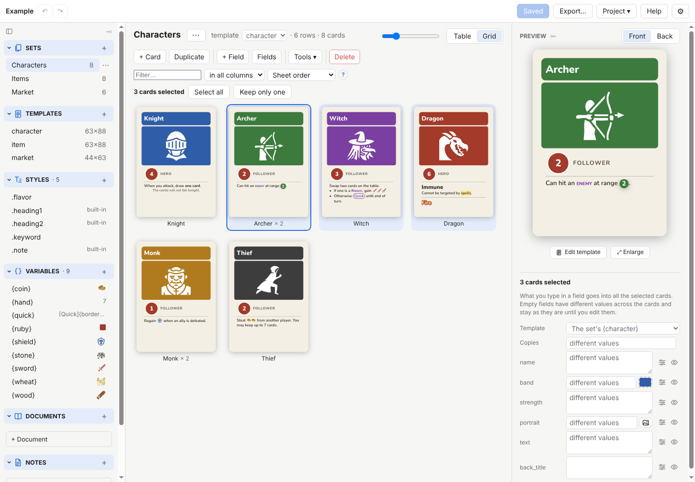

In both views, on the right, the form of the selected card has a field for every column. Clicking a layer in the preview takes you to its field; Alt+click on the same spot moves to the layer underneath, useful when a layer covers another. Double-clicking edits the layer right on the card: a box over the layer for text, the thumbnails for an image, the color picker for a shape. Esc cancels the edit, clicking outside or Ctrl+Enter closes it. Double-clicking a fixed or formula layer tells where its value comes from, with a button to open the template. The ⤢ button at the top of the preview opens the card large in a window, with the card form next to it, the same clicks and arrows to move from card to card. Page Up and Page Down move to the previous or next card, even while typing in a field of the form, which stays the same.

### 5.3 Sorting and filtering

Clicking a column heading sorts the cards (ascending, then descending, then the sheet order); in the grid you pick the column from the menu. The **Filter…** field shows only the rows that contain some text, in all columns or in one.

Sorting and filtering change only the view: the sheet and the export stay as they are. **Apply this order** reorders the sheet as you see it; **Show all** clears sorting and filter.

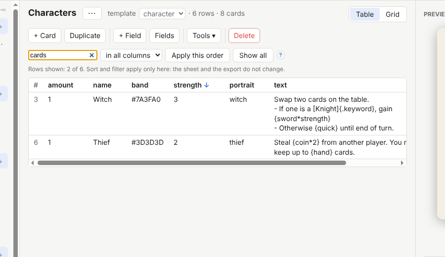

The checks on the set are in the **Checks** menu of the button row.

**Statistics…** shows how many cards have each value of a column, also of a formula layer, with a bar to compare them: useful to balance the set (for example how many cards per cost). For numeric columns it also gives sum, average, minimum and maximum. Copies from the `amount` column count, unless you untick the box; with an active filter only the filtered cards count.

**Check text…** looks, on every card of the set, front and back, for texts that do not fit in their box: those that spill out, those cut off and those that do not fit even shrunk to the minimum size. The list gives card, side and layers; a click selects the card. In the grid, cards with text that does not fit have an orange mark next to their name.

**Compare…** marks the cards that are new or changed since the last export or a backup, so you can reprint only those. Pick the version, and in the sets the different cards get a blue dot; **Show only these** hides the others. While comparing, the **Export…** window offers **Only the cards new or changed**. The comparison looks at what the cards show (data, template, and the variables and styles they use), not at the content of image and font files; a card that only moved does not count as changed, unless it shows its number. Every export made in the app remembers the exported cards in the project's hidden file `.stella-printed.json`.

### 5.4 Property columns

Besides the main value, every property of a layer can change card by card with a `layer.property` column: for example `name.color` for the title color, or `icon.tint` for the tint of an icon. **+ Column** suggests the columns the template reads and the sheet lacks, the properties of a layer of your choice, or a free column.

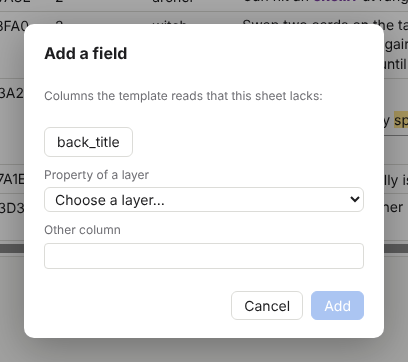

In cells, colors are written as names (`red`, or the name of a color variable) or in hex (`#A33A2A`); a stroke as `color/width/dash`, for example `red/0.3/dashed`; a crop as `x y width height` in percent of the image, for example `10 0 50 50` (`none` for the whole image). In the card form the **Crop…** button next to the crop field writes these numbers for you.

The **Template** field, at the top of the card form, picks the template of a single card among those with the set's size: empty means the set's, and the choice goes into the sheet's `template` column. It is useful, for example, to give a few cards of a set a derived template. In the card form the field becomes a menu with the templates that have the same size as the set's.

### 5.5 Editing the file in Excel

The data file is an ordinary spreadsheet and can also be edited with Excel, LibreOffice or Numbers, even with the project open: when you save the file, Stella reads it again by itself. If Stella has unsaved changes to the data, a notice with **Reload** and **Ignore** appears instead. To edit the data only outside Stella, tick **read-only** next to the file name at the bottom of the sidebar and save: Stella no longer writes to the data file, changes to the data in the grid and in the card panel are refused and _read-only_ appears next to the card count. Templates, previews and exports work as usual. **Check data file…**, under the checkbox, shows how Stella reads each sheet: the sets that use it, the columns their templates read and the sheet lacks, and problems (titles above the headings, merged cells, Excel errors, formulas without a saved result, empty rows); it does not change the file. From the same window, **Import a sheet from another file…** puts the rows of a sheet of another file (.xlsx, .ods, .csv) in place of those of a set: first it shows the new, removed and changed rows (matched by a column with all different values, such as the name) and lets you keep the columns the file does not have; then it makes a backup of the project. The change can be undone with ⌘Z / Ctrl+Z. When saving, Stella rewrites only the columns that have a heading: cell formatting, other sheets and columns without a heading stay as they are. A cell with an Excel formula stays a formula as long as its result does not change. If you start from an Excel file you already have, with formulas and analysis sheets, read [Using an Excel file you already have](existing-excel.md).

### 5.6 Data from Google Sheets

If you keep the data in a Google sheet, **Google Sheets…**, in the **Project** menu, brings it into the project. In the Google sheet choose **Share** → **Anyone with the link** (viewer), copy the link and paste it; **Download** reads all the tabs. Each tab goes to the set with the same name (ignoring case); from the menu you can pick another one or **do not import** the tab. If a tab lacks some columns of the set, the window lists them: after the import those columns are gone. **Import** replaces the data of the chosen sets (⌘Z / Ctrl+Z undoes it) and **Save** writes them to the project's data file, which stays the local copy: Stella works without a network too.

The link stays in the project: next time just open the window and press **Download**. A sheet not shared by link cannot be downloaded, and Stella says so. An AI can do the same with `stella pull-sheets`.

### 5.7 Cards in several languages

A project can print the same cards in several languages. **Languages…**, in the **Project** menu, opens the languages window: the first one is the main language, the one the usual columns are written in. With **Add language** you type the language code (en for English, fr for French, de for German…). Below, **Translated names** gives the name of the project and of the sets in the other languages: `{project.name}` and `{set.name}` use it. With the box at the bottom ticked, **Save** adds the columns to translate to the sheets.


The translation of a column goes in a column with the same name followed by @ and the language code: `name@en` next to `name`, `text@en` next to `text`. Columns with only numbers do not need one. An empty translated cell uses the text of the main language, so you can translate a little at a time.

The menu next to the project name, at the top, picks the language the cards are shown in: grid, preview, editor and documents change at once. Double-clicking the card edits the translated text, if the column exists.


Only what is read on the card is translated. Image names, colours and formulas starting with `=` always use the values of the main language: a formula such as `=IF({type}="Attack"; ...)` works in every language without changing it. To have a different image in one language, add its translated column, for example `icon@en`.

Texts that do not come from the sheet are translated where you write them. A text layer whose **Value on cards** is **Fixed** has, under its text, a field for each other language; the same goes for fixed value layers and, in their window, for text and value variables. A field left empty uses the text of the main language. If a formula with `=` must write a translated text, make it return a variable: `=IF({type}="Attack";"{attack}";"{defence}")` compares the main-language value and writes the `attack` variable in the language of the card.

A document always uses the main language, even when another language is chosen at the top. For an English rulebook write `language: en` at the top of the document, or choose it in **Page**, under **Card language**: the document's cards and variables will be in English. The **Languages** window says how many texts are left to translate in each language, and `stella check` lists them one by one.

In **Export…** choose the language, or **All languages**. The main language goes to the usual folder, the others to a subfolder named after their code, for example `export/en`; file names stay the same. An AI does the same with `stella render --lang en` and `stella export --profile NAME --lang all`.

## 6. Text and markup

Card text is written with a simple markup, the same in the app and in the sheet cells. No HTML is needed.

### 6.1 Markdown

| Write                    | You get                                           |
| ------------------------ | ------------------------------------------------- |
| `**text**`               | bold                                              |
| `*text*`                 | italic                                            |
| `++text++`               | underline                                         |
| `~~text~~`               | strikethrough                                     |
| `==text==`               | highlight                                         |
| `^text^` / `~text~`      | superscript / subscript                           |
| `# Title`, `## Subtitle` | paragraph with the `heading1` or `heading2` style |
| `> text`                 | paragraph with the `note` style                   |
| `- item` / `1. item`     | bulleted / numbered list                          |
| `---`                    | divider line                                      |
| `\` at the end of a line | line break without a new paragraph                |
| `_4{coin}_`              | never breaks across lines                         |

Every line break starts a new paragraph, as when you type in an Excel cell with Alt+Enter. To keep a piece of text on one line, so that `4` and its icon never end up on different lines, wrap it in underscores: `_4{coin}_`. It is the same as `[4{coin}]{nowrap}`. An underscore inside a word (`file_name`) stays as it is; write `\_` for a lone one.

### 6.2 Attributes

Square brackets mark the text and the braces that follow say how to format it: `[Warning]{color=red weight=800}`. Attributes are separated by spaces.

| Attribute                             | Example                                        | Effect                                         |
| ------------------------------------- | ---------------------------------------------- | ---------------------------------------------- |
| `.name`                               | `[pine]{.keyword}`                             | applies a style                                |
| `color=`, `highlight=`                | `{color=#A33A2A}`                              | text or highlight color                        |
| `size=`                               | `{size=14}` · `{size=+2}` · `{size=80%}`       | size in pt, relative or in percent             |
| `font=`, `weight=`                    | `{font=Open_Sans weight=800}`                  | family (with `_` instead of spaces) and weight |
| `stroke=`                             | `{stroke=white/8%}`                            | letter outline                                 |
| `upper`, `lower`, `smallcaps`         | `[Phase]{smallcaps}`                           | uppercase, lowercase, small caps               |
| `nowrap`                              | `[4 coins]{nowrap}`                            | the span never breaks across lines             |
| `left`, `center`, `right`, `justify`  | `{.flavor center}` at the start of a paragraph | paragraph alignment                            |
| `border=`, `fill=`, `radius=`, `pad=` | `[Quick]{border=red/0.3 radius=round}`         | box around the text                            |
| `bg=`, `bg-color=`, `bg-size=`        | `[3]{bg=circle bg-color=blue color=white}`     | shape or image behind the text                 |

The shapes `circle`, `square`, `rounded`, `hexagon` and `diamond` are always available for `bg=`. To move the text inside the box up or down without moving the box, use `text-raise=` in pt, also in a style: `.heart = bg=heart color=white text-raise=1` (`raise=` moves the whole box instead).

### 6.3 Fields, variables and icons

| Write                            | You get                                                           |
| -------------------------------- | ----------------------------------------------------------------- |
| `{strength}`                     | the value of the card's `strength` field                          |
| `{sword}`                        | the `sword` variable: an icon, a text, a color or a value         |
| `{sword*3}` · `{sword*strength}` | the icon repeated three times, or as many times as the field says |
| `{wood}`                         | an image from `assets/` with that name, as tall as the line       |
| `{sword tint=red size=150%}`     | the icon with attributes for this use only                        |
| `\{`, `\*`, `\[`                 | the literal character                                             |

Stella knows some values by itself, the **system variables**, written like fields, also in formulas: `{project.name}` (the game), `{set.name}`, `{template.name}`, `{card.number}` (the card's row in the set), `{set.rows}`, `{set.cards}` (cards with copies), `{card.copies}`, `{card.copy}` (the printed copy, for example to write `{card.copy}/{card.copies}`), `{card.side}` (`front` or `back`) and `{date}`. A footer like `{set.name} {card.number}/{set.rows}` numbers the cards by itself.

The **Help** button in the top bar and on the start screen, or the F1 key, opens a summary of markup, fields and variables, system variables, formulas and shortcuts.

<table><tr>
<td width="50%">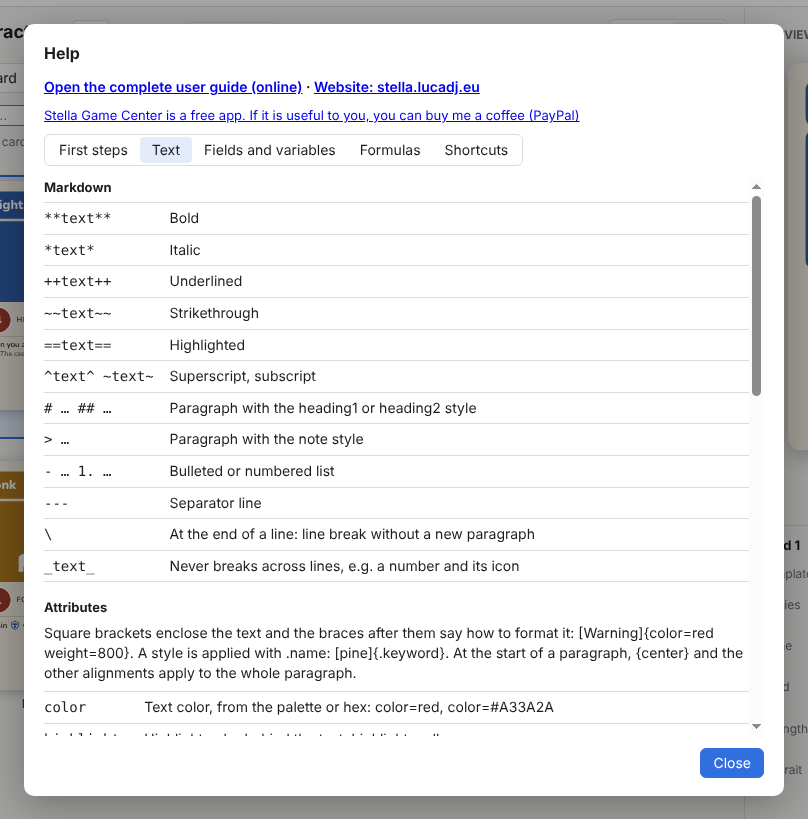</td>
<td width="50%">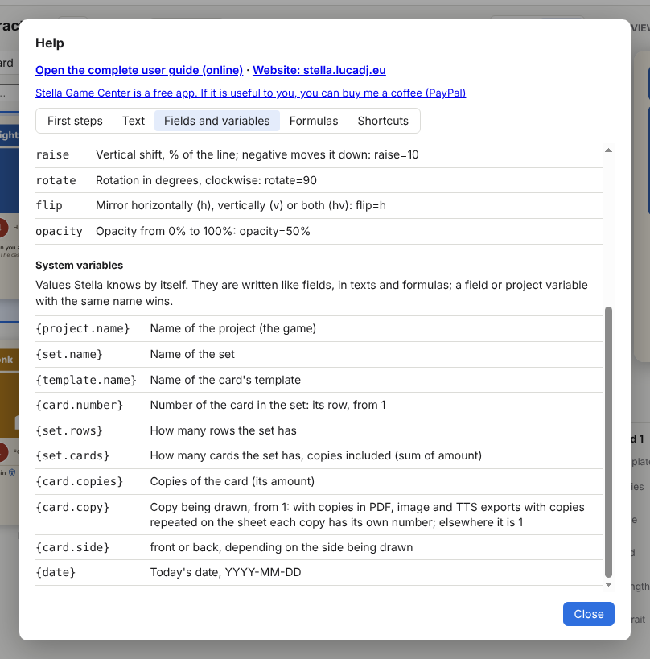</td>
</tr></table>

### 6.4 Writing help

In the text fields of the editor and of the card form, and in table cells, typing `{` shows fields and variables, with a preview of the icon, text or color. ↑ and ↓ choose, Enter or Tab insert, Esc closes. Inside braces, attributes, styles and colors are suggested the same way.

Markup is colored as you type. Errors, such as a variable that does not exist, are underlined in red and listed under the preview in **Problems on this card**.

<table>
<tr>
<td width="50%">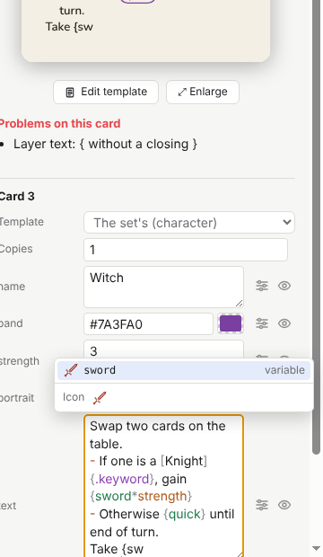</td>
<td width="50%">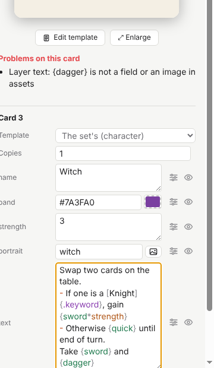</td>
</tr>
</table>

### 6.5 Formatting without writing markup

The **Aa Format…** button under a text field opens the visual editor: select part of the text, choose the attributes, and the app writes `[text]{...}`. The resulting markup is shown at the bottom. **Save as style…** turns the formatting into a project style; **Remove formatting** removes the brackets. Next to **Background** a button opens the thumbnails: built-in shapes, image variables and project images.

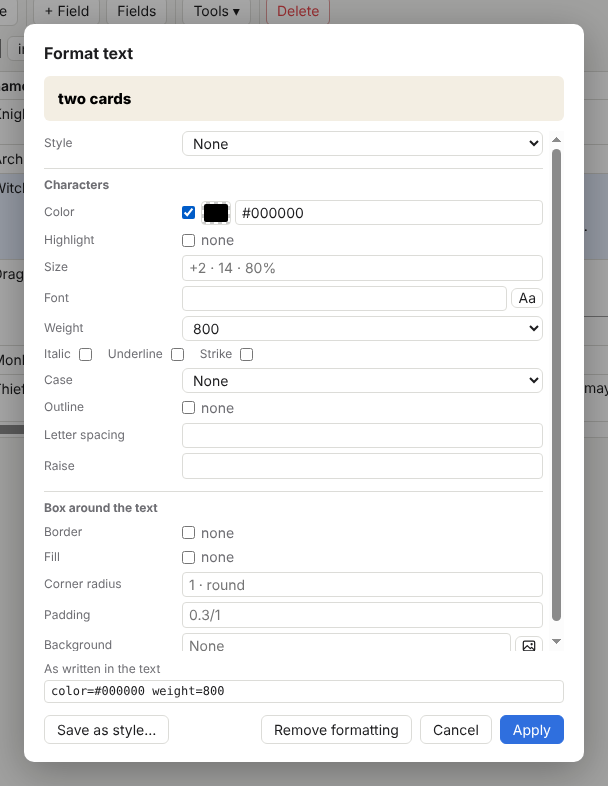

## 7. Variables and styles

### 7.1 Variables

Variables are created with the + next to **Variables** and edited with a click. There are four types:

- **Icon**: an image from `assets/` with tint, size relative to the line, vertical shift, rotation, flip and opacity. With **Color of the surrounding text** the icon takes the color of the text.
- **Text**: a text, formatted if you like, that replaces `{name}`. It can call other variables.
- **Color**: a named color, usable in every color property and in markup attributes. A variable named like a built-in color (for example `red`) redefines it in the whole project.
- **Value**: a text or a number, usable in texts and formulas (for example the maximum hand size).

<table>
<tr>
<td width="50%">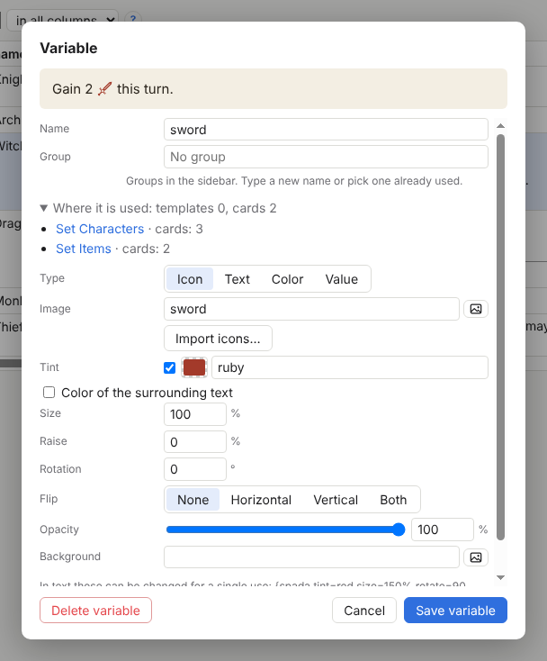</td>
<td width="50%">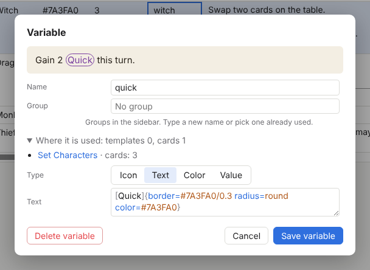</td>
</tr>
</table>

A sample sentence at the top of the window shows the result. Renaming a variable updates the references in templates, cells, other variables and styles.

### 7.2 Text styles

A style groups text attributes under a name: it applies to a whole layer (**Style** property), to a paragraph (`{.name}` at the start of a line) or to a portion of text (`[text]{.name}`). Changing a style changes every card that uses it. A style can be based on another and inherit its attributes.

`heading1`, `heading2` and `note` exist in every project and match `#`, `##` and `>`; they can be redefined.

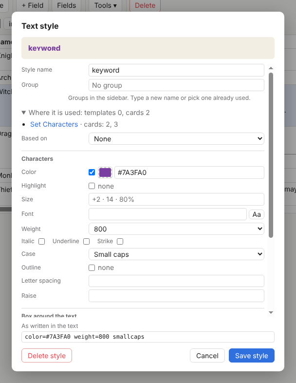

### 7.3 Choosing a color

The small square next to every color field opens the color picker: the large area chooses saturation and brightness, the two bars below it hue and transparency. The hex code goes in the field next to the preview; **RGB** and **HSL** switch the three number fields (the up and down arrows change them by 1, with Shift by 10). The eyedropper picks a color from anywhere on the screen, even another window. Below are the project colors: first the color variables, marked by a dot in the corner, which are written by name and show the variable's name when you hover over them; then the codes used in the project (templates, styles, variables and sheets), most used first, leaving out those equal to a variable. At the bottom, the last colors chosen, shared by all projects. Esc or a click outside closes the picker. **None** writes `none`, that is no color: a transparent fill or no outline.

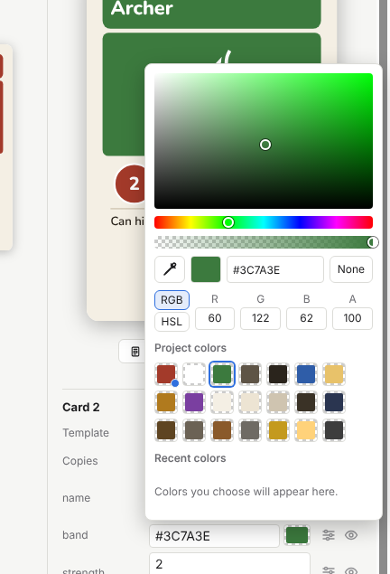

## 8. Images, icons and fonts

### 8.1 Project images

Images live in `assets/`, subfolders included, as SVG, PNG, WebP or JPG. Wherever you name an image, the file name is enough, without folder or extension. If two files share a name (for example `sword.png` and `sword.svg`) the app says so and asks you to add the extension or the folder.

The image button next to the fields opens thumbnails of the assets, with search and a folder filter. **Add images…** copies files from the computer into the project's `assets/images` (a file with the same name is not overwritten: the copy gets a number). **Dark background** shows the thumbnails on a dark background, to see white icons; the choice is remembered.

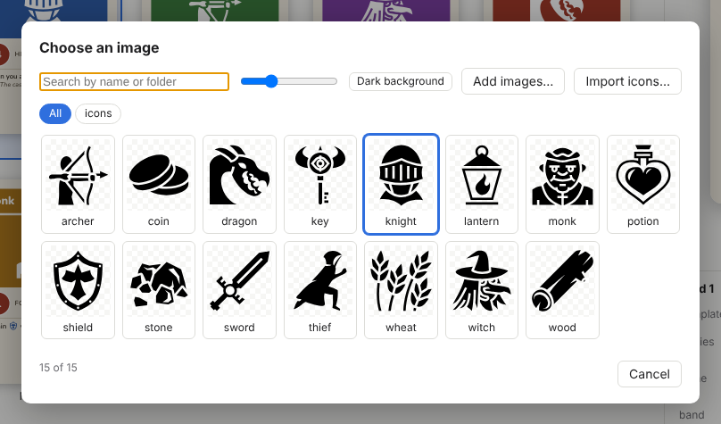

Single-color icons (black SVGs on a transparent background) are recolored with the layer's **Tint** property or with the variable's tint.

### 8.2 Importing icons

**Import icons…**, in the image chooser and in the window of an icon variable, opens three collections included in the app, which work offline, and an online one:

- **game-icons.net**: about 4200 icons, with categories and search. License CC BY 3.0: authors must be credited (see credits, [chapter 11.6](#116-credits)). **Update catalog** downloads the icons published after this version of the app (needs the network, takes about a minute).
- **Kenney: icons and patterns**: board game icons and tileable patterns, CC0.
- **Kenney: cards, dice and pawns**: color PNG images, CC0.
- **Iconify (online)**: over 200 more collections (Material Design, Tabler, Phosphor, emoji...), searched on the internet. Type in the search box to search all of them, or choose a collection on the left to browse it.

You can pick several icons, also from different collections, and rename them before importing. Icons go to `assets/icons/` (color ones to `assets/images/`) and their origin to `assets/sources.json`.

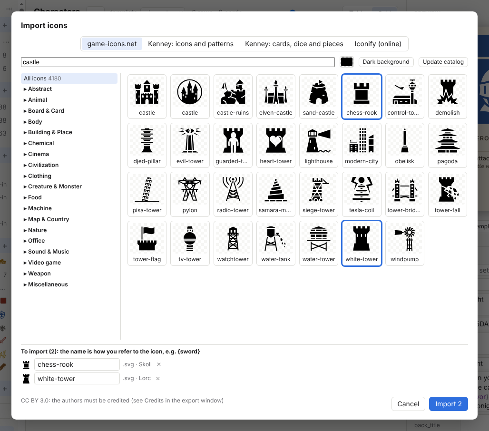

Each Iconify collection has its own license, shown by a dot: green for free licenses, blue for those that require crediting the author, orange for those that are restrictive for a published game (share-alike, non-commercial, GPL). **Hide restrictive licenses** removes them from the list and the results. The license and author of the collection go into the credits like those of the other icons.

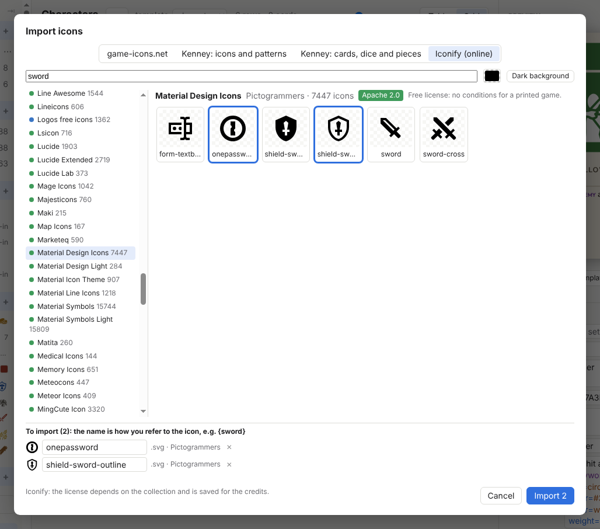

### 8.3 Fonts

The **Aa** button next to the font field opens the font chooser, with three tabs:

- **In the project**: the fonts in `assets/fonts/` and Nunito, the font included in the app.
- **Google Fonts**: the Google Fonts catalog, with a category filter. Choose the styles and **Download** saves the files in `assets/fonts/`, with the license. Previews need the network; once downloaded, the font works offline. **Update catalog** downloads the latest list, with the fonts published after this version of the app.
- **On this computer**: installed fonts. **Copy to project** copies the files to `assets/fonts/`, if the license allows it; otherwise the project looks the same only where that font is installed.

<table>
<tr>
<td width="50%">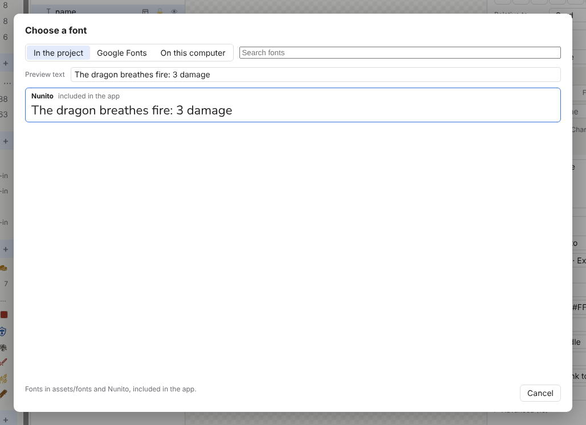</td>
<td width="50%">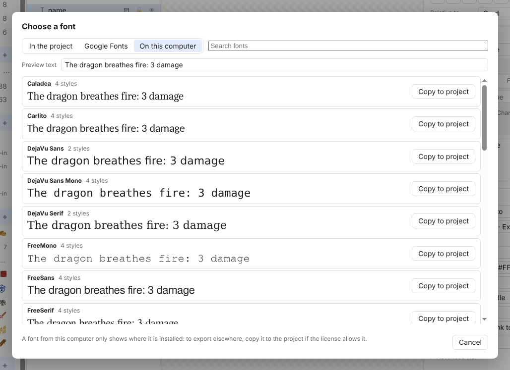</td>
</tr>
</table>

A font that cannot be found is reported under the card and at the end of the export; meanwhile the text uses a default font. Instead of a font name you can write a text variable, for example `{titles}`: changing the variable changes the font of every layer that uses it.

## 9. Formulas and calculated fields

A layer with **Value on cards: Formula** calculates its value from the other fields of the card.

- **Text composition**: `{name}.png`, `Strength {strength}`.
- **Calculation**: if the formula contains `+ - * /` and the result is a number, it is calculated: `{strength}+2`.
- **Expression**: with a leading `=` it works like Excel. Text in quotes, comparisons `= <> < > <= >=`, `&` to join text, arguments separated by `;` or `,`. Functions: `IF`, `AND`, `OR`, `NOT`, `MIN`, `MAX`, `ABS`, `ROUND`, `FLOOR`, `CEILING`, `UPPER`, `LOWER`, `LEN`, `CONCAT`, `ISBLANK`, `COUNTIN`, `MOD`, `PICK`.

The functions, with an example on the cards of this guide (Dragon, strength 4, cost `{gold}{gold}{wood}`):

| function                                      | what it does                                  | example                                                 |
| --------------------------------------------- | --------------------------------------------- | ------------------------------------------------------- |
| `IF(condition; if true; if false)`            | chooses between two values                    | `=IF({strength}>3; "Strong"; "Weak")` → Strong          |
| `AND`, `OR`, `NOT`                            | combine conditions                            | `=IF(AND({strength}>3; {cost}<>""); "yes"; "no")` → yes |
| `MIN`, `MAX`                                  | the smallest or largest number                | `=MAX({strength}; 3)` → 4                               |
| `ABS`                                         | the number without its sign                   | `=ABS({strength}-6)` → 2                                |
| `ROUND(number; decimals)`, `FLOOR`, `CEILING` | round                                         | `=ROUND({strength}/3; 1)` → 1.3                         |
| `UPPER`, `LOWER`                              | capitals and lower case                       | `=UPPER({name})` → DRAGON                               |
| `LEN`                                         | how many characters the text has              | `=LEN({name})` → 6                                      |
| `CONCAT`                                      | joins texts (like `&`)                        | `=CONCAT({name}; " "; {strength})` → Dragon 4           |
| `ISBLANK`                                     | true if the value is empty                    | `=IF(ISBLANK({note}); "-"; {note})` → -                 |
| `COUNTIN(text; wanted)`                       | how many times a text contains another        | `=COUNTIN({cost}; "gold")` → 2                          |
| `MOD(number; divisor)`                        | the remainder of a division                   | `=MOD({cell.index}; 10)` → 0 on every tenth cell        |
| `PICK(n; value1; value2; …)`                  | the n-th value, starting again after the last | `=PICK({strength}; "sword"; "shield"; "hand")` → sword  |

The **Help** window (F1), **Formulas** tab, has the same table with the result computed on the cards of the open project.

In the example the `rank` layer shows "Hero" or "Follower" depending on strength. Below the formula is its result for the first card of the set.

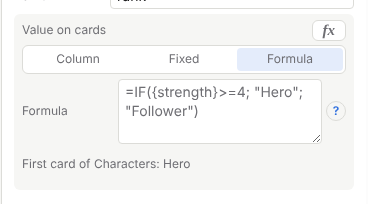

The **Value** layer (# tool) is not drawn: it holds a card value to use in formulas and in the texts of other layers as `{name}`. In the example, the `points` layer of the market cards counts the resources with `COUNTIN` and the `points_text` layer shows it.

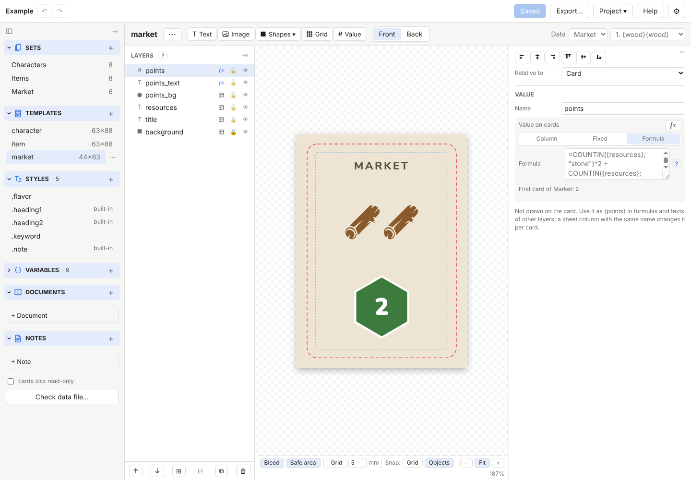

A value layer can also provide a colour: in colour fields (fill, text colour, stroke, shadow, tint) write the layer's `{name}`, which the field's menu suggests. The calculated value can be a code such as `#A33A2A`, a colour name or a colour variable, for example `=IF({strength}>3; "red"; "blue")`. An empty value gives a transparent colour.

A field's value is, in order of precedence: the calculated value layer, the non-empty cell of the row, the value written in the template. Formula errors are shown under the card and in the properties panel.

### 9.1 The formula assistant

The **fx** button next to the **Formula** field opens the assistant. On a layer with **Sheet column** or **Fixed** the same assistant opens with **Build a formula with the assistant…**, under **Value on cards**: when you confirm, the layer switches to **Formula**. It is also next to the **Filter** of the generator (section 10), where the formula must give true or false.

With an empty formula the assistant asks **What do you want to do?** and offers the common cases as cards: a different value depending on a condition, change something every N cells (or components), alternate two values, checkerboard, cycle through a list, pick at random, show only if a field is not empty, low/medium/high, calculate a number, join texts and fields. Next to the generator filter the cards are conditions (compare a field with a value, a field is not empty). **Write it myself** switches to the advanced mode.

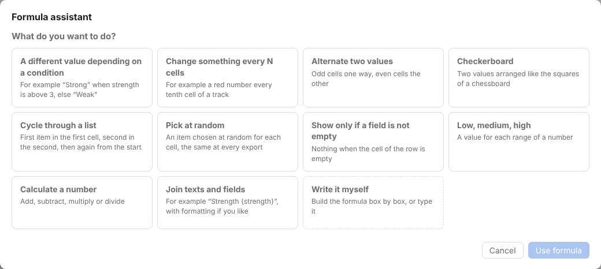

Once you pick a card, the formula appears as a sentence to complete, already filled with sensible values: for example **Every 10 cells, show "Yes" otherwise "No"**. Each blank is a button: the selected one has the picker below with what can go in it (**Field**, **Number**, **Text** with **Format…** for colour and weight, **Variable**, **Card & cell**, **Formula**…; **More…** shows the remaining tabs). Under the sentence the result on the first card and, inside a grid, the result of the first cells; **Show formula** opens the formula text, which you can also write by hand. When you open an existing formula that matches one of the sentences, the assistant shows it as that sentence.

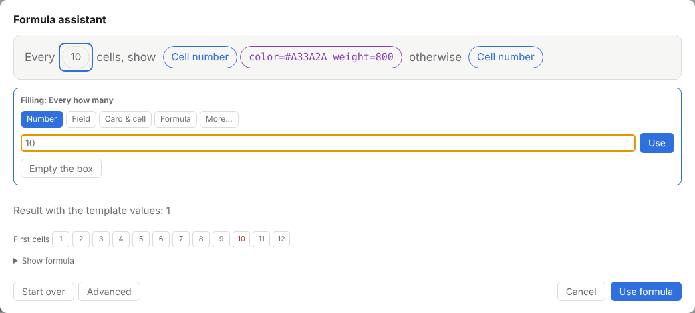

**Advanced** shows the formula as nested blocks: each function has its boxes with a name (for `IF`: **Condition**, **If true**, **If false**) and under each box the value it gives on the first card; **Formula** in the picker groups the functions by category (**Condition**, **Selection**, **Math**, **Text**, **Recipes**) and **Several cases** shows a chain of `IF` as a list of **When… Then…** rows with **Otherwise** at the end. **Guided** goes back to the sentence while the formula still has that shape; **Start over** returns to **What do you want to do?**. **Use formula** writes the formula in the field; a formula opened and not changed stays as it was.

On a **grid** layer the formula applies to the whole grid (for example the cell colour of a card): to change the cells one by one, the formula goes on a layer of the **cell content** (section 4.8). That is why, on a grid without content, the **Cell content** section has **Text in each cell** and **Shape in each cell**: they create a layer in the first cell, wrap it in a group and set it as the content; for the text the assistant opens right away. The same choice is on the start screen of the assistant as **Vary cell by cell**.

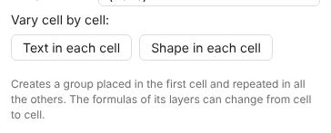

## 10. Generating cards

**Generate…**, in the set header, creates rows by combining sets of values. Each value set has a target column, a list of values (one per line or comma separated; `1-5` becomes 1, 2, 3, 4, 5) and how many values to put on each card.

- Several value sets are combined in every possible way: 6 suits and the numbers 1-5 give 30 cards.
- With more than one value per card you choose whether repetitions are allowed and whether order matters. Under **Limits per value** you set a minimum and maximum for each value.
- **As icon** writes each value as `{value}`, so the text shows the icon with that name.
- **Filter** keeps only the cards for which an expression is true, for example `COUNTIN({cost}; "gold") <= 1`.

The preview shows how many cards will be created and the first rows. **Add at the end** appends the cards, **Replace the cards** takes the place of the existing ones. **Update the cards** writes only the generated columns into the existing cards, one per row, leaving the other columns as they are: for example, first generate 30 cards from 6 suits and the numbers 1-5, then use **From a folder…** to assign 30 portraits to the portrait column. If more cards are generated, the extra ones are added at the end. ⌘Z / Ctrl+Z undoes.

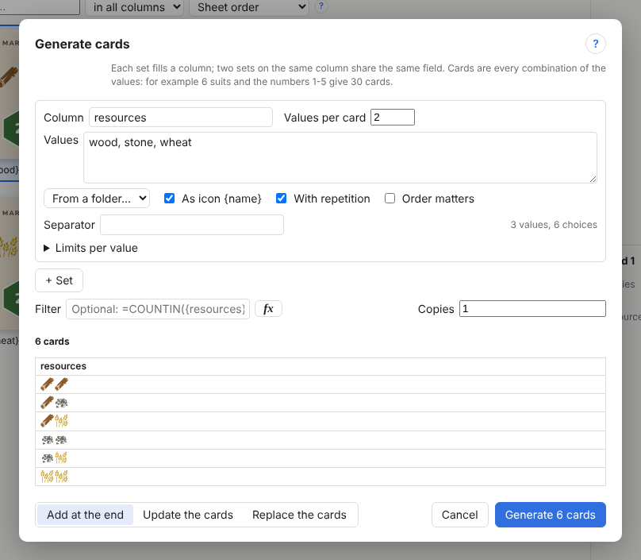

### 10.1 Splitting an image across cards

**Split image…** spreads one big image across the cards of the set: placed side by side in a grid, the cards make it up again (a map, an illustration over several cards). You choose the image layer of the template, the image, how many columns and rows, the card to start from and the order: by rows (left to right, then the row below) or by columns. Missing cards are added.

Each card shows the part of the image under its layer, as if the image covered the whole grid of trimmed cards. Stella writes in the card's columns the image (`layer.src`), the crop (`layer.crop`) and the **Stretch** fit; it removes the tint, so a template icon does not turn into a silhouette. The bleed of inner cards shows the image of the neighbouring cards. For cards on the edge there are two options: if the image also includes the bleed around the whole grid (tick the box), it is used; otherwise the layer stops at the edge of the image and the outer bleed shows what is underneath. The right proportions of the image are columns × card width by rows × card height (plus the bleed, if included): if the image differs, the window says so, because the pieces would be slightly stretched. Image layers that are not rotated and not inside groups can be split.

## 11. Exporting

**Export…** opens a window with three tabs: images, PDF and Tabletop Simulator. In each tab you choose the sets and whether to repeat cards as the `amount` column says. Cards are drawn by the same engine as the preview, including unsaved changes.

### 11.1 Images

PNG, JPG, WebP or SVG format, resolution (150, 300, 600 DPI or custom), bleed included or not, front, back or both, transparent background outside rounded corners. File names follow a pattern with `%set`, `%n` (card number), `%copy`, `%side` and `{field}`; a `/` creates subfolders.

SVG is vector and has no resolution: it scales without losing quality and opens in graphics programs (Inkscape, Illustrator, Affinity). Project images and fonts are inside the file; fonts installed on the computer are not, and whoever opens the file needs them. Texts become SVG text, one element per line, so they can be edited but no longer wrap by themselves.

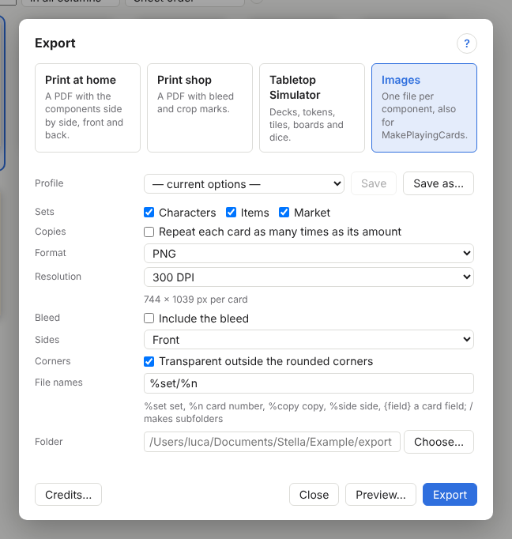

### 11.2 Print PDF

The PDF is vector, with embedded fonts. You choose page size and orientation, margins, spacing and layout (as many cards as fit, or columns × rows). Other options:

- **Bleed**: with bleed the cards touch and crop marks are outside.
- **Rotation**: rotates cards when they would not fit otherwise or more of them fit.
- **Poster**: splits cards larger than the page over several pages, with an overlap.
- **Fold**: front and back side by side, to fold.
- **Crop marks**: at the corners or as full lines, with length, width and color.
- **Duplex**: backs on alternate pages, flipping on the long or short edge, with an offset for printers that do not align the two sides. To find the right offset, print a single page first, hold the sheet against the light to measure how far the back is shifted from the front, and type that value in **Back offset**; then print everything. The **Proof sheet** lets you check all the cards small before using up paper.
- **Pages**: with **One after another on the same page** a set starts right after the previous one instead of on a new page (10 + 8 cards with 9 per page fit on 2 pages instead of 3). A set with cards of another size starts on a new row, if there is room on the page.
- **Proof sheet**: a separate PDF with every card small.
- **Convert to CMYK**: needs Ghostscript installed on the computer.

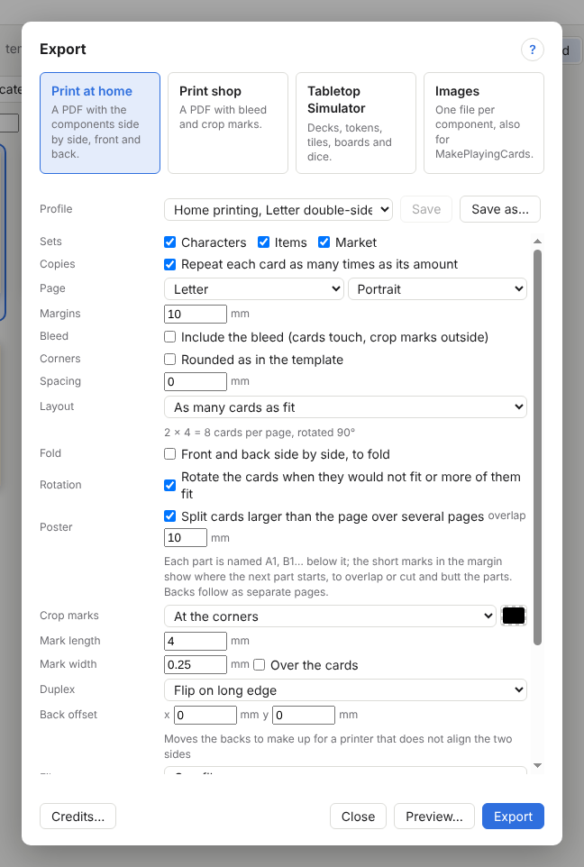

### 11.3 Preview

**Preview…** shows the files the export will write, without writing anything: images with their file names, PDF pages, Tabletop Simulator sheets. Browse them with ‹ › or the arrow keys.

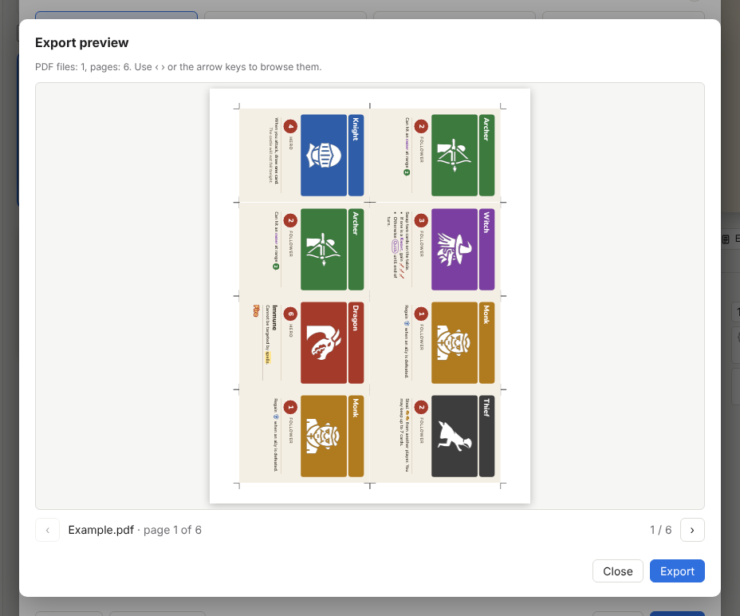

### 11.4 Tabletop Simulator

For each set it creates the card sheets (up to 10 × 7, with the grid chosen automatically to reduce empty slots) and the deck file to load in Tabletop Simulator. Files go to the project folder, to Tabletop Simulator's saved objects folder, or both. Card nickname and description can come from a field.

With **Copies** on, **Copies on the sheet** decides where a card's copies go: once on the sheet, with the deck file multiplying it (the default, which keeps sheets small), or repeated on the sheet as many times as `amount` says. The second is for loading the sheets into Tabletop Simulator by hand, without the deck file: each slot of the sheet is one card.

**Objects** chooses, for each set, what to create in Tabletop Simulator:

- **Cards**: the deck from the sheets, as above.
- **Tokens**: one image per card, cut out along the card shape (rectangle, rounded corners, circle, hexagon or silhouette). Tabletop Simulator turns it into a thick piece whose edge takes the image color; underneath it shows the front mirrored, so the card back is not used.
- **Tiles**: front and back of the card. The shape (square, rounded, hexagonal or round) comes from the card shape; a silhouette becomes a square. **Edge** is the color of the thickness.
- **Boards**: like tiles (front, back, edge and thickness), but they do not stack and do not go into a bag: each board, copies included, lands on the table next to the others.
- **Dice (6 faces)**: every six cards of the set make one die, in sheet order: the first card goes on face 1, the second on face 2 and so on; opposite faces add up to 7 (1-6, 2-5, 3-4). If the cards are not a multiple of six, the last die repeats its first faces and the export warns about it. The die's copies are those (`amount`) of its first card. The value Tabletop Simulator shows when you roll it is the field chosen in **Name** for the card, or the face number. Use a square template: the die face is square, as wide as the card, and a rectangular card gets squashed. Stella also writes the cube model (`models/<set>_d6.obj`) next to the images.

For tokens and tiles, **Thickness** is in mm. The pieces of a set go into a bag, copies included; a set with a single piece becomes that piece. Cards, tokens and tiles reach Tabletop Simulator in their true proportions: a 63 mm card has Tabletop Simulator's default size, and everything else is larger or smaller in proportion.

Sheets are referenced by local addresses, so the deck works on the computer that exported it. To play online, upload the images to a web service and change the addresses in Tabletop Simulator.

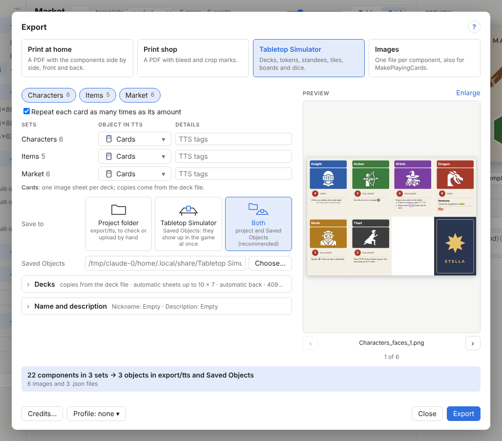

### 11.5 Profiles and presets

**Profile**, at the top of the window, picks a profile saved in the project or a preset: MakePlayingCards, The Game Crafter, home printing on A4 or Letter. **Save as…** stores the current options as a named profile, to run again later. Before ordering, check the specifications on the printer's website, which may change.

### 11.6 Credits

**Credits…** composes the text for the rulebook or the box, with the icons and fonts imported from the app grouped by source, license and author. By default it lists only what the cards use. The text can be copied or saved to `export/credits.txt`. Images copied into `assets/` by hand are not listed.

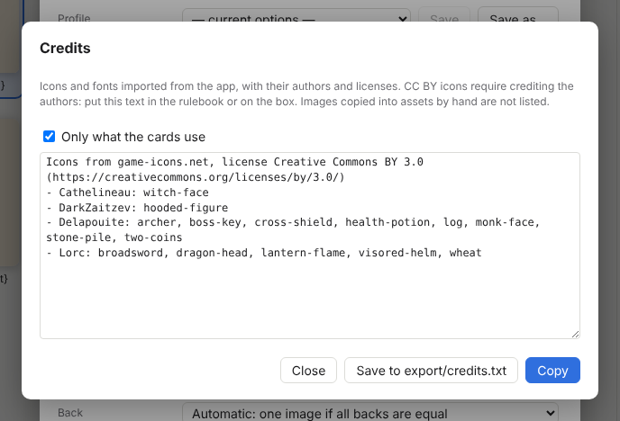

## 12. Documents

The **Documents** section of the sidebar holds the texts that go with the game: the rules, a sell sheet, an appendix, a FAQ. The + creates a document, a click opens it in place of the open set or template. You write on the left; on the right the preview shows the page as you type and follows the cursor, and a click on a point of the preview moves the cursor to that point of the text. The name changes from the title; the ⋯ next to the title, and a right click on the document in the sidebar, have **Rename**, **Duplicate** (a copy whose name ends with a number) and **Delete**, which moves the document to `deleted`. Documents save themselves as you type, as `docs/<name>.md` files in the project, so another editor or an AI agent can write them too.

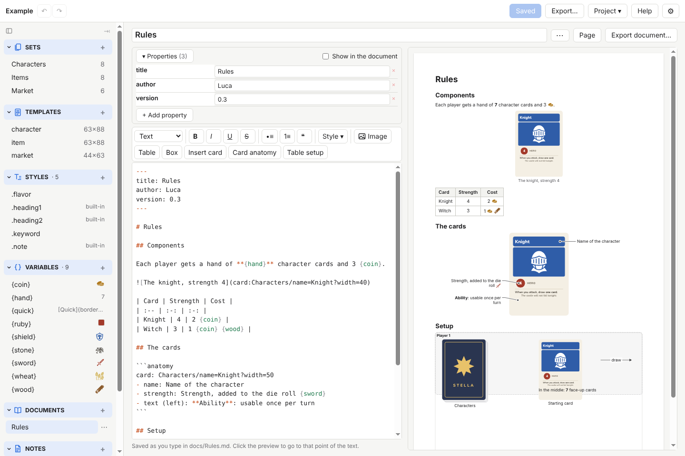

### 12.1 Writing and formatting

Above the text is the formatting bar: the **Text** menu turns the line into a first, second or third level heading, or back into a paragraph; **B**, _I_, U and S add or remove bold, italic, underline and strikethrough on the selected text (with no selection they leave the cursor between the two marks); the next three buttons turn the chosen lines into a bulleted list, a numbered list or a quote, and a second click removes them. **Style** applies a style of the project to the selected text and ends with **Aa Format…**, the advanced formatting of [chapter 6](#6-text-and-markup). The last buttons insert an image of the assets, a table, a card, an anatomy or a table setup. The bar writes in the text the markup you would write by hand, and ⌘Z / Ctrl+Z undoes it.

The text is Markdown, with Stella's markup from [chapter 6](#6-text-and-markup) inside the lines:

| Write                                        | You get                                                          |
| -------------------------------------------- | ---------------------------------------------------------------- |
| `# Title`, `## Title`, `### Title`           | headings on three levels                                         |
| an empty line                                | a new paragraph; a single line break stays in the same paragraph |
| `- item`, `1. item`                          | lists; an item with two spaces in front goes one level down      |
| `> text`                                     | a box for a note                                                 |
| `\| a \| b \|` with `\|---\|---\|` below     | a table; `:--`, `:-:` and `--:` align the column                 |
| `---`                                        | a line                                                           |
| `{sword}`, `[text]{.keyword}`                | icons, variables and styles, as on the cards                     |
| `{project.name}`, `{date}`                   | the project name and today's date                                |
| `` | a card of the game, with the caption "The wizard"                |
| ``                         | an image from assets                                             |
| ``    | an image 40 mm wide, on the right                                |

### 12.2 Cards and images

Cards are not copied into the document: Stella draws them from the project, so a change to the data or the template shows in the document at once. **Insert card** opens a window where you choose the set and the card (search by name), the side, the width in millimetres (empty for the real size) and the caption, and writes the reference at the cursor. By hand you write `card:Set/3` for the card on row 3, or `card:Set/column=value` for the card with that value in a column; after a `?` add `side=back` for the back and `width=40` for the width, joined by `&`, as in `card:Characters/name=Wizard?side=back&width=40`. A column value, like the name, is safer than the number, which changes when the rows are reordered. Several images on the same line of text sit side by side.

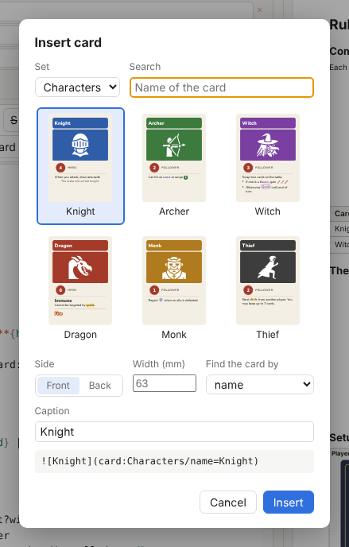

**Image** opens a window where you choose the file from the assets (with a preview), the width in millimetres (empty for the image's own size, reduced if it does not fit the page), the alignment (left, center, right) and the caption. With the cursor on an image already written, the same button opens it for editing. In the text the options go after a `?`, as for cards: ``. Cards accept `align=left` or `align=right` too. The alignment applies to the whole line: with several images side by side, the first one that sets it counts.

### 12.3 Tables and boxes

**Table** opens a grid to fill in: the first row is the heading, each column has its own alignment, **+ Row** and **+ Column** make it bigger and × removes a row or a column. You can paste cells copied from Excel or another spreadsheet. With the cursor inside a table already written, the same button opens it for editing. In the text the table becomes Markdown with aligned columns.

Cells take the same markup as the text (styles, icons, variables) and also images and cards: click a cell, then use the bar above the grid for bold, italic, styles and **Format…**, **Image** for an image from the assets and **Insert card** for a card of the project; in the text they are written as `` and ``. Under the grid, **Look** sets the table width (as % of the text, 0 for as wide as the content), the width of each column (the % field above it), which lines to draw (all, between rows only, outline only, none) with their color and thickness, and the backgrounds of the heading, of the rows and of every other row. The look is written in a comment under the table, `<!-- table width=90% columns=25,55,20 lines=rows header=#dde6f5 -->`, which other Markdown programs do not show. The HTML, PDF and Word exports keep it; the Markdown export keeps text and images only.

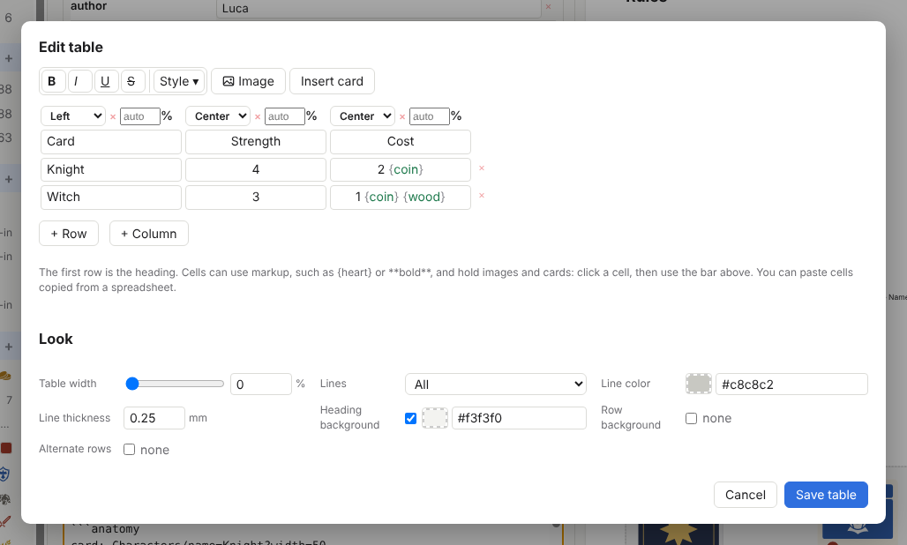

**Box** puts a colored background behind a part of the document: to make a piece of text stand out, or to set white images without a border apart from the page. With some lines selected it puts them in the box; with no selection it inserts a new box with sample text. You choose the background, a border (color and thickness), the inner space and rounded corners; with the cursor inside a box the same button changes it or removes it (**Remove box** keeps what is inside). In the text a box is two lines, `<!-- box fill=#fff3c4 border=#e0b000 -->` at the start and `<!-- /box -->` at the end: everything between them (headings, lists, tables, cards) gets the background. The HTML, PDF and Word exports keep it, the Markdown export does not.

### 12.4 Card anatomy

**Card anatomy** draws a card with labels that explain its parts, joined by a line to the layers of the template. The window has two columns: on the left you choose the card as in **Insert card**, on the right you see the anatomy as it will look in the document, and below it you tick the layers to explain and write a label for each. Above the labels a small bar applies bold, italic, underline, strikethrough or a project style to the selected text of the label you are writing in. Each label goes on the side of the card nearest to its layer; card and labels shrink to fit the page. With the cursor inside an anatomy, the same button opens it for editing. In the text the anatomy is a block like this, which you can also write by hand:

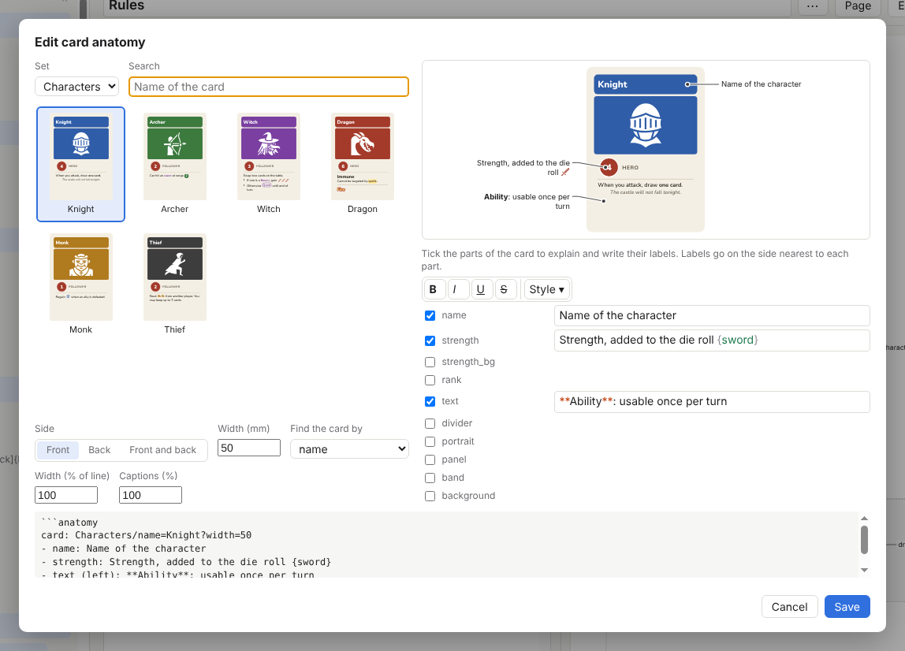

````
```anatomy
card: Characters/name=Wizard?width=50
- name: Name of the character
- strength: Strength, added to the die roll {sword}
- text (left): **Ability**: once per turn
```
````

`card:` is the card, written as in card references (also with `side=back` and `width`). Each `- layer: label` line explains a layer; `(left)` or `(right)` after the name chooses the side. With **Front and back** in the window (the `sides: both` line in the text) the two faces stand side by side, with the front labels on the left and the back labels on the right; back layers are written with `(back)`, for example `- logo (back): The game logo`. Labels can use markup. A layer the template does not have is reported under the text and by `stella check`.

### 12.5 Table setup

**Table setup** draws how to set up the table, with the real cards of the project. In the window the buttons **Zone**, **Card**, **Deck**, **Text**, **Arrow** and **Image** add an element; cards and decks are chosen as in **Insert card**, images from assets. Click an element to select it and drag it to move it, or use the arrow keys (1 mm, 5 with Shift); the handle at the bottom right resizes zones, texts and images, the handles at the two ends move the ends of an arrow. Cards, decks and images have a round handle above them that rotates them around their center (with Shift in 15° steps); in the panel on the right **Rotation** takes the exact degrees and **+90°** turns by a quarter. On the right you change position and sizes in millimetres, the label (or the text, with the same formatting bar as the anatomy), the number of cards in a deck and the rotation in steps of 90°; **Duplicate** and **Delete** do what they say. With nothing selected, **Fixed table size** gives the drawing a size in millimetres; without it, the drawing fits its elements. In the document the drawing shrinks to fit the page, and the labels stay readable. With the cursor inside a table setup, the same button opens it for editing. In the text it is a block like this, which you can also write by hand:

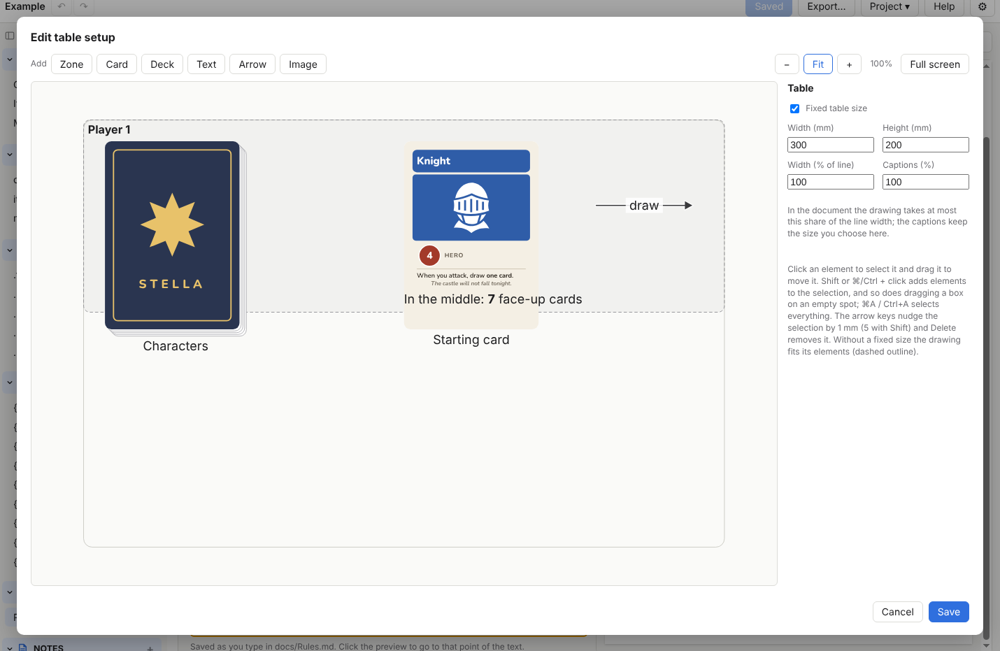

````
```setup
size 300x230
zone 0,0 300x112 "Player 1"
deck Characters/1?side=back 10,10 count=6 "Characters"
card Characters/name=Wizard 165,10 rotate=90 "The wizard"
text 165,85 width=80 "In the middle: **{hand}** face-up cards"
arrow 260,40 -> 290,40 "draw"
image icons/coin.png 270,75 width=12
```
````

Each line is an element, with sizes in millimetres from the top left corner: `zone x,y WxH "label"`, `card <card> x,y`, `deck <card> x,y count=N`, `text x,y width=W "text"`, `arrow x,y -> x2,y2 "label"`, `image <file> x,y width=W`. Cards, decks and images take `rotate=` with the degrees, clockwise (for example `rotate=90` or `rotate=30`), and cards and decks and a label in quotes; the card is written as in card references, with `%20` for spaces. `size WxH` fixes the size of the table. Texts and labels can use markup. Lines that are not understood and cards that are not found are reported under the text and by `stella check`.

### 12.6 Properties and page

**Properties**, above the bar, holds notes about the document, like Obsidian properties: title, author, version, tags or anything else. Each property has a name (letters, digits, `-` and `_`) and a value; a list, marked with ≡, has its items separated by commas. **+ Add property** adds one, × removes it. Properties are written at the top of the file between two `---` lines, in YAML, together with the page settings, and a document written with Obsidian or another Markdown editor keeps them. They are not printed: with **Show in the document** they appear as a table at the top of the page, in the exports too.

**Page** opens the document settings on the right: page size (A4, A5, Letter), margins, text and heading fonts, text size, line spacing, space after paragraphs, alignment (left or justified), and text and heading colors. The preview shows the page at its real width, scaled down if it does not fit. The settings are written at the top of the file, between two `---` lines, such as `size: 12` or `lineHeight: 1.6`: you can change them there too, and **Reset to default** removes them.

### 12.7 Exporting a document

**Export document…** saves the document in the project's `export/docs/` in four forms: **PDF**, to print or send, with the page size and margins of the document (desktop app only); **HTML**, one web page in a single file, with cards, images and fonts inside; **Word**, a `.docx` file to edit in Word or LibreOffice, with headings, lists, tables and quotes as Word styles, the page size, margins and fonts of the document, and cards, diagrams and images as PNG; **Markdown**, plain text for other programs, with the cards as 300 dpi PNG files and the images in a folder beside it (`<name> images`). Markdown keeps bold, italic and strikethrough; other styles are lost. Cards and images that are not found are left out, and the window reminds you when the document has problems. When the export is done, **Open file** opens the file with its default program and **Open folder** the folder that holds it. In the web version **Open file** shows PDF, HTML and Markdown in a new browser tab; for Word it is not shown, since the file is already in the project folder.

Below the text the problems are listed: cards that are not found, images not in assets, unknown names in braces; a click goes to that point of the text. `stella check` reports them with those of the cards, `stella docs` shows the documents to an AI agent and `stella export-doc` exports them without opening the app (see [cli.md](../cli.md)).

## 13. Backup

**Backup…**, in the **Project** menu, opens the project's backups. By default the app makes an automatic backup when the project opens (at most once an hour) and keeps the last 10; those made with **Back up now** are never deleted automatically.

Backups are kept outside the project, by default in `Documents/Stella/Backup`. Images are stored once for all backups of the project, so one more backup takes little space. **Restore…** extracts the backup into a new folder next to the project and opens it: the current project is not touched.

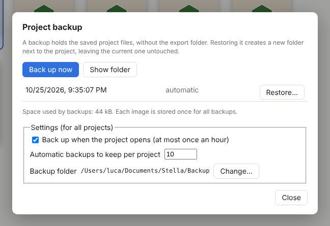

## 14. Importing from Tabletop Creator

**Import from Tabletop Creator…** converts a Tabletop Creator project into a new Stella project: templates, sets, variables and images. The original folder is only read.

You choose the Tabletop Creator project folder (the one with the `.tcp` file and the `data` folder), the folder of the new project, which must be new or empty, and optionally a folder in which to look for library icons. Icons from game-icons.net and Kenney are taken from the app's catalogs.

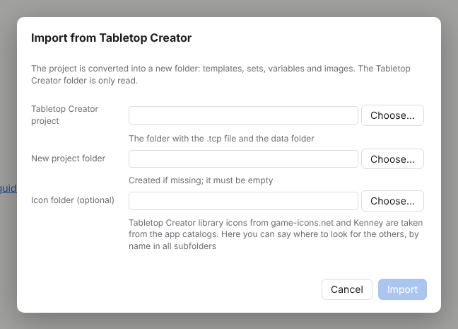

At the end the app lists what it could not convert, for example image masks and 9-slice images, and the fonts used that are not installed.

## 15. Working with an AI agent

An AI agent that runs commands on your computer (for example Claude Code, Codex or Cursor) can read and change Stella projects, look for problems and draw the cards to check them. It needs the Stella **skill**, a text of instructions.

**AI tools…**, in the ⚙ menu of every screen (and in the **Help** menu of the desktop app), shows the skill with this computer's `stella` command already filled in:

1. **Copy the skill**.
2. Paste it into the agent and ask it to install it as a skill (or as project instructions, if it has no skills). Alternatively **Save as file…** writes it into a skills folder; Claude Code reads them from `.claude/skills` in your home folder or in a project.
3. Ask the agent what you need, naming the project folder.

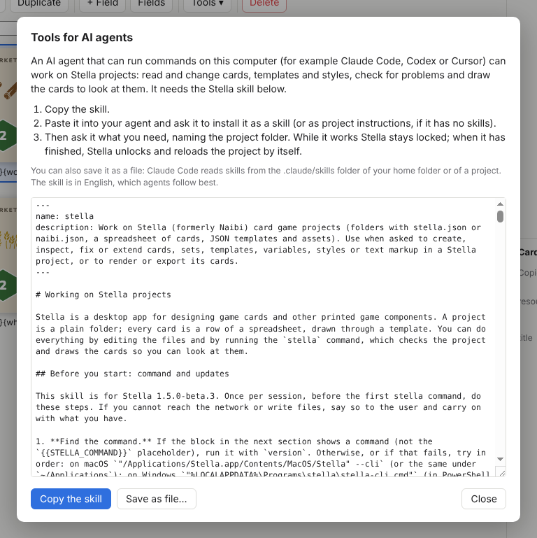

The project can stay open in Stella while the agent works. Before changing it, the agent asks the app with `stella begin`: if there are unsaved changes it stops and asks you to save; otherwise Stella shows that an AI is working and cannot be used until the agent has finished (`stella end`), then reloads the project by itself. If the agent stops without unlocking the app, **Unlock now** frees it. With a skill copied before version 1.2.0-beta.3 the agent cannot do this: copy it again.

The `stella` command can also be used directly, for example in a script. The main commands:

| command                                                        | what it does                                                                                                           |
| -------------------------------------------------------------- | ---------------------------------------------------------------------------------------------------------------------- |
| `info <project>`                                               | sets, templates and layers, variables, styles, assets, export profiles                                                 |
| `check <project> [--set S] [--lang L]`                         | the problems of cards and documents (missing images or fonts, unknown variables, formula errors, missing translations) |
| `check-data <project>`                                         | how the data file is read, like **Check data file…**                                                                   |
| `rows <project> <set>`, `set-rows <project> <set> <file>`      | read and write the rows of a set (with a backup first)                                                                 |
| `stats <project> <set>`                                        | how many cards have each value, like **Statistics…**                                                                   |
| `render <project> [--set S] [--card 1,3,5-7] [--lang L]`       | draws the cards as PNG                                                                                                 |
| `export <project> --profile NAME [--lang L\|all]`              | runs a saved export profile                                                                                            |
| `export-doc <project> [<name>] [--format pdf\|html\|docx\|md]` | exports the documents                                                                                                  |
| `notes`, `docs`                                                | read the project's notes and documents                                                                                 |
| `rename-set`, `rename-template`, `pull-sheets`, `new`          | rename, download from Google Sheets, create a project                                                                  |
| `begin`, `end`                                                 | open and close an agent's work on the project                                                                          |

All the details, the options and how to launch the command on each system are in [docs/cli.md](../cli.md) (in Italian).

## 16. The web version

Stella also runs in the browser, with nothing to install, at <https://stella.lucadj.eu/app/> (the beta version in `/beta/`). It is for places where a program cannot be installed, for example work computers that block unsigned programs. It works on the project folders of your computer: the projects are the same files as the app's, and you can open them with one or the other.

It needs Chrome, Edge or Opera (Brave only after turning on `brave://flags/#file-system-access-api`); Firefox and Safari lack the folder access it needs. In every session the browser asks for permission on the project folder when you open it.

What differs from the desktop app (the list is also at the bottom of the start screen, under **What the desktop app adds**):

- the PDF goes through the browser's print window, where you choose **Save as PDF** (margins none, background graphics on); there is no CMYK conversion;
- for Tabletop Simulator you choose the destination folder with **Choose…** and, the first time, paste its full path in the field below, because the browser does not tell it and the deck file needs it;
- backups without a chosen folder stay in the browser, and are lost when the site data is cleared: choosing a folder is safer;
- Google fonts come with the Latin alphabet only; the computer's fonts can be copied only in Chrome and Edge, after permission;
- the icon and font catalogs are those of the published version and do not update;
- there is no `stella` command and no update check (the site is always at the latest version), and the interface size is set with the browser zoom.

## 17. Project files

```
Example/
  stella.json            name, data file, sets, styles, variables, export profiles
  data/cards.xlsx       one sheet per set (or .ods, or .csv for a single set)
  templates/<name>.json one file per template
  docs/<name>.md        documents: rules, sell sheet, appendices
  notes/<name>.md       project notes
  assets/               images and icons, subfolders included
  assets/fonts/         project fonts
  assets/sources.json   origin and license of imported icons and fonts
  export/               exported files, can be regenerated
  deleted/              deleted templates and sheets of deleted sets, which can be recovered
```

A project is self-contained: copying the folder to another computer gives the same result, except for fonts installed only on the first one. The format is described in [docs/format.md](../format.md).

## 18. Keyboard shortcuts

Every shortcut is written first with the Mac ⌘ key and then, after the slash, with Ctrl for Windows and Linux.

| Where        | Keys                                             | Action                                                                                        |
| ------------ | ------------------------------------------------ | --------------------------------------------------------------------------------------------- |
| anywhere     | ⌘S / Ctrl+S                                      | save templates, data and settings                                                             |
| set          | ⌘Z / Ctrl+Z, ⇧⌘Z / Ctrl+Shift+Z                  | undo and redo data changes                                                                    |
| anywhere     | ⌘+, ⌘−, ⌘0 / Ctrl+, Ctrl−, Ctrl+0                | enlarge, shrink and reset the interface (desktop app)                                         |
| set          | ⌘A / Ctrl+A, Esc                                 | select all cards, go back to one                                                              |
| table        | Alt+Enter                                        | new line inside a cell                                                                        |
| text         | `{`, then ↑ ↓, Enter                             | field and variable suggestions                                                                |
| editor       | ⌘Z / Ctrl+Z, ⇧⌘Z / Ctrl+Shift+Z (or ⌘Y / Ctrl+Y) | undo and redo                                                                                 |
| editor       | T, R, E                                          | new text, rectangle, ellipse                                                                  |
| editor       | ⌘D / Ctrl+D                                      | duplicate the selected layers                                                                 |
| editor       | ⌘C / Ctrl+C, ⌘X / Ctrl+X, ⌘V / Ctrl+V            | copy, cut and paste layers                                                                    |
| editor       | ⌘G / Ctrl+G, ⇧⌘G / Ctrl+Shift+G                  | group and ungroup                                                                             |
| editor       | ⌘A / Ctrl+A                                      | select all layers                                                                             |
| editor       | Delete                                           | delete the selected layers                                                                    |
| editor       | arrows, ⇧ + arrows                               | move by 0.5 mm or 5 mm                                                                        |
| editor       | Esc                                              | clear the selection or leave the group                                                        |
| canvas       | Shift while dragging                             | move only horizontally, vertically or at 45°; switch the proportion lock; rotate in 15° steps |
| canvas       | ⌘ / Ctrl while resizing                          | resize from the center                                                                        |
| canvas       | Alt while dragging                               | move without snapping                                                                         |
| canvas, grid | ⌘ / Ctrl + mouse wheel                           | zoom                                                                                          |
| set          | PgUp, PgDn                                       | previous or next card, even while typing in the form                                          |
| card         | double click, Ctrl+Enter, Esc                    | edit a layer on the card, close the edit, cancel it                                           |
| card, editor | Alt+click                                        | selects the layer underneath                                                                  |
